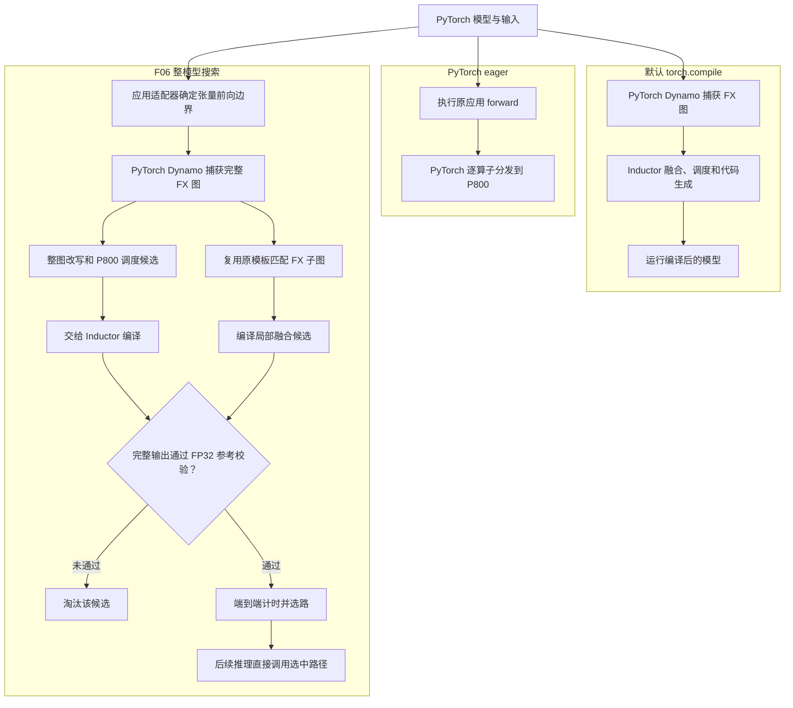

# P800 整模型推理中的 F06 与 Inductor

**Inductor 负责编译图，F06 负责为 P800 构造并筛选整模型执行方案。** F06 的整图路径仍用 Inductor 调度和生成代码，局部融合路径可以调用专门的 P800 内核。下图比较 PyTorch eager、默认 `torch.compile` 和 F06 的整模型搜索入口。 [F06 编译实现](../../python/triton/experimental/graph_fusion/_model_inductor.py#L586) · [整模型测试入口](../../review-local/f06-all-models-20261119/model_probe.py#L1317)

## 三条执行路径

eager 执行原应用的 Python 前向，单个算子也可以进入厂商已有的融合内核，例如 FlashAttention。默认 `torch.compile` 会在所捕获的图内做编译和融合。F06 的整模型入口要求完整张量前向，在捕获后扩展 P800 执行候选，再按完整应用的精度和延迟选路。 [PyTorch 编译入口复用](../../packaging/f06/src/f06/_vendor/graph_fusion/_model.py#L231) · [整模型选路](../../packaging/f06/src/f06/_vendor/graph_fusion/_whole_model_selection.py#L17)

## 原来的匹配在哪一步

- **原有算子模板匹配在局部融合分支。** `discover_regions` 在原精度 FX 图上复用原来的九类模板，例如 Add + LayerNorm、Add + Softmax 和 MatMul + Bias，再补充 QuickGELU 匹配。匹配依据是节点、依赖和使用关系。命中后会尝试编译局部区域，并把它组成一个完整模型候选参与校验和计时。 [九类注册模板](../../packaging/f06/src/f06/_vendor/graph_fusion/_patterns.py#L303) · [匹配实现](../../packaging/f06/src/f06/_vendor/graph_fusion/_template_local_fusion.py#L42) · [候选组装](../../packaging/f06/src/f06/_vendor/graph_fusion/_template_local_fusion.py#L390)
- **整图分支也做图模式改写。** 例如 `fuse_fp32_internals` 有独立的残差 LayerNorm 改写。LaBSE 的局部分支匹配了 24 个 `add_layernorm` 区域，有 11 条局部模板路径通过完整输出校验并进入计时。最终选中的是整图 `gemm_tuned` 候选，其 24 次 `triton_tem__3` 发射来自整图的残差模板。这显示了模板匹配、候选生成和最终发射是三个阶段。 [整图改写](../../packaging/f06/src/f06/_vendor/graph_fusion/_model_inductor.py#L441) · [LaBSE 选路审计](../../review-local/f06-all-models-20261119/results/0b5f90df7a849ec30fac-float32-1795640108567771011/status.json)
- **模型身份匹配发生在测试适配阶段。** 测试工具会按 adapter 类型，以及部分模型的 checkpoint 和源码签名，选择如何拆出预处理和完整张量前向。F06 编译阶段接收这个张量模块，并按捕获到的图生成候选。 [测试适配实现](../../review-local/f06-all-models-20261119/tensor_pipeline.py#L250) · [整模型候选入口](../../packaging/f06/README.md#L66)

## 在 PyTorch 图融合基础上的优化

PyTorch 提供 Dynamo 图捕获，Inductor 负责调度、内存分配和代码生成。下面以整模型测试所用的 `0.3.81+v51e.inductor64` 和配套 FlagTree XPU 编译器为口径。 [整图编译说明](../../packaging/f06/README.md#L231) · [编译器依赖](../../packaging/f06/README.md#L275)

| 作用位置 | 当前工作 | 解决的问题 |
| --- | --- | --- |
| FX 图改写和局部融合 | 将适用的厂商 `Linear` 暴露为 `aten.linear`。对满足条件的 FP32 投影做列主序权重预打包，或把共用输入的 Q/K/V 合为一次投影。为残差 Add + LayerNorm 和 QuickGELU 提供整图改写或局部模板 | 让 Inductor 看见原本封装在厂商调用内的算子边界。局部模板可少发射内核、少读写中间张量，并保留其他区域的厂商实现。[整图改写](../../packaging/f06/src/f06/_vendor/graph_fusion/_model_inductor.py#L441) · [权重与投影改写](../../packaging/f06/src/f06/_vendor/graph_fusion/_p800_model_gemm.py#L11) · [局部候选](../../packaging/f06/src/f06/_vendor/graph_fusion/_captured_candidates.py#L163) |
| 精度边界 | 比较保留逐算子语义与区域内部 FP32 两种策略。对已核实的 FP16 Add、Mul、Sigmoid 和 LayerNorm 区域，候选可保留 FP32 中间值，把舍入放到可观察的出口 | 减少区域内部重复的转换和舍入。矩阵累加、其他低精度算子及公开输出各自保留其精度约束。[FP32 区域实现](../../packaging/f06/src/f06/_vendor/graph_fusion/_fp32_compute_regions.py#L88) |
| Inductor 的 P800 调度 | 为适用的 FP32 GEMM 提供额外 SDNN 分块、整段 K 累加和受约束的加法／类型转换后处理融合。逐元素候选可比较生成核与厂商实现，以及适用的 Cluster／SDNN 和 512、1024、2048 字节本地缓冲配置 | 按 P800 的计算单元和片上容量选择实现。GEMM 调优和全 K 累加是独立候选，均需通过整模型校验。[GEMM 分块](../../packaging/f06/src/f06/_vendor/graph_fusion/_p800_gemm_candidates.py#L125) · [逐元素候选](../../packaging/f06/src/f06/_vendor/graph_fusion/_pointwise_candidates.py#L9) · [缓冲与资源](../../packaging/f06/src/f06/_vendor/graph_fusion/_model_pipeline.py#L145) |
| FlagTree XPU 代码生成 | 在 LLVM 阶段合并可证明独立的 DMA 等待。适用的有序 LayerNorm 将整行和已舍入残差留在片上供两阶段复用，并合并重复的 FP16 打包 | 降低访存、等待和转换开销。v64 专项中的特定 LayerNorm 每 64 列归约的转换从 8 条降到 4 条。该后端也服务同环境下的普通 Inductor 和直接 Triton 编译。[DMA 调度](../../third_party/xpu/tools/xpu-dma-opt/README.md#L3) · [v64 验证](../../review-local/f06-all-models-20261119/layernorm-hotpath-fix-20261124/report.txt#L2) |
| 热调用入口 | 预绑定符合条件的单 Cluster 融合核的启动参数布局，合并元数据守卫，发射时读取当前张量地址和流。适用的冻结权重预打包可按参数版本复用 | 减少重复的 Python 包装、检查和权重布局转换。同一机器码的 CLIP336 热入口对照为 102.76 → 102.07 ms，6 轮中 5 轮改善。[启动入口](../../packaging/f06/src/f06/_vendor/graph_fusion/_p800_region_launch.py#L68) · [同机器码对照](../../review-local/f06-all-models-20261119/layernorm-hotpath-fix-20261124/report.txt#L17) |
| 冷启动搜索与整模型验收 | 测试默认启用局部计时初筛逐元素实现。某族保留方案全部未通过精度时会重开被筛掉的候选。最终用独立的原始 FP32 参考检查全部公开输出，再比较包含预处理、输出转换与设备同步的完整应用延迟 | 局部计时用于缩小搜索范围，完整应用的测量决定选路。后续直接调用选中方案。所有候选均未通过时，记录 `no_valid_route`。[初筛和重开机制](../../packaging/f06/src/f06/_vendor/graph_fusion/_captured_candidates.py#L108) · [测试入口](../../review-local/f06-all-models-20261119/model_probe.py#L1316) · [整模型选路](../../packaging/f06/src/f06/_vendor/graph_fusion/_whole_model_selection.py#L17) |

下文的 LaBSE 和 KURE-v1 性能数字采用同精度 eager 基线。若要量化 F06 相对普通 Inductor 的增量，需要在同一 PyTorch、FlagTree、SDK、模型和输入下测两条编译路径，并使用相同的端到端计时口径。 [周报口径](<../../reports/周报/2026-11-26/P800三线测试周报_2026-11-26/P800三线测试周报/快照来源.txt>)

## 目前使用的 P800 内核

下表统计 2026-11-26 周报标为「当前统一版本」的 5 个 FP32 整模型用例，版本为 `0.3.81+v51e.inductor64`。统计对象是 **F06 最终选中路径**在真机追踪中记录的 **1,349 次 `xpu_launch_async`**，按入口名归类，含厂商 SDK 内核和数据搬运。次数是这些用例的发射合计，单个模型的内核组合随模型、精度、形状和选路变化。 [周报快照](<../../reports/周报/2026-11-26/P800三线测试周报_2026-11-26/P800三线测试周报/快照来源.txt>) · [资源类型定义](../../third_party/xpu/backend/driver.c#L35)

| 用途 | 真机入口名 | 来源 | P800 资源 | 发射次数 |
| --- | --- | --- | --- | ---: |
| Linear、GEMM | `fc_one_loop`、`fc_mn_kmn` | 厂商 XBLAS | SDNN | 327 |
| 调优后的 GEMM 模板 | `triton_tem__1`、`triton_tem__4`、`triton_tem__5` | Inductor 生成，LaBSE 和中文 sbert 选中 `gemm_tuned` | SDNN | 96 |
| FlashAttention | `flash_attention_fwd_2_sdnn_two_layer_loop_in_q_alibi_bias` | 厂商 FlashAttention | SDNN | 70 |
| 残差 Add + LayerNorm 模板 | `triton_tem__3` | Inductor 使用 F06 模板，和选中图的残差 LayerNorm 审计对应 | Cluster | 44 |
| 原生 LayerNorm | `layer_norm_fwd` | 厂商 SDK | Cluster | 101 |
| 逐元素核及其他生成核 | `triton_poi__*`（74 次）、`triton_unk__*`（58 次） | Inductor 生成 | Cluster | 132 |
| 逐元素算术、广播和 NaN 处理 | `tensor_calc_k_nk`、`tensor_calc_basic`、`broadcast_mtn_kl3`、`nan_to_num` | 厂商 SDK | Cluster | 303 |
| 激活 | `gelu_highprecision_nv`、`tanh_fwd` | 厂商 SDK | Cluster | 72 |
| 查表、索引和极值 | `embedding_fwd`、`gather`、`arg_max_min_mt` | 厂商 SDK | Cluster | 17 |
| 拷贝、转置和 dtype 转换 | `memcpy_1d`、`memcpy_2d`、`host2device_async`、`host2device_async_sdnn`、`transpose_021_sdnn_bsp`、`cluster_cast_kl3` | 厂商 SDK | Cluster 138 次，SDNN 49 次 | 187 |

厂商 C++ 入口省略命名空间和模板参数。`triton_*` 名称由生成代码分配，可在不同模型或编译中重复。逐次记录保留了完整入口、资源配置和机器码 SHA-256。 [LaBSE](../../review-local/f06-all-models-20261119/results/0b5f90df7a849ec30fac-float32-1795640108567771011/machine-comparison.json) · [KURE-v1](../../review-local/f06-all-models-20261119/results/ff6aaea2ba91cae7a44d-float32-1795653532701847574/machine-comparison.json) · [Granite](../../review-local/f06-all-models-20261119/results/3be5266b4c705f434e45-float32-1795639016323154836/machine-comparison.json) · [中文 sbert](../../review-local/f06-all-models-20261119/results/b44dd60309e95f6a21cc-float32-1795652475328123622/machine-comparison.json) · [Ruri](../../review-local/f06-all-models-20261119/results/507d49885abd7405d52f-float32-1795672172002231138/machine-comparison.json)

### F06 融合与调度候选

F06 按图上的匹配和精度条件提出这些候选。矩阵与激活模板可保留厂商矩阵调用，再编译匹配区域内的其余计算。编译后可能形成一次或多次内核发射。 [模板注册](../../packaging/f06/src/f06/_vendor/graph_fusion/_patterns.py#L303) · [局部编译](../../packaging/f06/src/f06/_vendor/graph_fusion/_template_local_fusion.py#L176)

| 内核或模板族 | 计算或调度方式 | 当前证据 |
| --- | --- | --- |
| 调优 GEMM、分组 Linear | `gemm_tuned` 和 `gemm_full_k` 是适用 FP32 Linear 的候选。分组投影可将兼容的 Q/K/V 合成一次 Linear | 上表的 LaBSE 和中文 sbert 选中 `gemm_tuned`。[GEMM 候选](../../packaging/f06/src/f06/_vendor/graph_fusion/_model_pipeline.py#L194) · [分组投影](../../packaging/f06/src/f06/_vendor/graph_fusion/_p800_model_gemm.py#L187) |
| 残差 Add + LayerNorm | `flagtree_model_layernorm`，输出归一化结果，必要时同时写回残差 | 上表 3 个 FP32 模型的选中路径有对应发射。[残差模板](../../packaging/f06/src/f06/_vendor/graph_fusion/_p800_model_layernorm.py#L126) · [LaBSE 选中图审计](../../review-local/f06-all-models-20261119/results/0b5f90df7a849ec30fac-float32-1795640108567771011/status.json) |
| 有序 Add + LayerNorm | `flagtree_ordered_add_layernorm`，保留约定的 FP16 舍入和归约顺序，支持仿射及单、双输出 | v64 的 CLIP336 FP16 专项验证过该候选的发射，专项最终选择了 QuickGELU。[有序归约模板](../../packaging/f06/src/f06/_vendor/graph_fusion/_p800_ordered_layernorm.py#L132) · [专项记录](../../review-local/f06-all-models-20261119/layernorm-hotpath-fix-20261124/report.txt#L9) |
| QuickGELU | `x * sigmoid(1.702 * x)`，局部路径生成一个 Cluster 核 | CLIP336 FP16 专项最终选中 `local_quickgelu_lm512`。[局部编译](../../packaging/f06/src/f06/_vendor/graph_fusion/_local_fusion.py#L88) · [专项记录](../../review-local/f06-all-models-20261119/layernorm-hotpath-fix-20261124/report.txt#L14) |
| 矩阵乘后处理 | `matmul_bias`、`matmul_bias_relu`、`matmul_bias_gelu`、`matmul_bias_silu` | 已接入局部模板搜索，按实际捕获图匹配。[模板注册](../../packaging/f06/src/f06/_vendor/graph_fusion/_patterns.py#L303) |
| 逐元素与行归约 | `add_gelu`、`add_silu`、`add_softmax`、`mul_sum` | 已接入局部模板搜索。整图路径也可对满足布局、dtype 和尾部掩码条件的逐元素核提议 SDNN 方案。[模板注册](../../packaging/f06/src/f06/_vendor/graph_fusion/_patterns.py#L303) · [SDNN 逐元素条件](../../packaging/f06/src/f06/_vendor/graph_fusion/_p800_model_schedule.py#L331) |

## 对已有内核的融合体现在哪，为什么可能比 eager 快

**F06 的融合发生在算子图上。** 它把原先分别调用厂商内核的相邻算子替换为一个新编译的计算区域。区域外可以继续调用相同的 SDK 内核。LaBSE 的部分 `embedding_fwd`、FlashAttention 和 `gelu_highprecision_nv` 发射在 eager 和 F06 中使用相同的机器码。 [LaBSE 发射对照](../../review-local/f06-all-models-20261119/results/0b5f90df7a849ec30fac-float32-1795640108567771011/machine-comparison.json)

| 算子组合 | eager 发射 | F06 发射 | 节省在哪里 |
| --- | --- | --- | --- |
| 残差 Add + LayerNorm | 加法写出残差和，`layer_norm_fwd` 再读入 | 一个 Cluster 核做加法、行统计和归一化 | 少一次主机提交。LayerNorm 直接读取片上残差和，其他算子也需要残差时由同一个核额外写回。[P800 实现](../../packaging/f06/src/f06/_vendor/graph_fusion/_p800_layernorm.xpu#L659) |
| QuickGELU | 标量乘、Sigmoid、张量乘各发射一次 | 一个 Cluster 核计算 `x * sigmoid(1.702 * x)` | 少两次主机提交，两个中间张量可在核内消费，省掉核间的全局内存读写。[局部发射对照](../../review-local/f06-all-models-20261119/fusion-advantages-20261124/report.txt#L47) |
| MatMul + Bias | XBLAS 矩阵乘，随后由独立 Cluster 核加偏置 | 特定 FP16 模板用一个 SDNN `mm_bias` 核完成 | 偏置在矩阵核写回前加上，省去独立后处理发射，以及矩阵结果供后处理的写出和回读。[模板实测](../../reports/FlagTree算子融合工作报告-20261112.md#L38) |

在 **LaBSE FP32** 的选中路径中，独立 `layer_norm_fwd` 从 25 次减到 1 次，同时发射了 24 次残差融合模板 `triton_tem__3`。这条路径也换用了调优 GEMM。**2.25× 是整条路径的实测收益**，同时包含残差融合、GEMM 调度和其他图改写的影响。 [选中图审计](../../review-local/f06-all-models-20261119/results/0b5f90df7a849ec30fac-float32-1795640108567771011/status.json) · [真机发射](../../review-local/f06-all-models-20261119/results/0b5f90df7a849ec30fac-float32-1795640108567771011/machine-comparison.json)

| P800 整模型用例 | 发射次数 eager → F06 | 端到端均值 eager → F06 | 加速比 |
| --- | ---: | ---: | ---: |
| LaBSE FP32 | 306 → 173 | 15.80 → 7.01 ms | 2.25× |
| KURE-v1 FP32 | 575 → 462 | 29.36 → 17.61 ms | 1.67× |
| CLIP336 FP16，v64 专项选中 QuickGELU | 978 → 906 | 101.27 → 101.82 ms | 0.995× |

KURE-v1 的 F06 路径仍发射了 120 次与 eager 机器码相同的 `fc_one_loop`，说明保留厂商矩阵核也可以降低整模型耗时。CLIP336 则展示了另一种结果，减少发射后，整模型均值仍接近 eager。融合省下的主机提交和中间数据搬运，需要覆盖新内核执行、运行时守卫和包装调用的成本。发射次数来自追踪，收益以完整应用的配对计时为准。 [KURE-v1 发射对照](../../review-local/f06-all-models-20261119/results/ff6aaea2ba91cae7a44d-float32-1795653532701847574/machine-comparison.json) · [FP32 配对数据](<../../reports/周报/2026-11-26/P800三线测试周报_2026-11-26/P800三线测试周报/结果快照/F06 逐精度结果.csv>) · [CLIP336 专项](../../review-local/f06-all-models-20261119/layernorm-hotpath-fix-20261124/report.txt#L8)
