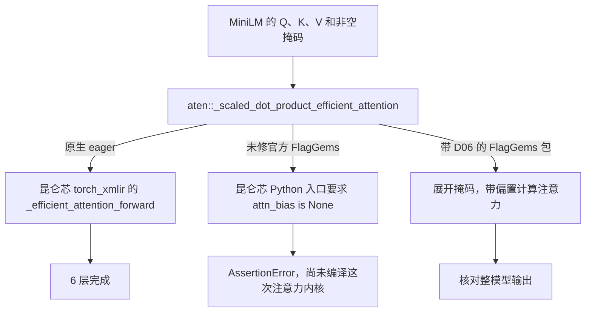

# [FlagGems][Kunlunxin] P800 高效注意力拒绝 MiniLM 的非空 attention bias

本地审阅稿。关联本地问题表 **D06**，目标仓库为 `flagos-ai/FlagGems`。2026 年 11 月 25 日的全模型测试再次复现了 11 月 19 日已验证的同一个问题。[D06 原条目](../FlagTree问题修复索引.md#d06) · [PR 草稿](FlagGems-D06-PR.md)

## 已有处理方案

| 记录 | 已有方案 | 验证范围 |
|---|---|---|
| D06，`p800fix1` | 将浮点、布尔和因果掩码转换为加在注意力分数上的偏置，保留负无穷屏蔽，处理负行最大值及全屏蔽行的 log-sum-exp。 | 11 月 19 日，28 项 FP16/FP32 注意力用例通过 CPU double 参考校验。组合安装包的三条 MiniLM 整模型路径最大绝对误差不超过 0.000367。包内另有 D02、D07 修复。[原补丁](../../work/2026-11-19/flaggems-official-fixes/patch.diff) · [原始验证](../../work/2026-11-19/flaggems-official-fixes/README.md) |
| D08，`p800fix2` | 保留 D06，将二维掩码展开改为一维连续写入。 | 11 月 25 日在同一张 P800 卡上单独补测，原始 MiniLM 输入、本地 FlagTree、关闭图优化，ON 相对 eager 最大绝对误差为 0.000244141。[优化及历史数据](../../work/2026-11-19/flaggems-attention-opt/README.md) |
| D10，`p800fix4` | 保留 D06/D08，增加 LayerNorm-384 与短 FP16 矩阵投影路径修复。 | 历史安装包回归 187 项通过、4 项已知严格 xfail。前一轮全模型测试使用这份 wheel，SHA-256 为 `e777d025f73c44384446c7d58e6a2e80ba689eb4480ef9c3f629c91b5d06725d`。[安装清单](../../work/2026-11-19/minilm-residual/deployment-final.json) · [逐模型记录](../../work/2026-11-24/xpu-gems-eager/fixed-package/model-results.csv) |
| 累计本地包 `p800fix5` | 在 `p800fix4` 上将 QK 缓冲区的无效尾列预填为负无穷，保留 D08 的一维 mask 内核和 D10 的 LayerNorm、矩阵乘法修复。 | 本地 P800 通过 D06 的 28 项测试；同卡 MiniLM 的最大绝对误差为 0.000244。[包指纹](../../work/2026-11-24/xpu-gems-eager/all-local-fixes/pins.json) · [算子回归](../../work/2026-11-24/xpu-gems-eager/all-local-fixes/evidence/43.179.154.78/e9e2c8815f70dad48afc/operator-regression/local-on/pytest.xml) · [端到端 ON 的原始结果](../../work/2026-11-24/xpu-gems-eager/all-local-fixes/evidence/43.179.154.78/e9e2c8815f70dad48afc/main/local-on/state.json) |

D09 单列非方形 Q/K 长度 33/65、65/33 出现 NaN 的四项历史用例。D06 的通过范围和 D08 的性能数据均保留这一边界。[D09 原记录](../FlagTree问题修复索引.md#d09)

11 月 25 日复核了先前仍出现断言的原因。旧测试切换了两套 FlagTree 编译器，但两组 ON 都从单独挂载的官方 FlagGems 包加载算子，其中仍有 D06 断言。当时的四组实验固定加载用户的 `p800fix4`，ON 进程在运行模型前核对包路径、版本和算子文件 SHA-256。MiniLM 在两套编译器上均通过，本地和官方的最大绝对误差分别为 0.000244 和 0.000305。[旧入口指纹](../../work/2026-11-24/xpu-gems-eager/evidence/flaggems-kunlun-entry-guards.json) · [新包指纹](../../work/2026-11-24/xpu-gems-eager/fixed-package/pins.json) · [新测试结果](../../work/2026-11-24/xpu-gems-eager/fixed-package/model-results.csv)

当前全模型测量使用同一套本地 FlagTree 和 `p800fix5`，在每张卡上分别运行 eager 与 FlagGems ON。已经完成的 MiniLM 测量中，eager 为 6.80 毫秒，ON 为 16.69 毫秒。D09 历史记录中的四个矩形输入在累计包上通过了输出和 LSE 断言，原套件因严格 `xfail` 将它们报告为 `XPASS(strict)`。另一张 P800 上使用 `--runxfail` 重新运行同函数的 8 个参数组合，8 项全部通过。[实测明细](../../work/2026-11-24/xpu-gems-eager/all-local-fixes/model-results.csv) · [独立复验](../../work/2026-11-24/xpu-gems-eager/all-local-fixes/evidence/43.179.154.78/e9e2c8815f70dad48afc/fix-verification/local-on/pytest.xml) · [原始回归记录](../../work/2026-11-24/xpu-gems-eager/all-local-fixes/evidence/43.179.154.78/e9e2c8815f70dad48afc/operator-regression/local-on/pytest.xml)

11 月 26 日逐模型复核了正式清单中 FlagGems ON 未跑通的 544 个模型。以往命中 D06 的 194 个模型均已用累计包测试，原断言复现 0 次。另有 7 个模型在同一文件内触发头维度白名单断言，固定修订配置的每头维度分别为 25、26 或 72。[逐模型 issue 对照与实卡证据](FlagGems-P800-未跑通模型逐项排查-20261126.md)

## 现象和调用链

同批 10 条文本长度不同，分词器将其补齐到 54 个位置。MiniLM 在 softmax 前用偏置屏蔽 padding。实测传入的偏置形状为 `[10,12,54,54]`，FP16 取值为 `0` 与 `-65504`。没有图编译时，原生实现和 FlagGems 注册的实现仍可走不同的执行路径。

官方提交 `675ac7011a` 为绕开通用注意力内核在 XPU 编译时被剥离等问题，引入了专用双遍实现。对非空 bias 的断言随该文件首次加入。提交说明记录了改用双遍内核的原因，但没有给出非空 bias 单独触发编译器故障的证据。[引入提交及说明](https://github.com/flagos-ai/FlagGems/commit/675ac7011a54a4a40829b6c00b78e01caceaa324)

## 复现

P800、昆仑芯 PyTorch 2.9，使用 CUDA 兼容接口；模型 `sentence-transformers/all-MiniLM-L6-v2` 固定修订 `1110a243fdf4706b3f48f1d95db1a4f5529b4d41`。分别在独立进程用 x-benchmark 官方适配器运行相同 10 条文本，关闭图优化，保留原生的 padding 掩码。在 ON 组开启 FlagGems 默认注册。未经修补的 FlagGems 固定为 `36a2e186a`。[复现入口与版本](../../work/2026-11-24/xpu-gems-eager/复现说明.txt)

OFF 返回形状为 `[10,384]` 的句向量。ON 在 `_kunlunxin/ops/_scaled_dot_product_efficient_attention.py` 第 370 行报 `AssertionError: attn_bias is not supported by this entry point`。冻结的本地 FlagTree 和新克隆的干净官方 FlagTree 均复现。原生前向的 6 层均实际调用支持该偏置的昆仑芯实现。预期是 ON 保留相同屏蔽语义，返回与 eager 对齐的向量。[断言及文件指纹](../../work/2026-11-24/xpu-gems-eager/evidence/flaggems-kunlun-entry-guards.json) · [原生实机调用链](../../work/2026-11-24/xpu-gems-eager/evidence/minilm-native-attention.json)

在未修官方 FlagGems 的全模型主测中，198 个原生 eager 通过的模型在两个 FlagTree 版本上命中同一断言。这个数只统计首错，修复后每个模型还需完成输出校验。[原始逐模型记录](../../work/2026-11-24/xpu-gems-eager/model-results.csv)
