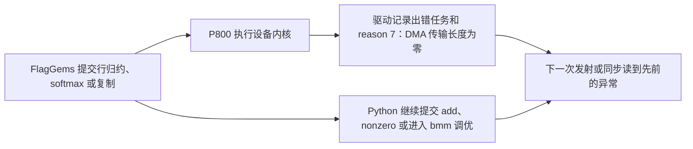

# FlagGems 在 P800 上未跑通的 544 个模型

在 x-benchmark 正式清单的 749 个模型中，FlagGems ON 有 544 个未完成端到端测试。其中 429 个在同卡原生 eager 下通过，115 个在 eager 下也失败。逐项排查发现，26 个模型可对应到已有的模型接入方案，7 个直接触发 FlagGems 头维度限制。最大的两组故障发生在设备执行和 FlagTree 编译阶段。历史 D06 的非空掩码断言本轮复现 0 次。[逐模型工作簿](FlagGems-P800-544个模型逐项排查.xlsx) · [既有 issue 索引](../FlagTree问题修复索引.md) · [正式基准与精度口径](../../work/2026-11-24/xpu-gems-eager/all-local-fixes/测试结果.txt)

## 每个模型在什么地方退出

每行按本模型 ON 退出时的证据归类一次。模型在两个模式下可以遇到不同错误。工作簿记录了每个模型的 eager 异常、ON 报错位置、驱动任务或编译阶段、对应的旧 issue、已有方案和证据路径。已完成端到端测试但与 eager 精度不符的 138 个模型另见原始精度表。[逐模型工作簿](FlagGems-P800-544个模型逐项排查.xlsx) · [749 个模型的原始记录](../../work/2026-11-24/xpu-gems-eager/all-local-fixes/model-results.csv)

| 归因 | 模型数 | 其中 eager 通过 | 定位到的范围 |
|---|---:|---:|---|
| 设备报告零长度 DMA 传输 | 296 | 288 | 行归约 170，softmax 120，分块复制 6。两个行归约模型已单独验证尾块触发条件。 |
| FlagTree 编译阶段复现 | 96 | 90 | 86 个在循环展开控制失败，9 个在合法化失败，1 个在 XPU→LLVM 转换失败。本地和干净官方编译器逐模型重放。 |
| 按内核名称选择的主机启动路径 | 39 | 36 | gather 16，指数 12，三维卷积 11。逐个核验启动库链接和错误消息，三类各有一个同卡单变量对照。 |
| 官方适配器与模型已有接入方案 | 26 | 0 | 同一模型在历史测试入口有加载或调用适配，本轮按官方原始入口运行。 |
| ALiBi 构造时输入分处 CPU 和 XPU | 8 | 8 | FlagGems 乘法包装器进入设备上下文时报错。5 个有同卡默认设备开关对照，3 个有当前栈和历史对照。 |
| FlagGems 高效注意力的头维度断言 | 7 | 7 | 实测配置为 25（1 个）、26（5 个）、72（1 个），均在编译前退出。 |
| 两组均离线加载失败，当前未匹配旧方案 | 28 | 0 | 每个模型已记录最后缺失的仓库、修订和文件。另有 14 个离线失败已计入 M10 所在的 26 个。 |
| 两组共同的加载、输入或输出问题 | 40 | 0 | 包括模型类、分词器、图文输入、权重格式及输出特征提取。逐项记录两组异常。 |
| 两组的复数运算分别报错 | 3 | 0 | M2-BERT 的位置编码初始化，ON 报复数乘张量类型错误，eager 报厂商原生操作未实现。 |
| FP8 类型支持 | 1 | 0 | 原生复制未实现，ON 的前端拒绝 fp8e4nv；历史干净编译器的对应组也报相同错误。 |
| **合计** | **544** | **429** | 测试包为本地累计修复版 p800fix5，图优化关闭。 |

## 哪些已有方案与本轮失败对应

| 已有 issue | 数量 | 已有处理方案及本轮适用边界 |
|---|---:|---|
| M10 | 14 | 使用适配器声明的固定基模型配置初始化 tokenizer。14 个本轮模型分别有同修订的历史对照；原始入口在查找根 config.json 时退出。 |
| M38 | 4 | 三个 Taiyi 版本和一个 UForm3 使用发布者的双塔及预处理。历史已有 CPU 权重和输出对照；当前入口仍用通用加载或分词器。 |
| M40 | 4 | 三个稀疏模型已有基于 SparseEncoder 的同修订输出对照。另一个 naver/splade-code-8B 已有基座修订、LoRA 权重和分词器兼容方案。 |
| M43、M44、M45、M48 | 各 1 | 对应意大利 CLIP 配置中整数温度、ConstBERT 文档编码入口、G2PTL 类注册，以及 Trendyol DINOv2 离线图像入口。 |

这 26 个模型在 eager 下也失败。已有修复位于模型接入或数据准备代码，把修复版 FlagGems wheel 放进容器不会自动启用这些适配。历史工作有的验证到 CPU 输出，有的已经验证到 P800；工作簿的“已有方案”页保留各条目的验证边界。[M10](../FlagTree问题修复索引.md#m10) · [M38](../FlagTree问题修复索引.md#m38) · [M40](../FlagTree问题修复索引.md#m40) · [M43–M48](../FlagTree问题修复索引.md#m43)

**D06 在本轮的表现。** 以往命中非空 attention bias 断言的 194 个正式模型，本轮全部测过，原断言再次出现 0 次；其中 24 个这次仍未完成，工作簿逐项保留了新的错误。另有 7 个模型触发同一注意力文件内的头维度白名单。该白名单在官方基线和 p800fix5 中均为 16、32、64、96、128、192、256。D06 处理掩码，D09 处理 Q/K 序列尾部，两项修复均未扩展这个集合。[D06 原记录](FlagGems-D06-Issue.md) · [实际执行的头维度断言](../../work/2026-11-24/xpu-gems-eager/all-local-fixes/FlagGems/src/flag_gems/runtime/backend/_kunlunxin/ops/_scaled_dot_product_efficient_attention.py) · [累计包汇总](../../work/2026-11-24/xpu-gems-eager/all-local-fixes/summary.json)

## 为什么 Python 会报 add 或 bmm，驱动却报归约或 softmax

293 个模型的正式记录同时满足同次开机、同一物理卡、运行窗口覆盖驱动时间戳、占卡观察指向本模型容器、模型私有编译缓存有驱动点名的内核。另 3 个正式窗口有外部进程，因此同卡重跑，用容器的主机 PID 对上驱动的出错 PID。三例都复现相同设备异常。这里确认了出错任务和硬件报告的条件；零长度描述符由哪一层产生，仍需结合算子输入、生成代码与运行时参数判断。[三台机器的核对证据 A](../../work/2026-11-24/xpu-gems-eager/all-local-fixes/evidence/43.138.5.189/on-failure-driver-tasks.json) · [B](../../work/2026-11-24/xpu-gems-eager/all-local-fixes/evidence/43.179.154.78/on-failure-driver-tasks.json) · [E](../../work/2026-11-24/xpu-gems-eager/all-local-fixes/evidence/81.70.153.29/on-failure-driver-tasks.json) · [PID 对照实例](../../work/2026-11-24/xpu-gems-eager/all-local-fixes/evidence/43.179.154.78/87ba295f78bf62d4962b/main/issue-pid-control.json)

**行归约的反例。** 两个模型都在 Python 的 add 调用报告异常。逐次同步把故障定位在 RMSNorm 使用的逐行均值。随后在相同卡上保持列数、设备机器码、网格以及已有各行的输入值一致，只改变行数；eager 六种输入均逐元素正确。两次“少一行”实验都复现了驱动的零长度 DMA。M68 的已验证核心分组绕行限定于短列二维逐点计算，明确排除了归约。[M68 验证边界](../FlagTree问题修复索引.md#m68) · [实际行归约实现](../../work/2026-11-24/xpu-gems-eager/all-local-fixes/FlagGems/src/flag_gems/runtime/backend/_kunlunxin/ops/sum.py)

| 模型 | 模型中的归约形状 | 同机器码通过 | 同机器码失败 |
|---|---|---|---|
| jinaai/jina-reranker-v3 | 158 行 × 1024 列 | 256 行，结果与 eager 全等 | 255 行、原始 158 行。[实卡证据](../../work/2026-11-24/xpu-gems-eager/all-local-fixes/evidence/81.70.153.29/f14c6ca839022477fca6/main/issue-row-tail-control.json) |
| microsoft/harrier-oss-v1-270m | 400 行 × 640 列 | 512 行，结果与 eager 全等 | 511 行、原始 400 行。[实卡证据](../../work/2026-11-24/xpu-gems-eager/all-local-fixes/evidence/81.70.153.29/c560e0195751e4a8122d/main/issue-row-tail-control.json) |

## 启动库和编译器怎样区分

39 个模型的失败调用都链接同一 SHA-256 的 liblaunch_shared.so。gather 打出 invalid rank -2 (num_vals=0)，指数和三维卷积分支分别打出本操作的专用错误。每类各选一个模型，在两个独立进程中固定镜像、卡、模型输入、设备机器码、网格、张量形状/步幅及标量，只改变传给主机启动器的内核名。原名触发错误，新名下这次调用及后续设备同步完成。这个对照直接验证了 3 个模型的按名分派问题；另外 36 个模型有逐模型的包装器链接和相同签名证据。该对照未验证输出数值，不能作为生产修法或模型通过记录。[39 个启动包装器](../../work/2026-11-24/xpu-gems-eager/all-local-fixes/evidence/operator-launcher-bindings.json) · [gather](../../work/2026-11-24/xpu-gems-eager/all-local-fixes/evidence/43.179.154.78/85470caa860c52d15fc2/main/launcher-name-control.json) · [exp](../../work/2026-11-24/xpu-gems-eager/all-local-fixes/evidence/81.70.153.29/5a2eb4d34c32103e1ba7/main/launcher-name-control.json) · [conv3d](../../work/2026-11-24/xpu-gems-eager/all-local-fixes/evidence/43.179.154.78/02ece07e78831d5a7c4e/main/launcher-name-control.json)

96 个编译失败使用每个模型日志保存的 IR 和流水线重放。两套编译器在同一个阶段退出，包括 86 个二维卷积展开、6 个 embedding bag 合法化、3 个三维卷积合法化和 1 个标量比较转换。M32 修的是指定 INF 布尔归约的循环分块，U09 修的是 scf.if 分支出口类型，U13 修的是特定 DMA 描述符的降层。工作簿列出相近条目和逐模型的具体差别，保留了少数需要继续对比变换前后类型的情况。两个 eager 在离线加载时退出的模型，其 ON 也各自有独立的二维卷积重放证据，已计入 96。[二维卷积](../../work/2026-11-24/xpu-gems-eager/all-local-fixes/evidence/81.70.153.29/5ef614104f3086c97c1a/main/conv2d-compiler-comparison.json) · [标量比较](../../work/2026-11-24/xpu-gems-eager/all-local-fixes/evidence/81.70.153.29/235a41730f726f9b98bb/main/llir-compiler-comparison.json) · [M32](../FlagTree问题修复索引.md#m32) · [U09](../FlagTree问题修复索引.md#u09) · [U13](../FlagTree问题修复索引.md#u13)
