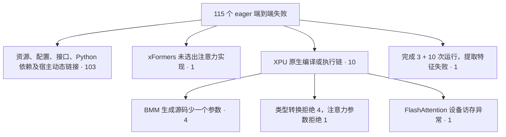

# P800 原生 eager 的 115 个失败模型

正式清单 749 个模型。在使用全部本地修复、关闭 FlagGems 和图优化的 eager 对照臂，634 个通过，115 个未满足端到端成功条件。按原始退出位置计，83 个在加载、27 个在预热、4 个在原生 JIT 编译退出，另有 1 个完成计时后无法提取特征。下表按该次运行的直接阻断原因归类，每个模型只计一次。

| 直接阻断原因 | 模型数 |
|---|---:|
| 离线资源或权重路径解析 | 53 |
| 模型配置、加载器或输入输出接口 | 46 |
| Python 依赖 | 3 |
| 宿主扩展动态链接 | 1 |
| xFormers 注意力分派 | 1 |
| XPU 原生 BMM 模板编译 | 4 |
| XPU eager 类型转换 | 4 |
| XPU eager 注意力参数 | 1 |
| 设备执行时访存异常 | 1 |
| 计时后提取特征 | 1 |
| **合计** | **115** |

## 编译、运行时和机器码证据

53 个资源或权重解析问题中，46 个是 Hugging Face 离线查找失败（含 2 个在首次前向才读 tokenizer.model），1 个缺少 torch.hub 的 DinoV2 骨干，6 个在权重路径解析时退出。46 个配置或接口问题中的两个 EVA-CLIP 模型在文本 embedding 与位置 embedding 相加时出现 126 对 77 的序列长度冲突。详见下方每个模型的异常。

**4 个 BMM 编译失败。** NV-Embed-v2、Giga-Embeddings-instruct、OFA Chinese-CLIP 336px 和 EVA-CLIP-8B-448 的同卡、同 revision 复跑均重现原诊断，并截获完整的 0.xpu。两组源码的第 69850 行定义含五个参数结构和第六个 OneLoop。第 69982 行显式实例化只列出五个。xpu3 前端拒绝该实例化，失败的特化未生成可运行机器码。其中 4 个模型还保留了同镜像、同依赖、同 revision 的官方 FlagTree eager 对照，模板诊断一致。 [两组完整生成源码](../../work/2026-11-24/xpu-gems-eager/all-local-fixes/evidence/eager-bmm-sources) · [本地与官方对照样例](../../work/2026-11-24/xpu-gems-eager/all-local-fixes/evidence/43.138.5.189/cbef59d2303c7961be52/repeat-peer-7bf1fc2b-card5/eager-jit-comparison.json)

**4 个类型转换失败。** 三个 M2-BERT（2k、8k、32k）都在 fftconv_ref 中用 float32 [768,108] 执行 rfft(n=108)，得到 complex64 [768,55]。接下来除以 108 时，XDNN 报 complex64 → float32 不支持。另一个是 Nemotron FP8，在加载阶段将 [2048,2048] 的 float8_e4m3fn 权重转为 bfloat16 时失败。两条路径汇合到 XMLIR 的 copy_kernel.cpp:407，触发它们的操作和阶段不同。 [M2-BERT 算子输入输出](../../work/2026-11-24/xpu-gems-eager/all-local-fixes/evidence/43.179.154.78/c264566c5b0f2208f847/main/eager-dtype-replay.json) · [FP8 权重转换](../../work/2026-11-24/xpu-gems-eager/all-local-fixes/evidence/43.179.154.78/92270bad15fc281e26c5/main/eager-dtype-replay.json)

**1 个高效注意力参数失败。** embeddinggemma-2 前五次 SDPA 调用的 head dimension 为 256。第六次 Q/K/V 为 FP16 [10,4,40,512]，布尔掩码为 [10,1,40,40]，原生高效注意力在 _efficient_attention_forward.cpp:340 返回 INVALID PARAMETER。相同输入和掩码切到 math 后端成功。改用默认 scale 仍失败。诊断中保留 512 并去掉掩码、或保留掩码并将维度截为 128 / 64，也能执行。后两种对照改变计算，仅用于定位触发组合。 [六次调用及六组对照](../../work/2026-11-24/xpu-gems-eager/all-local-fixes/evidence/81.70.153.29/39b44716f6fa2e5010de/main/eager-intermediate-replay.json)

**1 个设备访存异常。** DenseOn 原运行的 boot、PCI 0000:16:00、独占容器时间窗与驱动 PID 2034051 相符。设备任务名指向 BF16 的 flash_attention_fwd_2_sdnn_q_kv。12 个 SDNN cluster 均报告 reason[4]，即 load/store 超出内存范围。Python 在随后读取 cu_seqlens[b].item() 时收到错误 700。 [原始驱动事件](../../work/2026-11-24/xpu-gems-eager/all-local-fixes/evidence/81.70.153.29/abde0d4fb64fc29dcd3b/main/eager-device-journal.json) · [容器与设备时间窗](../../work/2026-11-24/xpu-gems-eager/all-local-fixes/evidence/81.70.153.29/eager-failure-driver.json)

同步重放中的 QKV 为 BF16 [282,3,12,64]，10 条序列合计 282 个 token，最长 67。第一层全局窗口 (-1,-1) 完成。第二次局部窗口 (64,64) 调用返回，紧接的设备同步报非法访存。再用第二次调用的同一份 QKV 和累积序列长度，仅将窗口改为 (-1,-1)，设备同步成功。还原 (64,64) 后再次报错。该对照改变了注意力语义，只用于定位故障。进程映射记录了 libxpu_flash_attention.so。 [每次 FlashAttention 调用与同步](../../work/2026-11-24/xpu-gems-eager/all-local-fixes/evidence/81.70.153.29/abde0d4fb64fc29dcd3b/main/eager-flash-sync.json) · [同一输入的窗口对照](../../work/2026-11-24/xpu-gems-eager/all-local-fixes/evidence/81.70.153.29/abde0d4fb64fc29dcd3b/main/eager-flash-window.json)

从同一镜像的 libxpu_flash_attention.so 注册描述符提取了 28,896 字节（0x70e0），按 256 字节对齐为 0x7100，与驱动任务的 ksz 一致。另一份库内同名候选的长度为 0x9b30。候选字节的 SHA-256 为 ea2bdb13de29e1dfb4e1faffc1951417f6f1da8c8f594ae7bdc51f648c95e910。SDK 对入口附近 7 个 4 字节片段完成了解码及同字节回编。驱动给出的是任务装载地址，现有证据未把异常 PC 映射到某条指令，无法指定哪次读写越界。 [提取的机器码](../../work/2026-11-24/xpu-gems-eager/all-local-fixes/evidence/81.70.153.29/abde0d4fb64fc29dcd3b/main/eager-flash-attention.bin) · [注册描述符](../../work/2026-11-24/xpu-gems-eager/all-local-fixes/evidence/81.70.153.29/abde0d4fb64fc29dcd3b/main/eager-flash-attention-descriptor.json) · [指令回编核对](../../work/2026-11-24/xpu-gems-eager/all-local-fixes/evidence/81.70.153.29/abde0d4fb64fc29dcd3b/main/eager-instruction-roundtrip.json)

**另外两处调度与链接失败。** dwzhu/e5rope-base 的 xFormers 在选择 kernel 时逐项拒绝了两个注意力实现。topk-io/topk-embed-v1-small 在动态链接时缺少 xpudnn::causal_conv1d_grad 的一个模板符号。原始 import 错误和扩展 ELF 的 UND 表项吻合。 [xFormers 分派对照](../../work/2026-11-24/xpu-gems-eager/all-local-fixes/evidence/43.138.5.189/8762012923b3b8da590d/repeat-import-retry-7bf1fc2b-card0/xformers-dispatch-comparison.json) · [宿主 ELF 和符号表](../../work/2026-11-24/xpu-gems-eager/all-local-fixes/evidence/43.179.154.78/eager-failure-inventory.json)

## 115 个模型逐项记录

“最后记录的未命中项”来自原运行或同快照的离线重放。单个未命中项不足以证明整套权重缺失。权重目录补查反映本次核查时固定快照的布局。

### 离线资源或权重路径解析（53）

| 模型 | 阶段 | 直接证据与结论 | 原始记录和复核 |
|---|---|---|---|
| Alibaba-NLP/gte-Qwen1.5-7B-instruct | 加载 | 离线加载失败。最后记录的未命中项为 Alibaba-NLP/gte-Qwen1.5-7B-instruct/config.json。 | [状态](../../work/2026-11-24/xpu-gems-eager/all-local-fixes/evidence/43.179.154.78/6542fec87d87a80d0131/main/local-off/state.json) · [日志](../../work/2026-11-24/xpu-gems-eager/all-local-fixes/evidence/43.179.154.78/6542fec87d87a80d0131/main/local-off/console.log) · [快照目录](../../work/2026-11-24/xpu-gems-eager/all-local-fixes/evidence/43.179.154.78/eager-failure-snapshots.json) |
| ATH-MaaS/Ovis-VL-Embedding-2B | 加载 | 加载器在当前快照中找不到其接受的权重文件名（含 pytorch_model.bin、model.safetensors）。 | [状态](../../work/2026-11-24/xpu-gems-eager/all-local-fixes/evidence/43.138.5.189/d649e1134cf7a1d1e843/main/local-off/state.json) · [日志](../../work/2026-11-24/xpu-gems-eager/all-local-fixes/evidence/43.138.5.189/d649e1134cf7a1d1e843/main/local-off/console.log) · [快照目录](../../work/2026-11-24/xpu-gems-eager/all-local-fixes/evidence/43.138.5.189/eager-failure-snapshots.json) |
| ATH-MaaS/Ovis-VL-Embedding-9B | 加载 | 加载器在当前快照中找不到其接受的权重文件名（含 pytorch_model.bin、model.safetensors）。 | [状态](../../work/2026-11-24/xpu-gems-eager/all-local-fixes/evidence/43.138.5.189/3298778c8a74cb5286a8/main/local-off/state.json) · [日志](../../work/2026-11-24/xpu-gems-eager/all-local-fixes/evidence/43.138.5.189/3298778c8a74cb5286a8/main/local-off/console.log) · [快照目录](../../work/2026-11-24/xpu-gems-eager/all-local-fixes/evidence/43.138.5.189/eager-failure-snapshots.json) |
| Baragi-AI/Munche-768 | 加载 | 离线加载失败。最后记录的未命中项为 google/embeddinggemma-300m/config.json。 | [状态](../../work/2026-11-24/xpu-gems-eager/all-local-fixes/evidence/43.179.154.78/65d857fc6c0ba29714b7/main/local-off/state.json) · [日志](../../work/2026-11-24/xpu-gems-eager/all-local-fixes/evidence/43.179.154.78/65d857fc6c0ba29714b7/main/local-off/console.log) · [快照目录](../../work/2026-11-24/xpu-gems-eager/all-local-fixes/evidence/43.179.154.78/eager-failure-snapshots.json) · [离线重放](../../work/2026-11-24/xpu-gems-eager/all-local-fixes/evidence/43.179.154.78/65d857fc6c0ba29714b7/main/offline-lookup-replay.json) |
| facebook/meta-encoder | 加载 | 离线加载失败。最后记录的未命中项为 facebook/meta-encoder/config.json。 | [状态](../../work/2026-11-24/xpu-gems-eager/all-local-fixes/evidence/81.70.153.29/9cfbd23def5a6873ff00/main/local-off/state.json) · [日志](../../work/2026-11-24/xpu-gems-eager/all-local-fixes/evidence/81.70.153.29/9cfbd23def5a6873ff00/main/local-off/console.log) · [快照目录](../../work/2026-11-24/xpu-gems-eager/all-local-fixes/evidence/81.70.153.29/eager-failure-snapshots.json) |
| facebook/PE-Core-B16-224 | 加载 | 离线加载失败。最后记录的未命中项为 facebook/PE-Core-B16-224/config.json。 | [状态](../../work/2026-11-24/xpu-gems-eager/all-local-fixes/evidence/43.138.5.189/ef8b8b798fe55a6c8b91/main/local-off/state.json) · [日志](../../work/2026-11-24/xpu-gems-eager/all-local-fixes/evidence/43.138.5.189/ef8b8b798fe55a6c8b91/main/local-off/console.log) · [快照目录](../../work/2026-11-24/xpu-gems-eager/all-local-fixes/evidence/43.138.5.189/eager-failure-snapshots.json) · [离线重放](../../work/2026-11-24/xpu-gems-eager/all-local-fixes/evidence/43.138.5.189/ef8b8b798fe55a6c8b91/main/offline-lookup-replay.json) |
| facebook/PE-Core-G14-448 | 加载 | 离线加载失败。最后记录的未命中项为 facebook/PE-Core-G14-448/config.json。 | [状态](../../work/2026-11-24/xpu-gems-eager/all-local-fixes/evidence/43.179.154.78/7872b36cf75afeb4a408/main/local-off/state.json) · [日志](../../work/2026-11-24/xpu-gems-eager/all-local-fixes/evidence/43.179.154.78/7872b36cf75afeb4a408/main/local-off/console.log) · [快照目录](../../work/2026-11-24/xpu-gems-eager/all-local-fixes/evidence/43.179.154.78/eager-failure-snapshots.json) · [离线重放](../../work/2026-11-24/xpu-gems-eager/all-local-fixes/evidence/43.179.154.78/7872b36cf75afeb4a408/main/offline-lookup-replay.json) |
| facebook/PE-Core-L14-336 | 加载 | 离线加载失败。最后记录的未命中项为 facebook/PE-Core-L14-336/config.json。 | [状态](../../work/2026-11-24/xpu-gems-eager/all-local-fixes/evidence/43.179.154.78/eb519f96f71eaddaf4a8/main/local-off/state.json) · [日志](../../work/2026-11-24/xpu-gems-eager/all-local-fixes/evidence/43.179.154.78/eb519f96f71eaddaf4a8/main/local-off/console.log) · [快照目录](../../work/2026-11-24/xpu-gems-eager/all-local-fixes/evidence/43.179.154.78/eager-failure-snapshots.json) · [离线重放](../../work/2026-11-24/xpu-gems-eager/all-local-fixes/evidence/43.179.154.78/eb519f96f71eaddaf4a8/main/offline-lookup-replay.json) |
| google/embeddinggemma-300m | 加载 | 离线加载失败。最后记录的未命中项为 google/embeddinggemma-300m/config.json。 | [状态](../../work/2026-11-24/xpu-gems-eager/all-local-fixes/evidence/43.179.154.78/ee101833d2afa4be82e2/main/local-off/state.json) · [日志](../../work/2026-11-24/xpu-gems-eager/all-local-fixes/evidence/43.179.154.78/ee101833d2afa4be82e2/main/local-off/console.log) · [快照目录](../../work/2026-11-24/xpu-gems-eager/all-local-fixes/evidence/43.179.154.78/eager-failure-snapshots.json) |
| google/embeddinggemma-300m-qat-q4_0-unquantized | 加载 | 离线加载失败。最后记录的未命中项为 google/embeddinggemma-300m-qat-q4_0-unquantized/config.json。 | [状态](../../work/2026-11-24/xpu-gems-eager/all-local-fixes/evidence/43.179.154.78/6f8bfd5d2646ecaa638b/main/local-off/state.json) · [日志](../../work/2026-11-24/xpu-gems-eager/all-local-fixes/evidence/43.179.154.78/6f8bfd5d2646ecaa638b/main/local-off/console.log) · [快照目录](../../work/2026-11-24/xpu-gems-eager/all-local-fixes/evidence/43.179.154.78/eager-failure-snapshots.json) |
| google/embeddinggemma-300m-qat-q8_0-unquantized | 加载 | 离线加载失败。最后记录的未命中项为 google/embeddinggemma-300m-qat-q8_0-unquantized/config.json。 | [状态](../../work/2026-11-24/xpu-gems-eager/all-local-fixes/evidence/43.179.154.78/afb3a4539a70d2ce826b/main/local-off/state.json) · [日志](../../work/2026-11-24/xpu-gems-eager/all-local-fixes/evidence/43.179.154.78/afb3a4539a70d2ce826b/main/local-off/console.log) · [快照目录](../../work/2026-11-24/xpu-gems-eager/all-local-fixes/evidence/43.179.154.78/eager-failure-snapshots.json) |
| google/medsiglip-448 | 加载 | 离线加载失败。最后记录的未命中项为 google/medsiglip-448/config.json。 | [状态](../../work/2026-11-24/xpu-gems-eager/all-local-fixes/evidence/43.179.154.78/ecd6a1119f9c7fd3e036/main/local-off/state.json) · [日志](../../work/2026-11-24/xpu-gems-eager/all-local-fixes/evidence/43.179.154.78/ecd6a1119f9c7fd3e036/main/local-off/console.log) · [快照目录](../../work/2026-11-24/xpu-gems-eager/all-local-fixes/evidence/43.179.154.78/eager-failure-snapshots.json) |
| google/tipsv2-g14 | 预热 | 模型在首次前向延迟加载 tokenizer.model，离线查找失败。 | [状态](../../work/2026-11-24/xpu-gems-eager/all-local-fixes/evidence/43.179.154.78/c42b70a0f8b40c78b922/main/local-off/state.json) · [日志](../../work/2026-11-24/xpu-gems-eager/all-local-fixes/evidence/43.179.154.78/c42b70a0f8b40c78b922/main/local-off/console.log) · [快照目录](../../work/2026-11-24/xpu-gems-eager/all-local-fixes/evidence/43.179.154.78/eager-failure-snapshots.json) |
| google/tipsv2-so400m14 | 预热 | 模型在首次前向延迟加载 tokenizer.model，离线查找失败。 | [状态](../../work/2026-11-24/xpu-gems-eager/all-local-fixes/evidence/43.138.5.189/84f72d337fcd31c0d671/repeat-peer-7bf1fc2b-card4/local-off/state.json) · [日志](../../work/2026-11-24/xpu-gems-eager/all-local-fixes/evidence/43.138.5.189/84f72d337fcd31c0d671/repeat-peer-7bf1fc2b-card4/local-off/console.log) · [快照目录](../../work/2026-11-24/xpu-gems-eager/all-local-fixes/evidence/43.138.5.189/eager-failure-snapshots.json) |
| HuggingFaceM4/siglip-so400m-14-980-flash-attn2-navit | 加载 | 离线加载失败。最后记录的未命中项为 HuggingFaceM4/siglip-so400m-14-980-flash-attn2-navit/config.json。 | [状态](../../work/2026-11-24/xpu-gems-eager/all-local-fixes/evidence/43.179.154.78/ed841b3db7f0619e6024/main/local-off/state.json) · [日志](../../work/2026-11-24/xpu-gems-eager/all-local-fixes/evidence/43.179.154.78/ed841b3db7f0619e6024/main/local-off/console.log) · [快照目录](../../work/2026-11-24/xpu-gems-eager/all-local-fixes/evidence/43.179.154.78/eager-failure-snapshots.json) |
| hyper3labs/hyper3-clip-v1 | 加载 | 离线加载失败。最后记录的未命中项为 hyper3labs/hyper3-clip-v1/config.json。 | [状态](../../work/2026-11-24/xpu-gems-eager/all-local-fixes/evidence/81.70.153.29/6d7d9bd9370b84a07041/main/local-off/state.json) · [日志](../../work/2026-11-24/xpu-gems-eager/all-local-fixes/evidence/81.70.153.29/6d7d9bd9370b84a07041/main/local-off/console.log) · [快照目录](../../work/2026-11-24/xpu-gems-eager/all-local-fixes/evidence/81.70.153.29/eager-failure-snapshots.json) |
| lightonai/MonoQwen2-VL-v0.1 | 加载 | 离线加载失败。最后记录的未命中项为 lightonai/MonoQwen2-VL-v0.1/config.json。 | [状态](../../work/2026-11-24/xpu-gems-eager/all-local-fixes/evidence/81.70.153.29/395acd959ff3493fe4e5/main/local-off/state.json) · [日志](../../work/2026-11-24/xpu-gems-eager/all-local-fixes/evidence/81.70.153.29/395acd959ff3493fe4e5/main/local-off/console.log) · [快照目录](../../work/2026-11-24/xpu-gems-eager/all-local-fixes/evidence/81.70.153.29/eager-failure-snapshots.json) · [离线重放](../../work/2026-11-24/xpu-gems-eager/all-local-fixes/evidence/81.70.153.29/395acd959ff3493fe4e5/main/offline-lookup-replay.json) |
| littlejohn-ai/bge-m3-spa-law-qa | 加载 | 离线加载失败。最后记录的未命中项为 littlejohn-ai/bge-m3-spa-law-qa/config.json。 | [状态](../../work/2026-11-24/xpu-gems-eager/all-local-fixes/evidence/43.179.154.78/b3f16aacd70bc7fe9331/main/local-off/state.json) · [日志](../../work/2026-11-24/xpu-gems-eager/all-local-fixes/evidence/43.179.154.78/b3f16aacd70bc7fe9331/main/local-off/console.log) · [快照目录](../../work/2026-11-24/xpu-gems-eager/all-local-fixes/evidence/43.179.154.78/eager-failure-snapshots.json) |
| McGill-NLP/LLM2Vec-Meta-Llama-3-8B-Instruct-mntp-supervised | 加载 | 离线加载失败。最后记录的未命中项为 McGill-NLP/LLM2Vec-Meta-Llama-3-8B-Instruct-mntp-supervised/config.json。 | [状态](../../work/2026-11-24/xpu-gems-eager/all-local-fixes/evidence/43.179.154.78/c66db948253943a2cc77/main/local-off/state.json) · [日志](../../work/2026-11-24/xpu-gems-eager/all-local-fixes/evidence/43.179.154.78/c66db948253943a2cc77/main/local-off/console.log) · [快照目录](../../work/2026-11-24/xpu-gems-eager/all-local-fixes/evidence/43.179.154.78/eager-failure-snapshots.json) · [离线重放](../../work/2026-11-24/xpu-gems-eager/all-local-fixes/evidence/43.179.154.78/c66db948253943a2cc77/main/offline-lookup-replay.json) |
| McGill-NLP/LLM2Vec-Mistral-7B-Instruct-v2-mntp-supervised | 加载 | 离线加载失败。最后记录的未命中项为 McGill-NLP/LLM2Vec-Mistral-7B-Instruct-v2-mntp-supervised/config.json。 | [状态](../../work/2026-11-24/xpu-gems-eager/all-local-fixes/evidence/43.179.154.78/3617f2a32bffefaca7fb/main/local-off/state.json) · [日志](../../work/2026-11-24/xpu-gems-eager/all-local-fixes/evidence/43.179.154.78/3617f2a32bffefaca7fb/main/local-off/console.log) · [快照目录](../../work/2026-11-24/xpu-gems-eager/all-local-fixes/evidence/43.179.154.78/eager-failure-snapshots.json) · [离线重放](../../work/2026-11-24/xpu-gems-eager/all-local-fixes/evidence/43.179.154.78/3617f2a32bffefaca7fb/main/offline-lookup-replay.json) |
| Metric-AI/colqwen2.5-3b-multilingual | 加载 | 离线加载失败。最后记录的未命中项为 Metric-AI/colqwen2.5-base/config.json。 | [状态](../../work/2026-11-24/xpu-gems-eager/all-local-fixes/evidence/43.179.154.78/0b77d67d7756c49ce001/main/local-off/state.json) · [日志](../../work/2026-11-24/xpu-gems-eager/all-local-fixes/evidence/43.179.154.78/0b77d67d7756c49ce001/main/local-off/console.log) · [快照目录](../../work/2026-11-24/xpu-gems-eager/all-local-fixes/evidence/43.179.154.78/eager-failure-snapshots.json) · [离线重放](../../work/2026-11-24/xpu-gems-eager/all-local-fixes/evidence/43.179.154.78/0b77d67d7756c49ce001/main/offline-lookup-replay.json) |
| Metric-AI/ColQwen2.5-7b-multilingual-v1.0 | 加载 | 离线加载失败。最后记录的未命中项为 Metric-AI/colqwen2.5-7b-base/config.json。 | [状态](../../work/2026-11-24/xpu-gems-eager/all-local-fixes/evidence/43.179.154.78/0da2c014218e159d822a/main/local-off/state.json) · [日志](../../work/2026-11-24/xpu-gems-eager/all-local-fixes/evidence/43.179.154.78/0da2c014218e159d822a/main/local-off/console.log) · [快照目录](../../work/2026-11-24/xpu-gems-eager/all-local-fixes/evidence/43.179.154.78/eager-failure-snapshots.json) · [离线重放](../../work/2026-11-24/xpu-gems-eager/all-local-fixes/evidence/43.179.154.78/0da2c014218e159d822a/main/offline-lookup-replay.json) |
| microsoft/colipri | 加载 | 离线加载失败。最后记录的未命中项为 microsoft/colipri/config.json。 | [状态](../../work/2026-11-24/xpu-gems-eager/all-local-fixes/evidence/81.70.153.29/910f56f92839416505e9/main/local-off/state.json) · [日志](../../work/2026-11-24/xpu-gems-eager/all-local-fixes/evidence/81.70.153.29/910f56f92839416505e9/main/local-off/console.log) · [快照目录](../../work/2026-11-24/xpu-gems-eager/all-local-fixes/evidence/81.70.153.29/eager-failure-snapshots.json) · [离线重放](../../work/2026-11-24/xpu-gems-eager/all-local-fixes/evidence/81.70.153.29/910f56f92839416505e9/main/offline-lookup-replay.json) |
| ModernVBERT/colmodernvbert | 加载 | 离线加载失败。最后记录的未命中项为 ModernVBERT/colmodernvbert/config.json。 | [状态](../../work/2026-11-24/xpu-gems-eager/all-local-fixes/evidence/43.179.154.78/e17b14654125efd81609/main/local-off/state.json) · [日志](../../work/2026-11-24/xpu-gems-eager/all-local-fixes/evidence/43.179.154.78/e17b14654125efd81609/main/local-off/console.log) · [快照目录](../../work/2026-11-24/xpu-gems-eager/all-local-fixes/evidence/43.179.154.78/eager-failure-snapshots.json) · [离线重放](../../work/2026-11-24/xpu-gems-eager/all-local-fixes/evidence/43.179.154.78/e17b14654125efd81609/main/offline-lookup-replay.json) |
| naver/splade-code-8B | 加载 | 加载器将 None 当作 checkpoint 路径调用 endswith。快照有 lora/adapter_model.safetensors，根目录缺少主干权重。 | [状态](../../work/2026-11-24/xpu-gems-eager/all-local-fixes/evidence/81.70.153.29/9f6f4bebd5fe0db7795f/main/local-off/state.json) · [日志](../../work/2026-11-24/xpu-gems-eager/all-local-fixes/evidence/81.70.153.29/9f6f4bebd5fe0db7795f/main/local-off/console.log) · [快照目录](../../work/2026-11-24/xpu-gems-eager/all-local-fixes/evidence/81.70.153.29/eager-failure-snapshots.json) |
| naver/splade-v3 | 加载 | 离线加载失败。最后记录的未命中项为 naver/splade-v3/config.json。 | [状态](../../work/2026-11-24/xpu-gems-eager/all-local-fixes/evidence/43.179.154.78/71243b800d6de3f6c4b2/main/local-off/state.json) · [日志](../../work/2026-11-24/xpu-gems-eager/all-local-fixes/evidence/43.179.154.78/71243b800d6de3f6c4b2/main/local-off/console.log) · [快照目录](../../work/2026-11-24/xpu-gems-eager/all-local-fixes/evidence/43.179.154.78/eager-failure-snapshots.json) |
| NetoAISolutions/T-VEC | 加载 | 离线加载失败。最后记录的未命中项为 NetoAISolutions/T-VEC/config.json。 | [状态](../../work/2026-11-24/xpu-gems-eager/all-local-fixes/evidence/43.179.154.78/14d90e1375c6222649e2/main/local-off/state.json) · [日志](../../work/2026-11-24/xpu-gems-eager/all-local-fixes/evidence/43.179.154.78/14d90e1375c6222649e2/main/local-off/console.log) · [快照目录](../../work/2026-11-24/xpu-gems-eager/all-local-fixes/evidence/43.179.154.78/eager-failure-snapshots.json) |
| NeuML/txtai-wikipedia | 加载 | 加载器将 None 当作 checkpoint 路径调用 endswith。固定快照根目录只有 config.json 和下载清单。 | [状态](../../work/2026-11-24/xpu-gems-eager/all-local-fixes/evidence/43.138.5.189/db0c6ba0a797f0b3e418/main/local-off/state.json) · [日志](../../work/2026-11-24/xpu-gems-eager/all-local-fixes/evidence/43.138.5.189/db0c6ba0a797f0b3e418/main/local-off/console.log) · [快照目录](../../work/2026-11-24/xpu-gems-eager/all-local-fixes/evidence/43.138.5.189/eager-failure-snapshots.json) |
| nomic-ai/colnomic-embed-multimodal-3b | 加载 | 离线加载失败。最后记录的未命中项为 nomic-ai/colnomic-embed-multimodal-3b/config.json。 | [状态](../../work/2026-11-24/xpu-gems-eager/all-local-fixes/evidence/81.70.153.29/d835ce666a0d5d6c913a/main/local-off/state.json) · [日志](../../work/2026-11-24/xpu-gems-eager/all-local-fixes/evidence/81.70.153.29/d835ce666a0d5d6c913a/main/local-off/console.log) · [快照目录](../../work/2026-11-24/xpu-gems-eager/all-local-fixes/evidence/81.70.153.29/eager-failure-snapshots.json) · [离线重放](../../work/2026-11-24/xpu-gems-eager/all-local-fixes/evidence/81.70.153.29/d835ce666a0d5d6c913a/main/offline-lookup-replay.json) |
| nomic-ai/colnomic-embed-multimodal-7b | 加载 | 离线加载失败。最后记录的未命中项为 nomic-ai/colnomic-embed-multimodal-7b/config.json。 | [状态](../../work/2026-11-24/xpu-gems-eager/all-local-fixes/evidence/43.138.5.189/2cde74fe7caca0626035/main/local-off/state.json) · [日志](../../work/2026-11-24/xpu-gems-eager/all-local-fixes/evidence/43.138.5.189/2cde74fe7caca0626035/main/local-off/console.log) · [快照目录](../../work/2026-11-24/xpu-gems-eager/all-local-fixes/evidence/43.138.5.189/eager-failure-snapshots.json) · [离线重放](../../work/2026-11-24/xpu-gems-eager/all-local-fixes/evidence/43.138.5.189/2cde74fe7caca0626035/main/offline-lookup-replay.json) |
| nvidia/NV-Embed-v1 | 加载 | 离线加载失败。最后记录的未命中项为 nvidia/NV-Embed-v1/config.json。 | [状态](../../work/2026-11-24/xpu-gems-eager/all-local-fixes/evidence/43.179.154.78/83c5d5306d5ddfeea7a0/main/local-off/state.json) · [日志](../../work/2026-11-24/xpu-gems-eager/all-local-fixes/evidence/43.179.154.78/83c5d5306d5ddfeea7a0/main/local-off/console.log) · [快照目录](../../work/2026-11-24/xpu-gems-eager/all-local-fixes/evidence/43.179.154.78/eager-failure-snapshots.json) |
| nvidia/NV-Retriever-v1 | 加载 | 离线加载失败。最后记录的未命中项为 nvidia/NV-Retriever-v1/config.json。 | [状态](../../work/2026-11-24/xpu-gems-eager/all-local-fixes/evidence/81.70.153.29/ad7d98cc1ec7ba84af7c/main/local-off/state.json) · [日志](../../work/2026-11-24/xpu-gems-eager/all-local-fixes/evidence/81.70.153.29/ad7d98cc1ec7ba84af7c/main/local-off/console.log) · [快照目录](../../work/2026-11-24/xpu-gems-eager/all-local-fixes/evidence/81.70.153.29/eager-failure-snapshots.json) |
| Omartificial-Intelligence-Space/AraGemma-Embedding-300m | 加载 | 离线加载失败。最后记录的未命中项为 Omartificial-Intelligence-Space/AraGemma-Embedding-300m/config.json。 | [状态](../../work/2026-11-24/xpu-gems-eager/all-local-fixes/evidence/81.70.153.29/bd5f8e11962e1dc6dba1/main/local-off/state.json) · [日志](../../work/2026-11-24/xpu-gems-eager/all-local-fixes/evidence/81.70.153.29/bd5f8e11962e1dc6dba1/main/local-off/console.log) · [快照目录](../../work/2026-11-24/xpu-gems-eager/all-local-fixes/evidence/81.70.153.29/eager-failure-snapshots.json) |
| redlessone/DermLIP_PanDerm-base-w-PubMed-256 | 加载 | 离线加载失败。最后记录的未命中项为 redlessone/DermLIP_PanDerm-base-w-PubMed-256/config.json。 | [状态](../../work/2026-11-24/xpu-gems-eager/all-local-fixes/evidence/43.138.5.189/c2578fd1520b02eed32a/repeat-peer-7bf1fc2b-card0/local-off/state.json) · [日志](../../work/2026-11-24/xpu-gems-eager/all-local-fixes/evidence/43.138.5.189/c2578fd1520b02eed32a/repeat-peer-7bf1fc2b-card0/local-off/console.log) · [快照目录](../../work/2026-11-24/xpu-gems-eager/all-local-fixes/evidence/43.138.5.189/eager-failure-snapshots.json) · [离线重放](../../work/2026-11-24/xpu-gems-eager/all-local-fixes/evidence/43.138.5.189/c2578fd1520b02eed32a/repeat-peer-7bf1fc2b-card0/offline-lookup-replay.json) |
| rinna/japanese-clip-vit-b-16 | 加载 | 离线加载失败。最后记录的未命中项为 rinna/japanese-clip-vit-b-16/tokenizer_config.json。 | [状态](../../work/2026-11-24/xpu-gems-eager/all-local-fixes/evidence/43.138.5.189/f4ba27db6cda727eee13/main/local-off/state.json) · [日志](../../work/2026-11-24/xpu-gems-eager/all-local-fixes/evidence/43.138.5.189/f4ba27db6cda727eee13/main/local-off/console.log) · [快照目录](../../work/2026-11-24/xpu-gems-eager/all-local-fixes/evidence/43.138.5.189/eager-failure-snapshots.json) · [离线重放](../../work/2026-11-24/xpu-gems-eager/all-local-fixes/evidence/43.138.5.189/f4ba27db6cda727eee13/main/offline-lookup-replay.json) |
| sensenova/piccolo-large-zh-v2 | 加载 | 加载器将 None 当作 checkpoint 路径调用 endswith。快照有 2_Dense/pytorch_model.bin，根目录缺少主干权重。 | [状态](../../work/2026-11-24/xpu-gems-eager/all-local-fixes/evidence/43.138.5.189/b466ba3cc19d4407c1bf/main/local-off/state.json) · [日志](../../work/2026-11-24/xpu-gems-eager/all-local-fixes/evidence/43.138.5.189/b466ba3cc19d4407c1bf/main/local-off/console.log) · [快照目录](../../work/2026-11-24/xpu-gems-eager/all-local-fixes/evidence/43.138.5.189/eager-failure-snapshots.json) |
| stabilityai/japanese-stable-clip-vit-l-16 | 加载 | 离线加载失败。最后记录的未命中项为 stabilityai/japanese-stable-clip-vit-l-16/config.json。 | [状态](../../work/2026-11-24/xpu-gems-eager/all-local-fixes/evidence/81.70.153.29/2ef11446fa7e338e68c9/main/local-off/state.json) · [日志](../../work/2026-11-24/xpu-gems-eager/all-local-fixes/evidence/81.70.153.29/2ef11446fa7e338e68c9/main/local-off/console.log) · [快照目录](../../work/2026-11-24/xpu-gems-eager/all-local-fixes/evidence/81.70.153.29/eager-failure-snapshots.json) |
| tencent/WeMM-Embedding-2B | 加载 | 离线加载失败。最后记录的未命中项为 tencent/WeMM-Embedding-2B/config.json。 | [状态](../../work/2026-11-24/xpu-gems-eager/all-local-fixes/evidence/43.179.154.78/8d31e806a11c0fdb3436/main/local-off/state.json) · [日志](../../work/2026-11-24/xpu-gems-eager/all-local-fixes/evidence/43.179.154.78/8d31e806a11c0fdb3436/main/local-off/console.log) · [快照目录](../../work/2026-11-24/xpu-gems-eager/all-local-fixes/evidence/43.179.154.78/eager-failure-snapshots.json) · [离线重放](../../work/2026-11-24/xpu-gems-eager/all-local-fixes/evidence/43.179.154.78/8d31e806a11c0fdb3436/main/offline-lookup-replay.json) |
| tencent/WeMM-Embedding-4B | 加载 | 离线加载失败。最后记录的未命中项为 tencent/WeMM-Embedding-4B/config.json。 | [状态](../../work/2026-11-24/xpu-gems-eager/all-local-fixes/evidence/43.179.154.78/d2879be0dce3bb774bad/main/local-off/state.json) · [日志](../../work/2026-11-24/xpu-gems-eager/all-local-fixes/evidence/43.179.154.78/d2879be0dce3bb774bad/main/local-off/console.log) · [快照目录](../../work/2026-11-24/xpu-gems-eager/all-local-fixes/evidence/43.179.154.78/eager-failure-snapshots.json) · [离线重放](../../work/2026-11-24/xpu-gems-eager/all-local-fixes/evidence/43.179.154.78/d2879be0dce3bb774bad/main/offline-lookup-replay.json) |
| Tevatron/OmniEmbed-v0.1 | 加载 | 离线加载失败。调用 AutoProcessor / Transformers 的离线文件解析时退出。 | [状态](../../work/2026-11-24/xpu-gems-eager/all-local-fixes/evidence/81.70.153.29/ae87bb1e2ee780aec8d1/main/local-off/state.json) · [日志](../../work/2026-11-24/xpu-gems-eager/all-local-fixes/evidence/81.70.153.29/ae87bb1e2ee780aec8d1/main/local-off/console.log) · [快照目录](../../work/2026-11-24/xpu-gems-eager/all-local-fixes/evidence/81.70.153.29/eager-failure-snapshots.json) |
| Trendyol/trendyol-dino-v2-ecommerce-256d | 加载 | 构造视觉骨干时，torch.hub 在 /root/.cache/torch/hub 找不到 DinoV2 仓库。 | [状态](../../work/2026-11-24/xpu-gems-eager/all-local-fixes/evidence/43.138.5.189/642a3a7dfeaae5776e10/main/local-off/state.json) · [日志](../../work/2026-11-24/xpu-gems-eager/all-local-fixes/evidence/43.138.5.189/642a3a7dfeaae5776e10/main/local-off/console.log) · [快照目录](../../work/2026-11-24/xpu-gems-eager/all-local-fixes/evidence/43.138.5.189/eager-failure-snapshots.json) |
| tsystems/colqwen2.5-3b-multilingual-v1.0 | 加载 | 离线加载失败。最后记录的未命中项为 tsystems/colqwen2.5-3b-multilingual-v1.0/config.json。 | [状态](../../work/2026-11-24/xpu-gems-eager/all-local-fixes/evidence/81.70.153.29/0b506149505c1c90a81d/main/local-off/state.json) · [日志](../../work/2026-11-24/xpu-gems-eager/all-local-fixes/evidence/81.70.153.29/0b506149505c1c90a81d/main/local-off/console.log) · [快照目录](../../work/2026-11-24/xpu-gems-eager/all-local-fixes/evidence/81.70.153.29/eager-failure-snapshots.json) · [离线重放](../../work/2026-11-24/xpu-gems-eager/all-local-fixes/evidence/81.70.153.29/0b506149505c1c90a81d/main/offline-lookup-replay.json) |
| vidore/colpali | 加载 | 离线加载失败。最后记录的未命中项为 vidore/colpali/config.json。 | [状态](../../work/2026-11-24/xpu-gems-eager/all-local-fixes/evidence/43.179.154.78/1da549d9538e0dc2e853/repeat-companion-cache-f8b7785a-card4/local-off/state.json) · [日志](../../work/2026-11-24/xpu-gems-eager/all-local-fixes/evidence/43.179.154.78/1da549d9538e0dc2e853/repeat-companion-cache-f8b7785a-card4/local-off/console.log) · [快照目录](../../work/2026-11-24/xpu-gems-eager/all-local-fixes/evidence/43.179.154.78/eager-failure-snapshots.json) · [离线重放](../../work/2026-11-24/xpu-gems-eager/all-local-fixes/evidence/43.179.154.78/1da549d9538e0dc2e853/repeat-companion-cache-f8b7785a-card4/offline-lookup-replay.json) |
| vidore/colpali-v1.2 | 加载 | 离线加载失败。最后记录的未命中项为 vidore/colpali-v1.2/config.json。 | [状态](../../work/2026-11-24/xpu-gems-eager/all-local-fixes/evidence/43.179.154.78/ab817b95b625aa2ed18c/repeat-companion-cache-f8b7785a-card4/local-off/state.json) · [日志](../../work/2026-11-24/xpu-gems-eager/all-local-fixes/evidence/43.179.154.78/ab817b95b625aa2ed18c/repeat-companion-cache-f8b7785a-card4/local-off/console.log) · [快照目录](../../work/2026-11-24/xpu-gems-eager/all-local-fixes/evidence/43.179.154.78/eager-failure-snapshots.json) · [离线重放](../../work/2026-11-24/xpu-gems-eager/all-local-fixes/evidence/43.179.154.78/ab817b95b625aa2ed18c/repeat-companion-cache-f8b7785a-card4/offline-lookup-replay.json) |
| vidore/colpali-v1.3 | 加载 | 离线加载失败。最后记录的未命中项为 vidore/colpali-v1.3/config.json。 | [状态](../../work/2026-11-24/xpu-gems-eager/all-local-fixes/evidence/43.138.5.189/41540638668bf282493d/main/local-off/state.json) · [日志](../../work/2026-11-24/xpu-gems-eager/all-local-fixes/evidence/43.138.5.189/41540638668bf282493d/main/local-off/console.log) · [快照目录](../../work/2026-11-24/xpu-gems-eager/all-local-fixes/evidence/43.138.5.189/eager-failure-snapshots.json) · [离线重放](../../work/2026-11-24/xpu-gems-eager/all-local-fixes/evidence/43.138.5.189/41540638668bf282493d/main/offline-lookup-replay.json) |
| vidore/colqwen-omni-v0.1 | 加载 | 离线加载失败。最后记录的未命中项为 vidore/colqwen-omni-v0.1/config.json。 | [状态](../../work/2026-11-24/xpu-gems-eager/all-local-fixes/evidence/43.179.154.78/e3788918660e645172f8/repeat-companion-cache-f8b7785a-card4/local-off/state.json) · [日志](../../work/2026-11-24/xpu-gems-eager/all-local-fixes/evidence/43.179.154.78/e3788918660e645172f8/repeat-companion-cache-f8b7785a-card4/local-off/console.log) · [快照目录](../../work/2026-11-24/xpu-gems-eager/all-local-fixes/evidence/43.179.154.78/eager-failure-snapshots.json) · [离线重放](../../work/2026-11-24/xpu-gems-eager/all-local-fixes/evidence/43.179.154.78/e3788918660e645172f8/repeat-companion-cache-f8b7785a-card4/offline-lookup-replay.json) |
| vidore/colqwen2-v0.1 | 加载 | 离线加载失败。最后记录的未命中项为 vidore/colqwen2-v0.1/config.json。 | [状态](../../work/2026-11-24/xpu-gems-eager/all-local-fixes/evidence/81.70.153.29/f3a1b9a5897a0944a1c7/main/local-off/state.json) · [日志](../../work/2026-11-24/xpu-gems-eager/all-local-fixes/evidence/81.70.153.29/f3a1b9a5897a0944a1c7/main/local-off/console.log) · [快照目录](../../work/2026-11-24/xpu-gems-eager/all-local-fixes/evidence/81.70.153.29/eager-failure-snapshots.json) · [离线重放](../../work/2026-11-24/xpu-gems-eager/all-local-fixes/evidence/81.70.153.29/f3a1b9a5897a0944a1c7/main/offline-lookup-replay.json) |
| vidore/colqwen2-v1.0 | 加载 | 离线加载失败。最后记录的未命中项为 vidore/colqwen2-v1.0/config.json。 | [状态](../../work/2026-11-24/xpu-gems-eager/all-local-fixes/evidence/43.138.5.189/f74f9dabb3e4eb997e53/main/local-off/state.json) · [日志](../../work/2026-11-24/xpu-gems-eager/all-local-fixes/evidence/43.138.5.189/f74f9dabb3e4eb997e53/main/local-off/console.log) · [快照目录](../../work/2026-11-24/xpu-gems-eager/all-local-fixes/evidence/43.138.5.189/eager-failure-snapshots.json) · [离线重放](../../work/2026-11-24/xpu-gems-eager/all-local-fixes/evidence/43.138.5.189/f74f9dabb3e4eb997e53/main/offline-lookup-replay.json) |
| vidore/colqwen2.5-v0.2 | 加载 | 离线加载失败。最后记录的未命中项为 vidore/colqwen2.5-v0.2/config.json。 | [状态](../../work/2026-11-24/xpu-gems-eager/all-local-fixes/evidence/43.138.5.189/0c126fbeb0429b91b839/main/local-off/state.json) · [日志](../../work/2026-11-24/xpu-gems-eager/all-local-fixes/evidence/43.138.5.189/0c126fbeb0429b91b839/main/local-off/console.log) · [快照目录](../../work/2026-11-24/xpu-gems-eager/all-local-fixes/evidence/43.138.5.189/eager-failure-snapshots.json) · [离线重放](../../work/2026-11-24/xpu-gems-eager/all-local-fixes/evidence/43.138.5.189/0c126fbeb0429b91b839/main/offline-lookup-replay.json) |
| vidore/colSmol-256M | 加载 | 离线加载失败。最后记录的未命中项为 vidore/colSmol-256M/config.json。 | [状态](../../work/2026-11-24/xpu-gems-eager/all-local-fixes/evidence/43.138.5.189/3fcfbed17f6f51d1c976/main/local-off/state.json) · [日志](../../work/2026-11-24/xpu-gems-eager/all-local-fixes/evidence/43.138.5.189/3fcfbed17f6f51d1c976/main/local-off/console.log) · [快照目录](../../work/2026-11-24/xpu-gems-eager/all-local-fixes/evidence/43.138.5.189/eager-failure-snapshots.json) · [离线重放](../../work/2026-11-24/xpu-gems-eager/all-local-fixes/evidence/43.138.5.189/3fcfbed17f6f51d1c976/main/offline-lookup-replay.json) |
| vidore/colSmol-500M | 加载 | 离线加载失败。最后记录的未命中项为 vidore/colSmol-500M/config.json。 | [状态](../../work/2026-11-24/xpu-gems-eager/all-local-fixes/evidence/43.138.5.189/ab8c2385f8619a1a704f/main/local-off/state.json) · [日志](../../work/2026-11-24/xpu-gems-eager/all-local-fixes/evidence/43.138.5.189/ab8c2385f8619a1a704f/main/local-off/console.log) · [快照目录](../../work/2026-11-24/xpu-gems-eager/all-local-fixes/evidence/43.138.5.189/eager-failure-snapshots.json) · [离线重放](../../work/2026-11-24/xpu-gems-eager/all-local-fixes/evidence/43.138.5.189/ab8c2385f8619a1a704f/main/offline-lookup-replay.json) |
| vidore/colsmolvlm-v0.1 | 加载 | 离线加载失败。最后记录的未命中项为 vidore/colsmolvlm-v0.1/config.json。 | [状态](../../work/2026-11-24/xpu-gems-eager/all-local-fixes/evidence/43.138.5.189/bb65a2bb229efc67d50e/main/local-off/state.json) · [日志](../../work/2026-11-24/xpu-gems-eager/all-local-fixes/evidence/43.138.5.189/bb65a2bb229efc67d50e/main/local-off/console.log) · [快照目录](../../work/2026-11-24/xpu-gems-eager/all-local-fixes/evidence/43.138.5.189/eager-failure-snapshots.json) · [离线重放](../../work/2026-11-24/xpu-gems-eager/all-local-fixes/evidence/43.138.5.189/bb65a2bb229efc67d50e/main/offline-lookup-replay.json) |
| yseop/roberta-base-finance-hypernym-identification | 加载 | 权重解析失败。固定快照根目录有 pytorch_model.bin，modules.json 指向的 0_Transformer 子目录只有配置和分词文件。 | [状态](../../work/2026-11-24/xpu-gems-eager/all-local-fixes/evidence/81.70.153.29/13c365b990b8cb36b236/repeat-snapshot-workdir-1288a141-card0/local-off/state.json) · [日志](../../work/2026-11-24/xpu-gems-eager/all-local-fixes/evidence/81.70.153.29/13c365b990b8cb36b236/repeat-snapshot-workdir-1288a141-card0/local-off/console.log) · [快照目录](../../work/2026-11-24/xpu-gems-eager/all-local-fixes/evidence/81.70.153.29/eager-failure-snapshots.json) |

### 模型配置、加载器或输入输出接口（46）

| 模型 | 阶段 | 直接证据与结论 | 原始记录和复核 |
|---|---|---|---|
| Alibaba-NLP/E2Rank-0.6B | 预热 | 处理器的聊天模板未通过 query/document 角色成对校验。 | [状态](../../work/2026-11-24/xpu-gems-eager/all-local-fixes/evidence/81.70.153.29/6f697fd9ddc6851bc96d/main/local-off/state.json) · [日志](../../work/2026-11-24/xpu-gems-eager/all-local-fixes/evidence/81.70.153.29/6f697fd9ddc6851bc96d/main/local-off/console.log) |
| amazon/Titan-text-embeddings-v2 | 加载 | AutoConfig 无法从快照的 model_type 或模型名称确定受支持的模型类。 | [状态](../../work/2026-11-24/xpu-gems-eager/all-local-fixes/evidence/43.138.5.189/3fbd2c4a60dd60abff10/main/local-off/state.json) · [日志](../../work/2026-11-24/xpu-gems-eager/all-local-fixes/evidence/43.138.5.189/3fbd2c4a60dd60abff10/main/local-off/console.log) |
| AQ-MedAI/Diver-Retriever-4B | 加载 | 加载 Pooling 模块时缺少构造参数 embedding_dimension。 | [状态](../../work/2026-11-24/xpu-gems-eager/all-local-fixes/evidence/43.138.5.189/00953ede9604495c3ccc/repeat-peer-7bf1fc2b-card1/local-off/state.json) · [日志](../../work/2026-11-24/xpu-gems-eager/all-local-fixes/evidence/43.138.5.189/00953ede9604495c3ccc/repeat-peer-7bf1fc2b-card1/local-off/console.log) |
| ATH-MaaS/Ovis-Omni-Embedding-3B | 加载 | 所调用的 AutoModel 类没有映射当前配置 Qwen2_5OmniConfig。 | [状态](../../work/2026-11-24/xpu-gems-eager/all-local-fixes/evidence/43.138.5.189/61fe2fd8ce10ed4226a9/main/local-off/state.json) · [日志](../../work/2026-11-24/xpu-gems-eager/all-local-fixes/evidence/43.138.5.189/61fe2fd8ce10ed4226a9/main/local-off/console.log) |
| BAAI/bge-reranker-v2.5-gemma2-lightweight | 预热 | 下游对 embedding 读取 ndim，实际得到 tuple。 | [状态](../../work/2026-11-24/xpu-gems-eager/all-local-fixes/evidence/43.179.154.78/259378a25cbac1128c7e/main/local-off/state.json) · [日志](../../work/2026-11-24/xpu-gems-eager/all-local-fixes/evidence/43.179.154.78/259378a25cbac1128c7e/main/local-off/console.log) |
| BAAI/EVA-CLIP-18B | 预热 | 文本 embedding 的序列长度为 126，位置 embedding 长度为 77，两者逐元素相加失败。 | [状态](../../work/2026-11-24/xpu-gems-eager/all-local-fixes/evidence/43.179.154.78/b0699026ebf1ef1be77d/main/local-off/state.json) · [日志](../../work/2026-11-24/xpu-gems-eager/all-local-fixes/evidence/43.179.154.78/b0699026ebf1ef1be77d/main/local-off/console.log) |
| BAAI/EVA-CLIP-8B | 预热 | 文本 embedding 的序列长度为 126，位置 embedding 长度为 77，两者逐元素相加失败。 | [状态](../../work/2026-11-24/xpu-gems-eager/all-local-fixes/evidence/43.179.154.78/b6b7802669d2332b588c/main/local-off/state.json) · [日志](../../work/2026-11-24/xpu-gems-eager/all-local-fixes/evidence/43.179.154.78/b6b7802669d2332b588c/main/local-off/console.log) |
| Cainiao-AI/G2PTL | 加载 | AutoModel 注册模型时发现模型声明的 config_class 与实际配置类不一致。 | [状态](../../work/2026-11-24/xpu-gems-eager/all-local-fixes/evidence/81.70.153.29/62efa75174d831b75fdc/main/local-off/state.json) · [日志](../../work/2026-11-24/xpu-gems-eager/all-local-fixes/evidence/81.70.153.29/62efa75174d831b75fdc/main/local-off/console.log) |
| clip-italian/clip-italian | 加载 | 构造 logit_scale 参数时传入非浮点、非复数张量，nn.Parameter 默认要求梯度。 | [状态](../../work/2026-11-24/xpu-gems-eager/all-local-fixes/evidence/43.138.5.189/230bac768015705fcd2f/main/local-off/state.json) · [日志](../../work/2026-11-24/xpu-gems-eager/all-local-fixes/evidence/43.138.5.189/230bac768015705fcd2f/main/local-off/console.log) |
| dxtech-asia/deepx-embedding-v1 | 加载 | 当前 Transformers 无法识别模型类型 deepx-embedding。 | [状态](../../work/2026-11-24/xpu-gems-eager/all-local-fixes/evidence/43.138.5.189/2aebd12b0c4f36ed9b8d/main/local-off/state.json) · [日志](../../work/2026-11-24/xpu-gems-eager/all-local-fixes/evidence/43.138.5.189/2aebd12b0c4f36ed9b8d/main/local-off/console.log) · [加载重放](../../work/2026-11-24/xpu-gems-eager/all-local-fixes/evidence/43.138.5.189/2aebd12b0c4f36ed9b8d/main/model-loader-replay.json) |
| EximiusLabs/fusion-embedding-1-2b-preview | 加载 | AutoProcessor 无法从该快照识别 processor、tokenizer、image processor 或 feature extractor。 | [状态](../../work/2026-11-24/xpu-gems-eager/all-local-fixes/evidence/81.70.153.29/243ca1b48836168c05e2/main/local-off/state.json) · [日志](../../work/2026-11-24/xpu-gems-eager/all-local-fixes/evidence/81.70.153.29/243ca1b48836168c05e2/main/local-off/console.log) |
| GoodBaiBai88/M3D-CLIP | 预热 | 多模态输入把 images 传入文本 tokenizer 的 _batch_encode_plus，接口不接受该参数。 | [状态](../../work/2026-11-24/xpu-gems-eager/all-local-fixes/evidence/43.179.154.78/2a36db05a4941bd527b2/main/local-off/state.json) · [日志](../../work/2026-11-24/xpu-gems-eager/all-local-fixes/evidence/43.179.154.78/2a36db05a4941bd527b2/main/local-off/console.log) |
| ibm-granite/granite-embedding-311m-multilingual-r2 | 加载 | AutoProcessor 无法从该快照识别 processor、tokenizer、image processor 或 feature extractor。 | [状态](../../work/2026-11-24/xpu-gems-eager/all-local-fixes/evidence/81.70.153.29/0b160a2d849d70553c5c/main/local-off/state.json) · [日志](../../work/2026-11-24/xpu-gems-eager/all-local-fixes/evidence/81.70.153.29/0b160a2d849d70553c5c/main/local-off/console.log) |
| ibm-granite/granite-vision-3.3-2b-embedding | 预热 | 获取 embedding[output_key] 时收到了 3 维张量，返回值与调用方的索引约定不匹配。 | [状态](../../work/2026-11-24/xpu-gems-eager/all-local-fixes/evidence/43.138.5.189/89741abf25b553ceb9c8/repeat-peer-7bf1fc2b-card6/local-off/state.json) · [日志](../../work/2026-11-24/xpu-gems-eager/all-local-fixes/evidence/43.138.5.189/89741abf25b553ceb9c8/repeat-peer-7bf1fc2b-card6/local-off/console.log) |
| IDEA-CCNL/Taiyi-CLIP-Roberta-102M-Chinese | 预热 | 多模态输入把 images 传入文本 tokenizer 的 _batch_encode_plus，接口不接受该参数。 | [状态](../../work/2026-11-24/xpu-gems-eager/all-local-fixes/evidence/43.138.5.189/02b76b9dec9eb825692e/main/local-off/state.json) · [日志](../../work/2026-11-24/xpu-gems-eager/all-local-fixes/evidence/43.138.5.189/02b76b9dec9eb825692e/main/local-off/console.log) |
| IDEA-CCNL/Taiyi-CLIP-RoBERTa-102M-ViT-L-Chinese | 预热 | 多模态输入把 images 传入文本 tokenizer 的 _batch_encode_plus，接口不接受该参数。 | [状态](../../work/2026-11-24/xpu-gems-eager/all-local-fixes/evidence/43.138.5.189/bab6f4f68f7807793804/repeat-import-retry-7bf1fc2b-card0/local-off/state.json) · [日志](../../work/2026-11-24/xpu-gems-eager/all-local-fixes/evidence/43.138.5.189/bab6f4f68f7807793804/repeat-import-retry-7bf1fc2b-card0/local-off/console.log) · [CPU 对照](../../work/2026-11-24/xpu-gems-eager/all-local-fixes/evidence/43.138.5.189/bab6f4f68f7807793804/repeat-import-retry-7bf1fc2b-card0/processor-cpu-comparison.json) |
| IDEA-CCNL/Taiyi-CLIP-Roberta-large-326M-Chinese | 预热 | 多模态输入把 images 传入文本 tokenizer 的 _batch_encode_plus，接口不接受该参数。 | [状态](../../work/2026-11-24/xpu-gems-eager/all-local-fixes/evidence/81.70.153.29/2c4b19e165be4d8714cd/main/local-off/state.json) · [日志](../../work/2026-11-24/xpu-gems-eager/all-local-fixes/evidence/81.70.153.29/2c4b19e165be4d8714cd/main/local-off/console.log) |
| jinaai/jina-embeddings-v4 | 预热 | LoRA 路径将 task_label 随 hidden_states 传给底层 Linear.forward，多出一个位置参数。 | [状态](../../work/2026-11-24/xpu-gems-eager/all-local-fixes/evidence/43.138.5.189/736b129f4f11172c958e/repeat-peer-7bf1fc2b-card6/local-off/state.json) · [日志](../../work/2026-11-24/xpu-gems-eager/all-local-fixes/evidence/43.138.5.189/736b129f4f11172c958e/repeat-peer-7bf1fc2b-card6/local-off/console.log) |
| Kingsoft-LLM/QZhou-Embedding-Zh | 预热 | 模型检查批次中的特殊 token 151644，至少一条官方输入缺少该 token。 | [状态](../../work/2026-11-24/xpu-gems-eager/all-local-fixes/evidence/43.138.5.189/9af530a3f6d779f0c3a0/repeat-peer-7bf1fc2b-card4/local-off/state.json) · [日志](../../work/2026-11-24/xpu-gems-eager/all-local-fixes/evidence/43.138.5.189/9af530a3f6d779f0c3a0/repeat-peer-7bf1fc2b-card4/local-off/console.log) |
| LanguageBind/LanguageBind_Image | 加载 | 当前 Transformers 无法识别模型类型 LanguageBindImage。 | [状态](../../work/2026-11-24/xpu-gems-eager/all-local-fixes/evidence/43.138.5.189/d24f270dae07d47cfa4c/main/local-off/state.json) · [日志](../../work/2026-11-24/xpu-gems-eager/all-local-fixes/evidence/43.138.5.189/d24f270dae07d47cfa4c/main/local-off/console.log) · [加载重放](../../work/2026-11-24/xpu-gems-eager/all-local-fixes/evidence/43.138.5.189/d24f270dae07d47cfa4c/main/model-loader-replay.json) |
| Linkup-Platform/linkup-sparseup-embed-v1 | 预热 | 获取 embedding[output_key] 时收到了 2 维张量，返回值与调用方的索引约定不匹配。 | [状态](../../work/2026-11-24/xpu-gems-eager/all-local-fixes/evidence/43.138.5.189/e5a7761324349d654854/main/local-off/state.json) · [日志](../../work/2026-11-24/xpu-gems-eager/all-local-fixes/evidence/43.138.5.189/e5a7761324349d654854/main/local-off/console.log) |
| lyua1225/clip-huge-zh-75k-steps-bs4096 | 加载 | 快照自定义 tokenizer 在定义类时引用未定义的 PRETRAINED_VOCAB_FILES_MAP。 | [状态](../../work/2026-11-24/xpu-gems-eager/all-local-fixes/evidence/43.138.5.189/53a99111106bf04c80c3/main/local-off/state.json) · [日志](../../work/2026-11-24/xpu-gems-eager/all-local-fixes/evidence/43.138.5.189/53a99111106bf04c80c3/main/local-off/console.log) |
| McGill-NLP/LLM2Vec-Meta-Llama-3-8B-Instruct-mntp | 加载 | 加载器把适配器的 LoraConfig 当作带 architectures 的模型配置使用。 | [状态](../../work/2026-11-24/xpu-gems-eager/all-local-fixes/evidence/43.179.154.78/e33e1f1367b486098333/main/local-off/state.json) · [日志](../../work/2026-11-24/xpu-gems-eager/all-local-fixes/evidence/43.179.154.78/e33e1f1367b486098333/main/local-off/console.log) |
| McGill-NLP/LLM2Vec-Mistral-7B-Instruct-v2-mntp | 加载 | 加载器把适配器的 LoraConfig 当作带 architectures 的模型配置使用。 | [状态](../../work/2026-11-24/xpu-gems-eager/all-local-fixes/evidence/43.138.5.189/8bea978a9978d580913a/main/local-off/state.json) · [日志](../../work/2026-11-24/xpu-gems-eager/all-local-fixes/evidence/43.138.5.189/8bea978a9978d580913a/main/local-off/console.log) |
| microsoft/LLM2CLIP-EVA02-L-14-336 | 加载 | AutoProcessor 无法从该快照识别 processor、tokenizer、image processor 或 feature extractor。 | [状态](../../work/2026-11-24/xpu-gems-eager/all-local-fixes/evidence/43.138.5.189/9c28d460eaa59019b9db/main/local-off/state.json) · [日志](../../work/2026-11-24/xpu-gems-eager/all-local-fixes/evidence/43.138.5.189/9c28d460eaa59019b9db/main/local-off/console.log) · [加载重放](../../work/2026-11-24/xpu-gems-eager/all-local-fixes/evidence/43.138.5.189/9c28d460eaa59019b9db/main/model-loader-replay.json) |
| naver/provence-reranker-debertav3-v1 | 加载 | 所调用的 AutoModel 类没有映射当前配置 ProvenceConfig。 | [状态](../../work/2026-11-24/xpu-gems-eager/all-local-fixes/evidence/81.70.153.29/9b4577593b49e595a67f/main/local-off/state.json) · [日志](../../work/2026-11-24/xpu-gems-eager/all-local-fixes/evidence/81.70.153.29/9b4577593b49e595a67f/main/local-off/console.log) |
| NeuML/txtai-arxiv | 加载 | AutoConfig 无法从快照的 model_type 或模型名称确定受支持的模型类。 | [状态](../../work/2026-11-24/xpu-gems-eager/all-local-fixes/evidence/43.138.5.189/f8578d38b48775c90c0d/main/local-off/state.json) · [日志](../../work/2026-11-24/xpu-gems-eager/all-local-fixes/evidence/43.138.5.189/f8578d38b48775c90c0d/main/local-off/console.log) |
| nvidia/llama-nemoretriever-colembed-1b-v1 | 预热 | SentenceTransformer 在预处理时拒绝 image+text 输入模态。 | [状态](../../work/2026-11-24/xpu-gems-eager/all-local-fixes/evidence/43.138.5.189/d21dff1db7016e930a7e/repeat-peer-7bf1fc2b-card0/local-off/state.json) · [日志](../../work/2026-11-24/xpu-gems-eager/all-local-fixes/evidence/43.138.5.189/d21dff1db7016e930a7e/repeat-peer-7bf1fc2b-card0/local-off/console.log) |
| nvidia/llama-nemoretriever-colembed-3b-v1 | 预热 | SentenceTransformer 在预处理时拒绝 image+text 输入模态。 | [状态](../../work/2026-11-24/xpu-gems-eager/all-local-fixes/evidence/43.138.5.189/db1a53779d8670fe5efc/repeat-peer-7bf1fc2b-card1/local-off/state.json) · [日志](../../work/2026-11-24/xpu-gems-eager/all-local-fixes/evidence/43.138.5.189/db1a53779d8670fe5efc/repeat-peer-7bf1fc2b-card1/local-off/console.log) |
| nvidia/Nemotron-3-Embed-1B-NVFP4 | 加载 | NVFP4 快照权重形状与所构造网络不匹配，例如 up_proj 的 [6144,1024] 对 [6144,2048]。 | [状态](../../work/2026-11-24/xpu-gems-eager/all-local-fixes/evidence/43.138.5.189/101c426771b7409f7fc2/main/local-off/state.json) · [日志](../../work/2026-11-24/xpu-gems-eager/all-local-fixes/evidence/43.138.5.189/101c426771b7409f7fc2/main/local-off/console.log) |
| openbmb/VisRAG-Ret | 预热 | 通用适配器调用 forward 时缺少模型签名要求的 text、image 和 tokenizer。 | [状态](../../work/2026-11-24/xpu-gems-eager/all-local-fixes/evidence/43.179.154.78/cb97c8944d47b06b2b9e/main/local-off/state.json) · [日志](../../work/2026-11-24/xpu-gems-eager/all-local-fixes/evidence/43.179.154.78/cb97c8944d47b06b2b9e/main/local-off/console.log) |
| pinecone/ConstBERT | 预热 | 输入到达 torch.nn.Module 的默认 _forward_unimplemented，无法接收 input_ids。 | [状态](../../work/2026-11-24/xpu-gems-eager/all-local-fixes/evidence/81.70.153.29/447c64e807b6dacc4770/main/local-off/state.json) · [日志](../../work/2026-11-24/xpu-gems-eager/all-local-fixes/evidence/81.70.153.29/447c64e807b6dacc4770/main/local-off/console.log) |
| Qdrant/bm25 | 加载 | AutoConfig 无法从快照的 model_type 或模型名称确定受支持的模型类。 | [状态](../../work/2026-11-24/xpu-gems-eager/all-local-fixes/evidence/43.138.5.189/ce2eb2b21f9b69ffd2dd/main/local-off/state.json) · [日志](../../work/2026-11-24/xpu-gems-eager/all-local-fixes/evidence/43.138.5.189/ce2eb2b21f9b69ffd2dd/main/local-off/console.log) |
| qihoo360/fg-clip-large | 加载 | 所调用的 AutoModel 类没有映射当前配置 FGCLIPConfig。 | [状态](../../work/2026-11-24/xpu-gems-eager/all-local-fixes/evidence/43.138.5.189/ae38b46b95888e307ad1/main/local-off/state.json) · [日志](../../work/2026-11-24/xpu-gems-eager/all-local-fixes/evidence/43.138.5.189/ae38b46b95888e307ad1/main/local-off/console.log) |
| Qwen/Qwen3-VL-Reranker-8B | 加载 | 加载 LogitScore 模块时缺少构造参数 true_token_id。 | [状态](../../work/2026-11-24/xpu-gems-eager/all-local-fixes/evidence/43.179.154.78/78db25a5ae57a01717ee/main/local-off/state.json) · [日志](../../work/2026-11-24/xpu-gems-eager/all-local-fixes/evidence/43.179.154.78/78db25a5ae57a01717ee/main/local-off/console.log) |
| RhapsodyAI/MiniCPM-V-Embedding-preview | 预热 | 通用适配器调用 forward 时缺少模型签名要求的 text、image 和 tokenizer。 | [状态](../../work/2026-11-24/xpu-gems-eager/all-local-fixes/evidence/43.138.5.189/379abb606567496b81d8/repeat-peer-7bf1fc2b-card2/local-off/state.json) · [日志](../../work/2026-11-24/xpu-gems-eager/all-local-fixes/evidence/43.138.5.189/379abb606567496b81d8/repeat-peer-7bf1fc2b-card2/local-off/console.log) |
| rinna/japanese-cloob-vit-b-16 | 加载 | 当前 Transformers 无法识别模型类型 cloob。 | [状态](../../work/2026-11-24/xpu-gems-eager/all-local-fixes/evidence/43.138.5.189/631929a123b05c20fc2b/main/local-off/state.json) · [日志](../../work/2026-11-24/xpu-gems-eager/all-local-fixes/evidence/43.138.5.189/631929a123b05c20fc2b/main/local-off/console.log) · [加载重放](../../work/2026-11-24/xpu-gems-eager/all-local-fixes/evidence/43.138.5.189/631929a123b05c20fc2b/main/model-loader-replay.json) |
| sdadas/stella-pl-retrieval | 加载 | AutoModel 注册模型时发现模型声明的 config_class 与实际配置类不一致。 | [状态](../../work/2026-11-24/xpu-gems-eager/all-local-fixes/evidence/43.138.5.189/37775afec59af8768269/main/local-off/state.json) · [日志](../../work/2026-11-24/xpu-gems-eager/all-local-fixes/evidence/43.138.5.189/37775afec59af8768269/main/local-off/console.log) |
| telepix/PIXIE-Splade-Preview | 预热 | 适配器向 ModernBertModel.forward 传入其签名不接受的 token_type_ids。 | [状态](../../work/2026-11-24/xpu-gems-eager/all-local-fixes/evidence/81.70.153.29/ab2e2d3ffefb2baa9d78/main/local-off/state.json) · [日志](../../work/2026-11-24/xpu-gems-eager/all-local-fixes/evidence/81.70.153.29/ab2e2d3ffefb2baa9d78/main/local-off/console.log) |
| Tevatron/OmniEmbed-v0.1-multivent | 加载 | 当前 Transformers 无法识别模型类型 qwen2_5_omni_thinker。 | [状态](../../work/2026-11-24/xpu-gems-eager/all-local-fixes/evidence/43.138.5.189/f175563c5a254d7f4594/main/local-off/state.json) · [日志](../../work/2026-11-24/xpu-gems-eager/all-local-fixes/evidence/43.138.5.189/f175563c5a254d7f4594/main/local-off/console.log) · [加载重放](../../work/2026-11-24/xpu-gems-eager/all-local-fixes/evidence/43.138.5.189/f175563c5a254d7f4594/main/model-loader-replay.json) |
| unum-cloud/uform-vl-english | 加载 | AutoConfig 无法从快照的 model_type 或模型名称确定受支持的模型类。 | [状态](../../work/2026-11-24/xpu-gems-eager/all-local-fixes/evidence/43.138.5.189/2a757142740478b545ba/main/local-off/state.json) · [日志](../../work/2026-11-24/xpu-gems-eager/all-local-fixes/evidence/43.138.5.189/2a757142740478b545ba/main/local-off/console.log) |
| unum-cloud/uform3-image-text-multilingual-base | 加载 | AutoConfig 无法从快照的 model_type 或模型名称确定受支持的模型类。 | [状态](../../work/2026-11-24/xpu-gems-eager/all-local-fixes/evidence/43.138.5.189/ad9bb50a1ce70d7fbcb3/main/local-off/state.json) · [日志](../../work/2026-11-24/xpu-gems-eager/all-local-fixes/evidence/43.138.5.189/ad9bb50a1ce70d7fbcb3/main/local-off/console.log) |
| VAGOsolutions/SauerkrautLM-Reason-EuroColBERT | 加载 | RoPE 初始化查找 ROPE_INIT_FUNCTIONS 时缺少 default 项。 | [状态](../../work/2026-11-24/xpu-gems-eager/all-local-fixes/evidence/81.70.153.29/bf2c9812d6896b43e799/main/local-off/state.json) · [日志](../../work/2026-11-24/xpu-gems-eager/all-local-fixes/evidence/81.70.153.29/bf2c9812d6896b43e799/main/local-off/console.log) |
| vllm-sr/multi-modal-embed-small | 加载 | AutoConfig 无法从快照的 model_type 或模型名称确定受支持的模型类。 | [状态](../../work/2026-11-24/xpu-gems-eager/all-local-fixes/evidence/43.138.5.189/3a235d22904f71d54c14/main/local-off/state.json) · [日志](../../work/2026-11-24/xpu-gems-eager/all-local-fixes/evidence/43.138.5.189/3a235d22904f71d54c14/main/local-off/console.log) |
| webAI-Official/webAI-ColVec1-4b | 加载 | 构造池化模块时无法从 ColVec1Config 取得 embedding 维度。 | [状态](../../work/2026-11-24/xpu-gems-eager/all-local-fixes/evidence/43.138.5.189/55085ab6afc6cfceb261/main/local-off/state.json) · [日志](../../work/2026-11-24/xpu-gems-eager/all-local-fixes/evidence/43.138.5.189/55085ab6afc6cfceb261/main/local-off/console.log) |
| yjoonjang/splade-ko-v1 | 预热 | 适配器向 ModernBertModel.forward 传入其签名不接受的 token_type_ids。 | [状态](../../work/2026-11-24/xpu-gems-eager/all-local-fixes/evidence/81.70.153.29/24ffb157a5582acbd566/main/local-off/state.json) · [日志](../../work/2026-11-24/xpu-gems-eager/all-local-fixes/evidence/81.70.153.29/24ffb157a5582acbd566/main/local-off/console.log) |

### Python 依赖（3）

| 模型 | 阶段 | 直接证据与结论 | 原始记录和复核 |
|---|---|---|---|
| 5CD-AI/Vintern-Embedding-1B | 加载 | 模型代码导入所需的 decord 失败。 | [状态](../../work/2026-11-24/xpu-gems-eager/all-local-fixes/evidence/81.70.153.29/4b26a53533d8bcd3b883/main/local-off/state.json) · [日志](../../work/2026-11-24/xpu-gems-eager/all-local-fixes/evidence/81.70.153.29/4b26a53533d8bcd3b883/main/local-off/console.log) |
| DatologyAI/luxical-one | 加载 | 模型代码导入所需的 arrow_tokenize 失败。 | [状态](../../work/2026-11-24/xpu-gems-eager/all-local-fixes/evidence/43.138.5.189/0b730ce6b7dfbdd51f06/main/local-off/state.json) · [日志](../../work/2026-11-24/xpu-gems-eager/all-local-fixes/evidence/43.138.5.189/0b730ce6b7dfbdd51f06/main/local-off/console.log) |
| topk-io/topk-embed-v1-xsmall | 加载 | 模型代码导入所需的 fla 失败。 | [状态](../../work/2026-11-24/xpu-gems-eager/all-local-fixes/evidence/81.70.153.29/46054070fb4eb1df0729/main/local-off/state.json) · [日志](../../work/2026-11-24/xpu-gems-eager/all-local-fixes/evidence/81.70.153.29/46054070fb4eb1df0729/main/local-off/console.log) |

### 宿主扩展动态链接（1）

| 模型 | 阶段 | 直接证据与结论 | 原始记录和复核 |
|---|---|---|---|
| topk-io/topk-embed-v1-small | 加载 | 导入 fla_xpu_ops 的 x86-64 ELF 时缺少 xpudnn::causal_conv1d_grad 的指定模板实例。动态符号表为 UND，加载器报告同名符号未解析。 | [状态](../../work/2026-11-24/xpu-gems-eager/all-local-fixes/evidence/43.179.154.78/4374103c58be2eb6baa4/main/local-off/state.json) · [日志](../../work/2026-11-24/xpu-gems-eager/all-local-fixes/evidence/43.179.154.78/4374103c58be2eb6baa4/main/local-off/console.log) |

### xFormers 注意力分派（1）

| 模型 | 阶段 | 直接证据与结论 | 原始记录和复核 |
|---|---|---|---|
| dwzhu/e5rope-base | 预热 | Q/K/V 为 [10,54,12,64] FP16。fa2F 拒绝 Tensor 类型的 bias，cutlassF 报告 bias 步幅不满足对齐。调度器找不到可用实现。 | [状态](../../work/2026-11-24/xpu-gems-eager/all-local-fixes/evidence/43.138.5.189/8762012923b3b8da590d/repeat-import-retry-7bf1fc2b-card0/local-off/state.json) · [日志](../../work/2026-11-24/xpu-gems-eager/all-local-fixes/evidence/43.138.5.189/8762012923b3b8da590d/repeat-import-retry-7bf1fc2b-card0/local-off/console.log) · [分派对照](../../work/2026-11-24/xpu-gems-eager/all-local-fixes/evidence/43.138.5.189/8762012923b3b8da590d/repeat-import-retry-7bf1fc2b-card0/xformers-dispatch-comparison.json) |

### XPU 原生 BMM 模板编译（4）

| 模型 | 阶段 | 直接证据与结论 | 原始记录和复核 |
|---|---|---|---|
| ai-sage/Giga-Embeddings-instruct | 原生 JIT | 生成的 bmm_one_loop 实例化列了五个参数，定义要求第六个 OneLoop。xpu3 前端拒绝生成该特化。 | [状态](../../work/2026-11-24/xpu-gems-eager/all-local-fixes/evidence/43.179.154.78/f50f8e396fcdaf14c6ec/main/local-off/state.json) · [日志](../../work/2026-11-24/xpu-gems-eager/all-local-fixes/evidence/43.179.154.78/f50f8e396fcdaf14c6ec/main/local-off/console.log) · [官方对照](../../work/2026-11-24/xpu-gems-eager/all-local-fixes/evidence/43.179.154.78/f50f8e396fcdaf14c6ec/main/eager-jit-comparison.json) · [中间产物](../../work/2026-11-24/xpu-gems-eager/all-local-fixes/evidence/43.179.154.78/f50f8e396fcdaf14c6ec/main/eager-intermediate-replay.json) |
| BAAI/EVA-CLIP-8B-448 | 原生 JIT | 生成的 bmm_one_loop 实例化列了五个参数，定义要求第六个 OneLoop。xpu3 前端拒绝生成该特化。 | [状态](../../work/2026-11-24/xpu-gems-eager/all-local-fixes/evidence/43.138.5.189/840d1760efc83bb4af10/repeat-peer-7bf1fc2b-card1/local-off/state.json) · [日志](../../work/2026-11-24/xpu-gems-eager/all-local-fixes/evidence/43.138.5.189/840d1760efc83bb4af10/repeat-peer-7bf1fc2b-card1/local-off/console.log) · [官方对照](../../work/2026-11-24/xpu-gems-eager/all-local-fixes/evidence/43.138.5.189/840d1760efc83bb4af10/repeat-peer-7bf1fc2b-card1/eager-jit-comparison.json) · [中间产物](../../work/2026-11-24/xpu-gems-eager/all-local-fixes/evidence/43.138.5.189/840d1760efc83bb4af10/repeat-peer-7bf1fc2b-card1/eager-intermediate-replay.json) |
| nvidia/NV-Embed-v2 | 原生 JIT | 生成的 bmm_one_loop 实例化列了五个参数，定义要求第六个 OneLoop。xpu3 前端拒绝生成该特化。 | [状态](../../work/2026-11-24/xpu-gems-eager/all-local-fixes/evidence/43.138.5.189/cbef59d2303c7961be52/repeat-peer-7bf1fc2b-card5/local-off/state.json) · [日志](../../work/2026-11-24/xpu-gems-eager/all-local-fixes/evidence/43.138.5.189/cbef59d2303c7961be52/repeat-peer-7bf1fc2b-card5/local-off/console.log) · [官方对照](../../work/2026-11-24/xpu-gems-eager/all-local-fixes/evidence/43.138.5.189/cbef59d2303c7961be52/repeat-peer-7bf1fc2b-card5/eager-jit-comparison.json) · [中间产物](../../work/2026-11-24/xpu-gems-eager/all-local-fixes/evidence/43.138.5.189/cbef59d2303c7961be52/repeat-peer-7bf1fc2b-card5/eager-intermediate-replay.json) |
| OFA-Sys/chinese-clip-vit-large-patch14-336px | 原生 JIT | 生成的 bmm_one_loop 实例化列了五个参数，定义要求第六个 OneLoop。xpu3 前端拒绝生成该特化。 | [状态](../../work/2026-11-24/xpu-gems-eager/all-local-fixes/evidence/43.138.5.189/0d89633265bdbb397e63/main/local-off/state.json) · [日志](../../work/2026-11-24/xpu-gems-eager/all-local-fixes/evidence/43.138.5.189/0d89633265bdbb397e63/main/local-off/console.log) · [官方对照](../../work/2026-11-24/xpu-gems-eager/all-local-fixes/evidence/43.138.5.189/0d89633265bdbb397e63/main/eager-jit-comparison.json) · [中间产物](../../work/2026-11-24/xpu-gems-eager/all-local-fixes/evidence/43.138.5.189/0d89633265bdbb397e63/main/eager-intermediate-replay.json) |

### XPU eager 类型转换（4）

| 模型 | 阶段 | 直接证据与结论 | 原始记录和复核 |
|---|---|---|---|
| nvidia/llama-nemotron-embed-vl-1b-v2-fp8 | 加载 | 加载器将 [2048,2048] 的 float8_e4m3fn 权重转为 bfloat16，XDNN 的源类型显示为 UnknownScalarType，copy_kernel.cpp:407 返回 4。 | [状态](../../work/2026-11-24/xpu-gems-eager/all-local-fixes/evidence/43.179.154.78/92270bad15fc281e26c5/main/local-off/state.json) · [日志](../../work/2026-11-24/xpu-gems-eager/all-local-fixes/evidence/43.179.154.78/92270bad15fc281e26c5/main/local-off/console.log) · [算子重放](../../work/2026-11-24/xpu-gems-eager/all-local-fixes/evidence/43.179.154.78/92270bad15fc281e26c5/main/eager-dtype-replay.json) |
| togethercomputer/m2-bert-80M-2k-retrieval | 预热 | rfft 返回 complex64，随后除以 fft_size。XDNN cast.cpp:163 拒绝 complex64 → float32，XMLIR copy_kernel.cpp:407 返回 4。 | [状态](../../work/2026-11-24/xpu-gems-eager/all-local-fixes/evidence/43.138.5.189/284683104f8008f8cc6e/main/local-off/state.json) · [日志](../../work/2026-11-24/xpu-gems-eager/all-local-fixes/evidence/43.138.5.189/284683104f8008f8cc6e/main/local-off/console.log) · [算子重放](../../work/2026-11-24/xpu-gems-eager/all-local-fixes/evidence/43.138.5.189/284683104f8008f8cc6e/main/eager-dtype-replay.json) |
| togethercomputer/m2-bert-80M-32k-retrieval | 预热 | rfft 返回 complex64，随后除以 fft_size。XDNN cast.cpp:163 拒绝 complex64 → float32，XMLIR copy_kernel.cpp:407 返回 4。 | [状态](../../work/2026-11-24/xpu-gems-eager/all-local-fixes/evidence/43.179.154.78/c264566c5b0f2208f847/main/local-off/state.json) · [日志](../../work/2026-11-24/xpu-gems-eager/all-local-fixes/evidence/43.179.154.78/c264566c5b0f2208f847/main/local-off/console.log) · [算子重放](../../work/2026-11-24/xpu-gems-eager/all-local-fixes/evidence/43.179.154.78/c264566c5b0f2208f847/main/eager-dtype-replay.json) |
| togethercomputer/m2-bert-80M-8k-retrieval | 预热 | rfft 返回 complex64，随后除以 fft_size。XDNN cast.cpp:163 拒绝 complex64 → float32，XMLIR copy_kernel.cpp:407 返回 4。 | [状态](../../work/2026-11-24/xpu-gems-eager/all-local-fixes/evidence/81.70.153.29/509cf4906e59c785b527/main/local-off/state.json) · [日志](../../work/2026-11-24/xpu-gems-eager/all-local-fixes/evidence/81.70.153.29/509cf4906e59c785b527/main/local-off/console.log) · [算子重放](../../work/2026-11-24/xpu-gems-eager/all-local-fixes/evidence/81.70.153.29/509cf4906e59c785b527/main/eager-dtype-replay.json) |

### XPU eager 注意力参数（1）

| 模型 | 阶段 | 直接证据与结论 | 原始记录和复核 |
|---|---|---|---|
| google/embeddinggemma-2 | 预热 | FP16 Q/K/V 为 [10,4,40,512]、布尔掩码为 [10,1,40,40] 时原生高效 SDPA 返回参数错误。相同张量走 math 后端成功。 | [状态](../../work/2026-11-24/xpu-gems-eager/all-local-fixes/evidence/81.70.153.29/39b44716f6fa2e5010de/main/local-off/state.json) · [日志](../../work/2026-11-24/xpu-gems-eager/all-local-fixes/evidence/81.70.153.29/39b44716f6fa2e5010de/main/local-off/console.log) · [中间产物](../../work/2026-11-24/xpu-gems-eager/all-local-fixes/evidence/81.70.153.29/39b44716f6fa2e5010de/main/eager-intermediate-replay.json) |

### 设备执行时访存异常（1）

| 模型 | 阶段 | 直接证据与结论 | 原始记录和复核 |
|---|---|---|---|
| lightonai/DenseOn | 预热 | 局部窗口 (64,64) 的 FlashAttention BF16 设备任务触发 SDNN cluster reason[4]（load/store 超出内存范围）。宿主在读取 cu_seqlens[b].item() 时收到异步错误 700。 | [状态](../../work/2026-11-24/xpu-gems-eager/all-local-fixes/evidence/81.70.153.29/abde0d4fb64fc29dcd3b/main/local-off/state.json) · [日志](../../work/2026-11-24/xpu-gems-eager/all-local-fixes/evidence/81.70.153.29/abde0d4fb64fc29dcd3b/main/local-off/console.log) · [设备日志](../../work/2026-11-24/xpu-gems-eager/all-local-fixes/evidence/81.70.153.29/abde0d4fb64fc29dcd3b/main/eager-device-journal.json) · [同步重放](../../work/2026-11-24/xpu-gems-eager/all-local-fixes/evidence/81.70.153.29/abde0d4fb64fc29dcd3b/main/eager-flash-sync.json) · [同输入窗口对照](../../work/2026-11-24/xpu-gems-eager/all-local-fixes/evidence/81.70.153.29/abde0d4fb64fc29dcd3b/main/eager-flash-window.json) |

### 计时后提取特征（1）

| 模型 | 阶段 | 直接证据与结论 | 原始记录和复核 |
|---|---|---|---|
| sonoisa/clip-vit-b-32-japanese-v1 | 特征提取 | 3 次预热和 10 次计时均完成。官方特征提取返回“未找到可保存的输出特征”。 | [状态](../../work/2026-11-24/xpu-gems-eager/all-local-fixes/evidence/81.70.153.29/c4bd0dd3083bb019f515/main/local-off/state.json) · [日志](../../work/2026-11-24/xpu-gems-eager/all-local-fixes/evidence/81.70.153.29/c4bd0dd3083bb019f515/main/local-off/console.log) |

## 核查范围

逐个校验了 115 份 eager 的模型、revision、退出状态及远端 console.log、state.json、exit.json 的 SHA-256。原运行的私有目录仅有一个 x86-64 的 xpu_utils.so，未保留逐模型的 XPU 设备二进制。预编译算子可从运行时共享库直接加载。额外复跑仅用于诊断，未计入性能。

- 43.138.5.189　[原运行文件及校验和](../../work/2026-11-24/xpu-gems-eager/all-local-fixes/evidence/43.138.5.189/eager-failure-inventory.json) · [驱动关联](../../work/2026-11-24/xpu-gems-eager/all-local-fixes/evidence/43.138.5.189/eager-failure-driver.json) · [固定快照布局](../../work/2026-11-24/xpu-gems-eager/all-local-fixes/evidence/43.138.5.189/eager-failure-snapshots.json)
- 43.179.154.78　[原运行文件及校验和](../../work/2026-11-24/xpu-gems-eager/all-local-fixes/evidence/43.179.154.78/eager-failure-inventory.json) · [驱动关联](../../work/2026-11-24/xpu-gems-eager/all-local-fixes/evidence/43.179.154.78/eager-failure-driver.json) · [固定快照布局](../../work/2026-11-24/xpu-gems-eager/all-local-fixes/evidence/43.179.154.78/eager-failure-snapshots.json)
- 81.70.153.29　[原运行文件及校验和](../../work/2026-11-24/xpu-gems-eager/all-local-fixes/evidence/81.70.153.29/eager-failure-inventory.json) · [驱动关联](../../work/2026-11-24/xpu-gems-eager/all-local-fixes/evidence/81.70.153.29/eager-failure-driver.json) · [固定快照布局](../../work/2026-11-24/xpu-gems-eager/all-local-fixes/evidence/81.70.153.29/eager-failure-snapshots.json)
