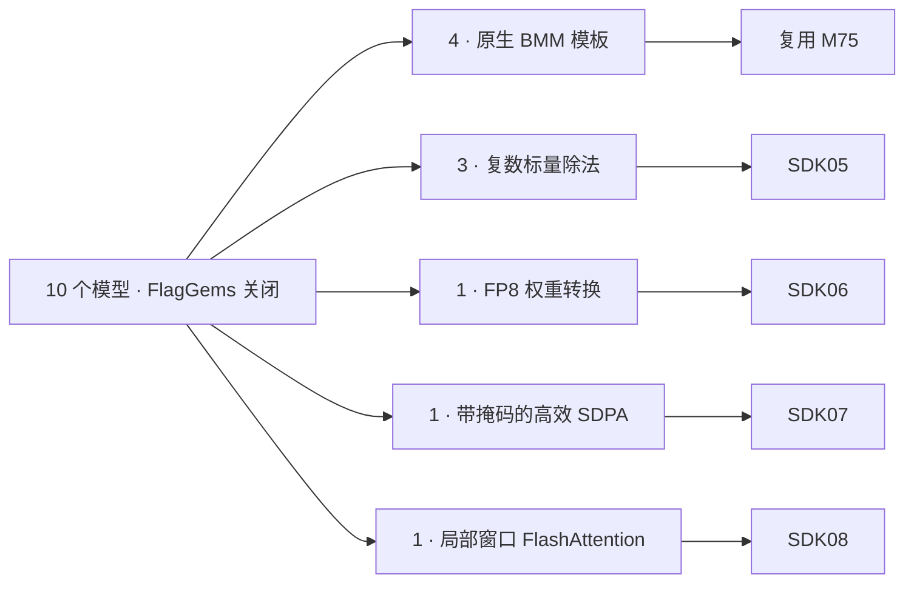

# P800 eager 修复对照

正式清单中原始 eager 为 634/749。对当时失败的 115 个模型，已有 115 个取得修复任务回执（含 2 个仅在等待卡锁时撤回）。其中 43 个至少一次完成 3 次预热和 10 次计时、导出有限特征。
复测固定模型 revision，关闭图优化和 FlagGems。下列“通过”衡量可执行性。与独立参考输出的数值等价、原生厂商包修复及性能比较均须另行验收。

## 10 个进入昆仑芯原生算子链的模型

10 个原始故障均定位到昆仑芯软件栈，其中 8 个已有端到端规避通过记录。四个 BMM 模型在干净官方 FlagTree 与本地累计修复版上均触发同一原生模板诊断。其余六个的证据为原生算子重放、参数对照或设备任务。

| 模型 | 原始故障归属 | 对照过的方案与覆盖范围 | 端到端复测 | 证据 |
|---|---|---|---|---|
| nvidia/NV-Embed-v2 | 昆仑芯原生 BMM JIT · M75 | 已有逐头二维 mm 对照。厂商的模板实例化仍需补足 OneLoop。 | 规避后通过。 | [原始](<../../work/2026-11-24/xpu-gems-eager/all-local-fixes/evidence/43.138.5.189/cbef59d2303c7961be52/repeat-peer-7bf1fc2b-card5/local-off/console.log>) · [r1 通过](<../../work/2026-11-24/xpu-gems-eager/all-local-fixes/evidence/43.138.5.189/cbef59d2303c7961be52/repeat-peer-7bf1fc2b-card5/repair-eager-r1.json>) |
| ai-sage/Giga-Embeddings-instruct | 昆仑芯原生 BMM JIT · M75 | 已有逐头二维 mm 对照。厂商的模板实例化仍需补足 OneLoop。 | 复测仍失败。退出码 124，详见复测日志 | [原始](<../../work/2026-11-24/xpu-gems-eager/all-local-fixes/evidence/43.179.154.78/f50f8e396fcdaf14c6ec/main/local-off/console.log>) · [r1 未通过](<../../work/2026-11-24/xpu-gems-eager/all-local-fixes/evidence/43.179.154.78/f50f8e396fcdaf14c6ec/main/repair-eager-r1.json>) · [r3 未通过](<../../work/2026-11-24/xpu-gems-eager/all-local-fixes/evidence/43.179.154.78/f50f8e396fcdaf14c6ec/main/repair-eager-r3.json>) · [r6 未通过](<../../work/2026-11-24/xpu-gems-eager/all-local-fixes/evidence/43.179.154.78/f50f8e396fcdaf14c6ec/main/repair-eager-r6.json>) |
| OFA-Sys/chinese-clip-vit-large-patch14-336px | 昆仑芯原生 BMM JIT · M75 | 已有逐头二维 mm 对照。厂商的模板实例化仍需补足 OneLoop。 | 规避后通过。 | [原始](<../../work/2026-11-24/xpu-gems-eager/all-local-fixes/evidence/43.138.5.189/0d89633265bdbb397e63/main/local-off/console.log>) · [r1 通过](<../../work/2026-11-24/xpu-gems-eager/all-local-fixes/evidence/43.138.5.189/0d89633265bdbb397e63/main/repair-eager-r1.json>) |
| BAAI/EVA-CLIP-8B-448 | 昆仑芯原生 BMM JIT · M75 | 已有逐头二维 mm 对照。厂商的模板实例化仍需补足 OneLoop。 | 复测仍失败。RuntimeError: The size of tensor a (126) must match the size of tensor b (77) at non-singleton dimension 1 | [原始](<../../work/2026-11-24/xpu-gems-eager/all-local-fixes/evidence/43.138.5.189/840d1760efc83bb4af10/repeat-peer-7bf1fc2b-card1/local-off/console.log>) · [r1 未通过](<../../work/2026-11-24/xpu-gems-eager/all-local-fixes/evidence/43.138.5.189/840d1760efc83bb4af10/repeat-peer-7bf1fc2b-card1/repair-eager-r1.json>) · [r3 未通过](<../../work/2026-11-24/xpu-gems-eager/all-local-fixes/evidence/43.138.5.189/840d1760efc83bb4af10/repeat-peer-7bf1fc2b-card1/repair-eager-r3.json>) |
| togethercomputer/m2-bert-80M-2k-retrieval | 昆仑芯 XDNN / XMLIR · [SDK05](<p800-sdk/ComplexScalarDiv/ISSUE.md>) | M06 记录 32k 的 FFT 现象。现已定位复数除实标量的 cast，另有 FFT 参数拒绝。调用方用实数矩阵运算实现同一傅里叶卷积。 | 规避后通过。RuntimeError: [INVALID PARAMETER]: error code= 1(at /home/agent/xpytorch/workspace/8ba19c15-fc11-4377-85f3-84daf8eaab09/XMLIR/python/torch_xmlir/csrc/ | [原始](<../../work/2026-11-24/xpu-gems-eager/all-local-fixes/evidence/43.138.5.189/284683104f8008f8cc6e/main/local-off/console.log>) · [r1 未通过](<../../work/2026-11-24/xpu-gems-eager/all-local-fixes/evidence/43.138.5.189/284683104f8008f8cc6e/main/repair-eager-r1.json>) · [r2 通过](<../../work/2026-11-24/xpu-gems-eager/all-local-fixes/evidence/43.138.5.189/284683104f8008f8cc6e/main/repair-eager-r2.json>) · [r3 通过](<../../work/2026-11-24/xpu-gems-eager/all-local-fixes/evidence/43.138.5.189/284683104f8008f8cc6e/main/repair-eager-r3.json>) |
| togethercomputer/m2-bert-80M-8k-retrieval | 昆仑芯 XDNN / XMLIR · [SDK05](<p800-sdk/ComplexScalarDiv/ISSUE.md>) | M06 记录 32k 的 FFT 现象。现已定位复数除实标量的 cast，另有 FFT 参数拒绝。调用方用实数矩阵运算实现同一傅里叶卷积。 | 规避后通过。 | [原始](<../../work/2026-11-24/xpu-gems-eager/all-local-fixes/evidence/81.70.153.29/509cf4906e59c785b527/main/local-off/console.log>) · [r1 未通过](<../../work/2026-11-24/xpu-gems-eager/all-local-fixes/evidence/81.70.153.29/509cf4906e59c785b527/main/repair-eager-r1.json>) · [r2 通过](<../../work/2026-11-24/xpu-gems-eager/all-local-fixes/evidence/81.70.153.29/509cf4906e59c785b527/main/repair-eager-r2.json>) |
| togethercomputer/m2-bert-80M-32k-retrieval | 昆仑芯 XDNN / XMLIR · [SDK05](<p800-sdk/ComplexScalarDiv/ISSUE.md>) | M06 记录 32k 的 FFT 现象。现已定位复数除实标量的 cast，另有 FFT 参数拒绝。调用方用实数矩阵运算实现同一傅里叶卷积。 | 规避后通过。 | [原始](<../../work/2026-11-24/xpu-gems-eager/all-local-fixes/evidence/43.179.154.78/c264566c5b0f2208f847/main/local-off/console.log>) · [r1 未通过](<../../work/2026-11-24/xpu-gems-eager/all-local-fixes/evidence/43.179.154.78/c264566c5b0f2208f847/main/repair-eager-r1.json>) · [r2 通过](<../../work/2026-11-24/xpu-gems-eager/all-local-fixes/evidence/43.179.154.78/c264566c5b0f2208f847/main/repair-eager-r2.json>) |
| nvidia/llama-nemotron-embed-vl-1b-v2-fp8 | 昆仑芯原生 FP8 cast · [SDK06](<p800-sdk/FP8WeightCast/ISSUE.md>) | D02 和 M96 涉及其他调用路径。规避在加载时按原字节在 CPU 转为 BF16，再送回 XPU 并沿用发布者的权重缩放。 | 规避后通过。另次复测设备等待超时（noc idle） | [原始](<../../work/2026-11-24/xpu-gems-eager/all-local-fixes/evidence/43.179.154.78/92270bad15fc281e26c5/main/local-off/console.log>) · [r1 通过](<../../work/2026-11-24/xpu-gems-eager/all-local-fixes/evidence/43.179.154.78/92270bad15fc281e26c5/main/repair-eager-r1.json>) · [r3 未通过](<../../work/2026-11-24/xpu-gems-eager/all-local-fixes/evidence/43.179.154.78/92270bad15fc281e26c5/main/repair-eager-r3.json>) |
| google/embeddinggemma-2 | 昆仑芯原生 SDPA · [SDK07](<p800-sdk/MaskedSDPA512/ISSUE.md>) | D06、D08、D09 涉及 FlagGems ON。此处保留原 Q/K/V 和布尔掩码，改用 math SDPA。 | 规避后通过。 | [原始](<../../work/2026-11-24/xpu-gems-eager/all-local-fixes/evidence/81.70.153.29/39b44716f6fa2e5010de/main/local-off/console.log>) · [r1 未通过](<../../work/2026-11-24/xpu-gems-eager/all-local-fixes/evidence/81.70.153.29/39b44716f6fa2e5010de/main/repair-eager-r1.json>) · [r2 通过](<../../work/2026-11-24/xpu-gems-eager/all-local-fixes/evidence/81.70.153.29/39b44716f6fa2e5010de/main/repair-eager-r2.json>) |
| lightonai/DenseOn | 昆仑芯原生 FlashAttention · [SDK08](<p800-sdk/LocalVarlenFlash/ISSUE.md>) | M11、M97、M102 的修复范围不同。规避保留逐序列 (64,64) 局部窗口，以 math SDPA 计算。 | 规避后通过。 | [原始](<../../work/2026-11-24/xpu-gems-eager/all-local-fixes/evidence/81.70.153.29/abde0d4fb64fc29dcd3b/main/local-off/console.log>) · [r1 通过](<../../work/2026-11-24/xpu-gems-eager/all-local-fixes/evidence/81.70.153.29/abde0d4fb64fc29dcd3b/main/repair-eager-r1.json>) |

## 其余 105 个模型

表中保留原始阻断点。后续阶段的异常可通过复测回执回溯。下载目录、快照版本和缓存未命中记录保存在个人工作目录。

| 模型 | 原始阻断点 | 修复复测 | 证据 |
|---|---|---|---|
| 5CD-AI/Vintern-Embedding-1B | Python 依赖。模型代码导入所需的 decord 失败。 | 复测仍失败。ValueError: Could not determine embedding dimension from model config. Config type: InternVLChatConfig. | [原始](<../../work/2026-11-24/xpu-gems-eager/all-local-fixes/evidence/81.70.153.29/4b26a53533d8bcd3b883/main/local-off/console.log>) · [r1 未通过](<../../work/2026-11-24/xpu-gems-eager/all-local-fixes/evidence/81.70.153.29/4b26a53533d8bcd3b883/main/repair-eager-r1.json>) · [r5 未通过](<../../work/2026-11-24/xpu-gems-eager/all-local-fixes/evidence/81.70.153.29/4b26a53533d8bcd3b883/main/repair-eager-r5.json>) |
| AQ-MedAI/Diver-Retriever-4B | 模型配置、加载器或输入输出接口。加载 Pooling 模块时缺少构造参数 embedding_dimension。 | 规避后通过。 | [原始](<../../work/2026-11-24/xpu-gems-eager/all-local-fixes/evidence/43.138.5.189/00953ede9604495c3ccc/repeat-peer-7bf1fc2b-card1/local-off/console.log>) · [r1 通过](<../../work/2026-11-24/xpu-gems-eager/all-local-fixes/evidence/43.138.5.189/00953ede9604495c3ccc/repeat-peer-7bf1fc2b-card1/repair-eager-r1.json>) |
| ATH-MaaS/Ovis-Omni-Embedding-3B | 模型配置、加载器或输入输出接口。所调用的 AutoModel 类没有映射当前配置 Qwen2_5OmniConfig。 | 复测仍失败。Model type should be one of AfmoeConfig, Aimv2Config, Aimv2VisionConfig, AlbertConfig, AlignConfig, AltCLIPConfig, ApertusConfig, ArceeConfig, AriaCon | [原始](<../../work/2026-11-24/xpu-gems-eager/all-local-fixes/evidence/43.138.5.189/61fe2fd8ce10ed4226a9/main/local-off/console.log>) · [r1 未通过](<../../work/2026-11-24/xpu-gems-eager/all-local-fixes/evidence/43.138.5.189/61fe2fd8ce10ed4226a9/main/repair-eager-r1.json>) |
| ATH-MaaS/Ovis-VL-Embedding-2B | 离线资源或权重路径解析。加载器在当前快照中找不到其接受的权重文件名（含 pytorch_model.bin、model.safetensors）。 | 复测仍失败。OSError: ATH-MaaS/Ovis-VL-Embedding-2B does not appear to have a file named pytorch_model.bin or model.safetensors. | [原始](<../../work/2026-11-24/xpu-gems-eager/all-local-fixes/evidence/43.138.5.189/d649e1134cf7a1d1e843/main/local-off/console.log>) · [r1 未通过](<../../work/2026-11-24/xpu-gems-eager/all-local-fixes/evidence/43.138.5.189/d649e1134cf7a1d1e843/main/repair-eager-r1.json>) |
| ATH-MaaS/Ovis-VL-Embedding-9B | 离线资源或权重路径解析。加载器在当前快照中找不到其接受的权重文件名（含 pytorch_model.bin、model.safetensors）。 | 复测仍失败。OSError: ATH-MaaS/Ovis-VL-Embedding-9B does not appear to have a file named pytorch_model.bin or model.safetensors. | [原始](<../../work/2026-11-24/xpu-gems-eager/all-local-fixes/evidence/43.138.5.189/3298778c8a74cb5286a8/main/local-off/console.log>) · [r1 未通过](<../../work/2026-11-24/xpu-gems-eager/all-local-fixes/evidence/43.138.5.189/3298778c8a74cb5286a8/main/repair-eager-r1.json>) |
| Alibaba-NLP/E2Rank-0.6B | 模型配置、加载器或输入输出接口。处理器的聊天模板未通过 query/document 角色成对校验。 | 复测仍失败。via `processor_kwargs={"chat_template": ...}` when loading, `model.processor.chat_template = ...` afterwards, or a `chat_template.jinja` file alongsid | [原始](<../../work/2026-11-24/xpu-gems-eager/all-local-fixes/evidence/81.70.153.29/6f697fd9ddc6851bc96d/main/local-off/console.log>) · [r1 未通过](<../../work/2026-11-24/xpu-gems-eager/all-local-fixes/evidence/81.70.153.29/6f697fd9ddc6851bc96d/main/repair-eager-r1.json>) |
| Alibaba-NLP/gte-Qwen1.5-7B-instruct | 离线资源或权重路径解析。离线加载失败。最后记录的未命中项为 Alibaba-NLP/gte-Qwen1.5-7B-instruct/config.json。 | 复测仍失败。Check your internet connection or see how to run the library in offline mode at 'https://huggingface.co/docs/transformers/installation#offline-mode'. | [原始](<../../work/2026-11-24/xpu-gems-eager/all-local-fixes/evidence/43.179.154.78/6542fec87d87a80d0131/main/local-off/console.log>) · [r1 未通过](<../../work/2026-11-24/xpu-gems-eager/all-local-fixes/evidence/43.179.154.78/6542fec87d87a80d0131/main/repair-eager-r1.json>) |
| BAAI/EVA-CLIP-18B | 模型配置、加载器或输入输出接口。文本 embedding 的序列长度为 126，位置 embedding 长度为 77，两者逐元素相加失败。 | 复测仍失败。RuntimeError: The size of tensor a (126) must match the size of tensor b (77) at non-singleton dimension 1 | [原始](<../../work/2026-11-24/xpu-gems-eager/all-local-fixes/evidence/43.179.154.78/b0699026ebf1ef1be77d/main/local-off/console.log>) · [r1 未通过](<../../work/2026-11-24/xpu-gems-eager/all-local-fixes/evidence/43.179.154.78/b0699026ebf1ef1be77d/main/repair-eager-r1.json>) |
| BAAI/EVA-CLIP-8B | 模型配置、加载器或输入输出接口。文本 embedding 的序列长度为 126，位置 embedding 长度为 77，两者逐元素相加失败。 | 复测仍失败。RuntimeError: The size of tensor a (126) must match the size of tensor b (77) at non-singleton dimension 1 | [原始](<../../work/2026-11-24/xpu-gems-eager/all-local-fixes/evidence/43.179.154.78/b6b7802669d2332b588c/main/local-off/console.log>) · [r1 未通过](<../../work/2026-11-24/xpu-gems-eager/all-local-fixes/evidence/43.179.154.78/b6b7802669d2332b588c/main/repair-eager-r1.json>) |
| BAAI/bge-reranker-v2.5-gemma2-lightweight | 模型配置、加载器或输入输出接口。下游对 embedding 读取 ndim，实际得到 tuple。 | 复测仍失败。AttributeError: 'tuple' object has no attribute 'ndim' | [原始](<../../work/2026-11-24/xpu-gems-eager/all-local-fixes/evidence/43.179.154.78/259378a25cbac1128c7e/main/local-off/console.log>) · [r1 未通过](<../../work/2026-11-24/xpu-gems-eager/all-local-fixes/evidence/43.179.154.78/259378a25cbac1128c7e/main/repair-eager-r1.json>) |
| Baragi-AI/Munche-768 | 离线资源或权重路径解析。离线加载失败。最后记录的未命中项为 google/embeddinggemma-300m/config.json。 | 复测仍失败。Check your internet connection or see how to run the library in offline mode at 'https://huggingface.co/docs/transformers/installation#offline-mode'. | [原始](<../../work/2026-11-24/xpu-gems-eager/all-local-fixes/evidence/43.179.154.78/65d857fc6c0ba29714b7/main/local-off/console.log>) · [r1 未通过](<../../work/2026-11-24/xpu-gems-eager/all-local-fixes/evidence/43.179.154.78/65d857fc6c0ba29714b7/main/repair-eager-r1.json>) |
| Cainiao-AI/G2PTL | 模型配置、加载器或输入输出接口。AutoModel 注册模型时发现模型声明的 config_class 与实际配置类不一致。 | 规避后通过。 | [原始](<../../work/2026-11-24/xpu-gems-eager/all-local-fixes/evidence/81.70.153.29/62efa75174d831b75fdc/main/local-off/console.log>) · [r1 通过](<../../work/2026-11-24/xpu-gems-eager/all-local-fixes/evidence/81.70.153.29/62efa75174d831b75fdc/main/repair-eager-r1.json>) |
| DatologyAI/luxical-one | Python 依赖。模型代码导入所需的 arrow_tokenize 失败。 | 复测仍失败。ModuleNotFoundError: No module named 'arrow_tokenize'；所需 luxical 1.1.2 及 arrow-tokenize 声明 Python ≥3.11，当前固定 XPU PyTorch 环境为 3.10 | [原始](<../../work/2026-11-24/xpu-gems-eager/all-local-fixes/evidence/43.138.5.189/0b730ce6b7dfbdd51f06/main/local-off/console.log>) · [r1 未通过](<../../work/2026-11-24/xpu-gems-eager/all-local-fixes/evidence/43.138.5.189/0b730ce6b7dfbdd51f06/main/repair-eager-r1.json>) |
| EximiusLabs/fusion-embedding-1-2b-preview | 模型配置、加载器或输入输出接口。AutoProcessor 无法从该快照识别 processor、tokenizer、image processor 或 feature extractor。 | 复测仍失败。ValueError: Unrecognized processing class in EximiusLabs/fusion-embedding-1-2b-preview. Can't instantiate a processor, a tokenizer, an image processor | [原始](<../../work/2026-11-24/xpu-gems-eager/all-local-fixes/evidence/81.70.153.29/243ca1b48836168c05e2/main/local-off/console.log>) · [r1 未通过](<../../work/2026-11-24/xpu-gems-eager/all-local-fixes/evidence/81.70.153.29/243ca1b48836168c05e2/main/repair-eager-r1.json>) |
| GoodBaiBai88/M3D-CLIP | 模型配置、加载器或输入输出接口。多模态输入把 images 传入文本 tokenizer 的 _batch_encode_plus，接口不接受该参数。 | 复测仍失败。退出码 124，详见复测日志 | [原始](<../../work/2026-11-24/xpu-gems-eager/all-local-fixes/evidence/43.179.154.78/2a36db05a4941bd527b2/main/local-off/console.log>) · [r1 未通过](<../../work/2026-11-24/xpu-gems-eager/all-local-fixes/evidence/43.179.154.78/2a36db05a4941bd527b2/main/repair-eager-r1.json>) |
| HuggingFaceM4/siglip-so400m-14-980-flash-attn2-navit | 离线资源或权重路径解析。离线加载失败。最后记录的未命中项为 HuggingFaceM4/siglip-so400m-14-980-flash-attn2-navit/config.json。 | 复测仍失败。Checkout your internet connection or see how to run the library in offline mode at 'https://huggingface.co/docs/transformers/installation#offline-mode | [原始](<../../work/2026-11-24/xpu-gems-eager/all-local-fixes/evidence/43.179.154.78/ed841b3db7f0619e6024/main/local-off/console.log>) · [r1 未通过](<../../work/2026-11-24/xpu-gems-eager/all-local-fixes/evidence/43.179.154.78/ed841b3db7f0619e6024/main/repair-eager-r1.json>) |
| IDEA-CCNL/Taiyi-CLIP-RoBERTa-102M-ViT-L-Chinese | 模型配置、加载器或输入输出接口。多模态输入把 images 传入文本 tokenizer 的 _batch_encode_plus，接口不接受该参数。 | 复测仍失败。RuntimeError: Taiyi published OpenAI vision companion has not been staged | [原始](<../../work/2026-11-24/xpu-gems-eager/all-local-fixes/evidence/43.138.5.189/bab6f4f68f7807793804/repeat-import-retry-7bf1fc2b-card0/local-off/console.log>) · [r1 未通过](<../../work/2026-11-24/xpu-gems-eager/all-local-fixes/evidence/43.138.5.189/bab6f4f68f7807793804/repeat-import-retry-7bf1fc2b-card0/repair-eager-r1.json>) |
| IDEA-CCNL/Taiyi-CLIP-Roberta-102M-Chinese | 模型配置、加载器或输入输出接口。多模态输入把 images 传入文本 tokenizer 的 _batch_encode_plus，接口不接受该参数。 | 复测仍失败。Checkout your internet connection or see how to run the library in offline mode at 'https://huggingface.co/docs/transformers/installation#offline-mode | [原始](<../../work/2026-11-24/xpu-gems-eager/all-local-fixes/evidence/43.138.5.189/02b76b9dec9eb825692e/main/local-off/console.log>) · [r1 未通过](<../../work/2026-11-24/xpu-gems-eager/all-local-fixes/evidence/43.138.5.189/02b76b9dec9eb825692e/main/repair-eager-r1.json>) |
| IDEA-CCNL/Taiyi-CLIP-Roberta-large-326M-Chinese | 模型配置、加载器或输入输出接口。多模态输入把 images 传入文本 tokenizer 的 _batch_encode_plus，接口不接受该参数。 | 规避后通过。 | [原始](<../../work/2026-11-24/xpu-gems-eager/all-local-fixes/evidence/81.70.153.29/2c4b19e165be4d8714cd/main/local-off/console.log>) · [r1 通过](<../../work/2026-11-24/xpu-gems-eager/all-local-fixes/evidence/81.70.153.29/2c4b19e165be4d8714cd/main/repair-eager-r1.json>) |
| Kingsoft-LLM/QZhou-Embedding-Zh | 模型配置、加载器或输入输出接口。模型检查批次中的特殊 token 151644，至少一条官方输入缺少该 token。 | 复测仍失败。AssertionError: Not all sequences contain the token 151644 | [原始](<../../work/2026-11-24/xpu-gems-eager/all-local-fixes/evidence/43.138.5.189/9af530a3f6d779f0c3a0/repeat-peer-7bf1fc2b-card4/local-off/console.log>) · [r1 未通过](<../../work/2026-11-24/xpu-gems-eager/all-local-fixes/evidence/43.138.5.189/9af530a3f6d779f0c3a0/repeat-peer-7bf1fc2b-card4/repair-eager-r1.json>) |
| LanguageBind/LanguageBind_Image | 模型配置、加载器或输入输出接口。当前 Transformers 无法识别模型类型 LanguageBindImage。 | 复测仍失败。ValueError: The checkpoint you are trying to load has model type `LanguageBindImage` but Transformers does not recognize this architecture. This could | [原始](<../../work/2026-11-24/xpu-gems-eager/all-local-fixes/evidence/43.138.5.189/d24f270dae07d47cfa4c/main/local-off/console.log>) · [r1 未通过](<../../work/2026-11-24/xpu-gems-eager/all-local-fixes/evidence/43.138.5.189/d24f270dae07d47cfa4c/main/repair-eager-r1.json>) |
| Linkup-Platform/linkup-sparseup-embed-v1 | 模型配置、加载器或输入输出接口。获取 embedding[output_key] 时收到了 2 维张量，返回值与调用方的索引约定不匹配。 | 规避后通过。通过的复测使用另一台服务器的镜像 | [原始](<../../work/2026-11-24/xpu-gems-eager/all-local-fixes/evidence/43.138.5.189/e5a7761324349d654854/main/local-off/console.log>) · [r1 未通过](<../../work/2026-11-24/xpu-gems-eager/all-local-fixes/evidence/43.138.5.189/e5a7761324349d654854/main/repair-eager-r1.json>) · [r4 未通过](<../../work/2026-11-24/xpu-gems-eager/all-local-fixes/evidence/43.138.5.189/e5a7761324349d654854/main/repair-eager-r4.json>) · [r5 未通过](<../../work/2026-11-24/xpu-gems-eager/all-local-fixes/evidence/43.138.5.189/e5a7761324349d654854/main/repair-eager-r5.json>) · [r6 通过](<../../work/2026-11-24/xpu-gems-eager/all-local-fixes/evidence/43.138.5.189/e5a7761324349d654854/main/repair-eager-r6.json>) |
| McGill-NLP/LLM2Vec-Meta-Llama-3-8B-Instruct-mntp | 模型配置、加载器或输入输出接口。加载器把适配器的 LoraConfig 当作带 architectures 的模型配置使用。 | 复测仍失败。AttributeError: 'LoraConfig' object has no attribute 'architectures' | [原始](<../../work/2026-11-24/xpu-gems-eager/all-local-fixes/evidence/43.179.154.78/e33e1f1367b486098333/main/local-off/console.log>) · [r1 未通过](<../../work/2026-11-24/xpu-gems-eager/all-local-fixes/evidence/43.179.154.78/e33e1f1367b486098333/main/repair-eager-r1.json>) |
| McGill-NLP/LLM2Vec-Meta-Llama-3-8B-Instruct-mntp-supervised | 离线资源或权重路径解析。离线加载失败。最后记录的未命中项为 McGill-NLP/LLM2Vec-Meta-Llama-3-8B-Instruct-mntp-supervised/config.json。 | 复测仍失败。Check your internet connection or see how to run the library in offline mode at 'https://huggingface.co/docs/transformers/installation#offline-mode'. | [原始](<../../work/2026-11-24/xpu-gems-eager/all-local-fixes/evidence/43.179.154.78/c66db948253943a2cc77/main/local-off/console.log>) · [r1 未通过](<../../work/2026-11-24/xpu-gems-eager/all-local-fixes/evidence/43.179.154.78/c66db948253943a2cc77/main/repair-eager-r1.json>) |
| McGill-NLP/LLM2Vec-Mistral-7B-Instruct-v2-mntp | 模型配置、加载器或输入输出接口。加载器把适配器的 LoraConfig 当作带 architectures 的模型配置使用。 | 复测仍失败。AttributeError: 'LoraConfig' object has no attribute 'architectures' | [原始](<../../work/2026-11-24/xpu-gems-eager/all-local-fixes/evidence/43.138.5.189/8bea978a9978d580913a/main/local-off/console.log>) · [r1 未通过](<../../work/2026-11-24/xpu-gems-eager/all-local-fixes/evidence/43.138.5.189/8bea978a9978d580913a/main/repair-eager-r1.json>) |
| McGill-NLP/LLM2Vec-Mistral-7B-Instruct-v2-mntp-supervised | 离线资源或权重路径解析。离线加载失败。最后记录的未命中项为 McGill-NLP/LLM2Vec-Mistral-7B-Instruct-v2-mntp-supervised/config.json。 | 排队任务已撤回。设备超时后移出测试白名单，任务尚未取得卡锁 | [原始](<../../work/2026-11-24/xpu-gems-eager/all-local-fixes/evidence/43.179.154.78/3617f2a32bffefaca7fb/main/local-off/console.log>) · [r1 未通过](<../../work/2026-11-24/xpu-gems-eager/all-local-fixes/evidence/43.179.154.78/3617f2a32bffefaca7fb/main/repair-eager-r1.json>) |
| Metric-AI/ColQwen2.5-7b-multilingual-v1.0 | 离线资源或权重路径解析。离线加载失败。最后记录的未命中项为 Metric-AI/colqwen2.5-7b-base/config.json。 | 复测仍失败。Check your internet connection or see how to run the library in offline mode at 'https://huggingface.co/docs/transformers/installation#offline-mode'. | [原始](<../../work/2026-11-24/xpu-gems-eager/all-local-fixes/evidence/43.179.154.78/0da2c014218e159d822a/main/local-off/console.log>) · [r1 未通过](<../../work/2026-11-24/xpu-gems-eager/all-local-fixes/evidence/43.179.154.78/0da2c014218e159d822a/main/repair-eager-r1.json>) |
| Metric-AI/colqwen2.5-3b-multilingual | 离线资源或权重路径解析。离线加载失败。最后记录的未命中项为 Metric-AI/colqwen2.5-base/config.json。 | 复测仍失败。Check your internet connection or see how to run the library in offline mode at 'https://huggingface.co/docs/transformers/installation#offline-mode'. | [原始](<../../work/2026-11-24/xpu-gems-eager/all-local-fixes/evidence/43.179.154.78/0b77d67d7756c49ce001/main/local-off/console.log>) · [r1 未通过](<../../work/2026-11-24/xpu-gems-eager/all-local-fixes/evidence/43.179.154.78/0b77d67d7756c49ce001/main/repair-eager-r1.json>) |
| ModernVBERT/colmodernvbert | 离线资源或权重路径解析。离线加载失败。最后记录的未命中项为 ModernVBERT/colmodernvbert/config.json。 | 复测仍失败。Check your internet connection or see how to run the library in offline mode at 'https://huggingface.co/docs/transformers/installation#offline-mode'. | [原始](<../../work/2026-11-24/xpu-gems-eager/all-local-fixes/evidence/43.179.154.78/e17b14654125efd81609/main/local-off/console.log>) · [r1 未通过](<../../work/2026-11-24/xpu-gems-eager/all-local-fixes/evidence/43.179.154.78/e17b14654125efd81609/main/repair-eager-r1.json>) |
| NetoAISolutions/T-VEC | 离线资源或权重路径解析。离线加载失败。最后记录的未命中项为 NetoAISolutions/T-VEC/config.json。 | 复测仍失败。Check your internet connection or see how to run the library in offline mode at 'https://huggingface.co/docs/transformers/installation#offline-mode'. | [原始](<../../work/2026-11-24/xpu-gems-eager/all-local-fixes/evidence/43.179.154.78/14d90e1375c6222649e2/main/local-off/console.log>) · [r1 未通过](<../../work/2026-11-24/xpu-gems-eager/all-local-fixes/evidence/43.179.154.78/14d90e1375c6222649e2/main/repair-eager-r1.json>) |
| NeuML/txtai-arxiv | 模型配置、加载器或输入输出接口。AutoConfig 无法从快照的 model_type 或模型名称确定受支持的模型类。 | 复测仍失败。ValueError: Unrecognized model in NeuML/txtai-arxiv. Should have a `model_type` key in its config.json, or contain one of the following strings in its | [原始](<../../work/2026-11-24/xpu-gems-eager/all-local-fixes/evidence/43.138.5.189/f8578d38b48775c90c0d/main/local-off/console.log>) · [r1 未通过](<../../work/2026-11-24/xpu-gems-eager/all-local-fixes/evidence/43.138.5.189/f8578d38b48775c90c0d/main/repair-eager-r1.json>) |
| NeuML/txtai-wikipedia | 离线资源或权重路径解析。加载器将 None 当作 checkpoint 路径调用 endswith。固定快照根目录只有 config.json 和下载清单。 | 复测仍失败。AttributeError: 'NoneType' object has no attribute 'endswith' | [原始](<../../work/2026-11-24/xpu-gems-eager/all-local-fixes/evidence/43.138.5.189/db0c6ba0a797f0b3e418/main/local-off/console.log>) · [r1 未通过](<../../work/2026-11-24/xpu-gems-eager/all-local-fixes/evidence/43.138.5.189/db0c6ba0a797f0b3e418/main/repair-eager-r1.json>) |
| Omartificial-Intelligence-Space/AraGemma-Embedding-300m | 离线资源或权重路径解析。离线加载失败。最后记录的未命中项为 Omartificial-Intelligence-Space/AraGemma-Embedding-300m/config.json。 | 复测仍失败。Check your internet connection or see how to run the library in offline mode at 'https://huggingface.co/docs/transformers/installation#offline-mode'. | [原始](<../../work/2026-11-24/xpu-gems-eager/all-local-fixes/evidence/81.70.153.29/bd5f8e11962e1dc6dba1/main/local-off/console.log>) · [r1 未通过](<../../work/2026-11-24/xpu-gems-eager/all-local-fixes/evidence/81.70.153.29/bd5f8e11962e1dc6dba1/main/repair-eager-r1.json>) |
| Qdrant/bm25 | 模型配置、加载器或输入输出接口。AutoConfig 无法从快照的 model_type 或模型名称确定受支持的模型类。 | 复测仍失败。ValueError: Unrecognized model in Qdrant/bm25. Should have a `model_type` key in its config.json, or contain one of the following strings in its name: | [原始](<../../work/2026-11-24/xpu-gems-eager/all-local-fixes/evidence/43.138.5.189/ce2eb2b21f9b69ffd2dd/main/local-off/console.log>) · [r1 未通过](<../../work/2026-11-24/xpu-gems-eager/all-local-fixes/evidence/43.138.5.189/ce2eb2b21f9b69ffd2dd/main/repair-eager-r1.json>) |
| Qwen/Qwen3-VL-Reranker-8B | 模型配置、加载器或输入输出接口。加载 LogitScore 模块时缺少构造参数 true_token_id。 | 规避后通过。 | [原始](<../../work/2026-11-24/xpu-gems-eager/all-local-fixes/evidence/43.179.154.78/78db25a5ae57a01717ee/main/local-off/console.log>) · [r1 通过](<../../work/2026-11-24/xpu-gems-eager/all-local-fixes/evidence/43.179.154.78/78db25a5ae57a01717ee/main/repair-eager-r1.json>) |
| RhapsodyAI/MiniCPM-V-Embedding-preview | 模型配置、加载器或输入输出接口。通用适配器调用 forward 时缺少模型签名要求的 text、image 和 tokenizer。 | 规避后通过。 | [原始](<../../work/2026-11-24/xpu-gems-eager/all-local-fixes/evidence/43.138.5.189/379abb606567496b81d8/repeat-peer-7bf1fc2b-card2/local-off/console.log>) · [r1 未通过](<../../work/2026-11-24/xpu-gems-eager/all-local-fixes/evidence/43.138.5.189/379abb606567496b81d8/repeat-peer-7bf1fc2b-card2/repair-eager-r1.json>) · [r5 通过](<../../work/2026-11-24/xpu-gems-eager/all-local-fixes/evidence/43.138.5.189/379abb606567496b81d8/repeat-peer-7bf1fc2b-card2/repair-eager-r5.json>) |
| Tevatron/OmniEmbed-v0.1 | 离线资源或权重路径解析。离线加载失败。调用 AutoProcessor / Transformers 的离线文件解析时退出。 | 规避后通过。 | [原始](<../../work/2026-11-24/xpu-gems-eager/all-local-fixes/evidence/81.70.153.29/ae87bb1e2ee780aec8d1/main/local-off/console.log>) · [r1 未通过](<../../work/2026-11-24/xpu-gems-eager/all-local-fixes/evidence/81.70.153.29/ae87bb1e2ee780aec8d1/main/repair-eager-r1.json>) · [r6 通过](<../../work/2026-11-24/xpu-gems-eager/all-local-fixes/evidence/81.70.153.29/ae87bb1e2ee780aec8d1/main/repair-eager-r6.json>) |
| Tevatron/OmniEmbed-v0.1-multivent | 模型配置、加载器或输入输出接口。当前 Transformers 无法识别模型类型 qwen2_5_omni_thinker。 | 复测仍失败。You can update Transformers with the command `pip install --upgrade transformers`. If this does not work, and the checkpoint is very new, then there m | [原始](<../../work/2026-11-24/xpu-gems-eager/all-local-fixes/evidence/43.138.5.189/f175563c5a254d7f4594/main/local-off/console.log>) · [r1 未通过](<../../work/2026-11-24/xpu-gems-eager/all-local-fixes/evidence/43.138.5.189/f175563c5a254d7f4594/main/repair-eager-r1.json>) · [r6 未通过](<../../work/2026-11-24/xpu-gems-eager/all-local-fixes/evidence/43.138.5.189/f175563c5a254d7f4594/main/repair-eager-r6.json>) |
| Trendyol/trendyol-dino-v2-ecommerce-256d | 离线资源或权重路径解析。构造视觉骨干时，torch.hub 在 /root/.cache/torch/hub 找不到 DinoV2 仓库。 | 规避后通过。 | [原始](<../../work/2026-11-24/xpu-gems-eager/all-local-fixes/evidence/43.138.5.189/642a3a7dfeaae5776e10/main/local-off/console.log>) · [r1 通过](<../../work/2026-11-24/xpu-gems-eager/all-local-fixes/evidence/43.138.5.189/642a3a7dfeaae5776e10/main/repair-eager-r1.json>) |
| VAGOsolutions/SauerkrautLM-Reason-EuroColBERT | 模型配置、加载器或输入输出接口。RoPE 初始化查找 ROPE_INIT_FUNCTIONS 时缺少 default 项。 | 复测仍失败。KeyError: 'default' | [原始](<../../work/2026-11-24/xpu-gems-eager/all-local-fixes/evidence/81.70.153.29/bf2c9812d6896b43e799/main/local-off/console.log>) · [r1 未通过](<../../work/2026-11-24/xpu-gems-eager/all-local-fixes/evidence/81.70.153.29/bf2c9812d6896b43e799/main/repair-eager-r1.json>) |
| amazon/Titan-text-embeddings-v2 | 模型配置、加载器或输入输出接口。AutoConfig 无法从快照的 model_type 或模型名称确定受支持的模型类。 | 复测仍失败。ValueError: Unrecognized model in amazon/Titan-text-embeddings-v2. Should have a `model_type` key in its config.json, or contain one of the following  | [原始](<../../work/2026-11-24/xpu-gems-eager/all-local-fixes/evidence/43.138.5.189/3fbd2c4a60dd60abff10/main/local-off/console.log>) · [r1 未通过](<../../work/2026-11-24/xpu-gems-eager/all-local-fixes/evidence/43.138.5.189/3fbd2c4a60dd60abff10/main/repair-eager-r1.json>) |
| clip-italian/clip-italian | 模型配置、加载器或输入输出接口。构造 logit_scale 参数时传入非浮点、非复数张量，nn.Parameter 默认要求梯度。 | 规避后通过。通过的复测使用另一台服务器的镜像 | [原始](<../../work/2026-11-24/xpu-gems-eager/all-local-fixes/evidence/43.138.5.189/230bac768015705fcd2f/main/local-off/console.log>) · [r1 未通过](<../../work/2026-11-24/xpu-gems-eager/all-local-fixes/evidence/43.138.5.189/230bac768015705fcd2f/main/repair-eager-r1.json>) · [r4 未通过](<../../work/2026-11-24/xpu-gems-eager/all-local-fixes/evidence/43.138.5.189/230bac768015705fcd2f/main/repair-eager-r4.json>) · [r5 通过](<../../work/2026-11-24/xpu-gems-eager/all-local-fixes/evidence/43.138.5.189/230bac768015705fcd2f/main/repair-eager-r5.json>) |
| dwzhu/e5rope-base | xFormers 注意力分派。Q/K/V 为 [10,54,12,64] FP16。fa2F 拒绝 Tensor 类型的 bias，cutlassF 报告 bias 步幅不满足对齐。调度器找不到可用实现。 | 规避后通过。 | [原始](<../../work/2026-11-24/xpu-gems-eager/all-local-fixes/evidence/43.138.5.189/8762012923b3b8da590d/repeat-import-retry-7bf1fc2b-card0/local-off/console.log>) · [r1 通过](<../../work/2026-11-24/xpu-gems-eager/all-local-fixes/evidence/43.138.5.189/8762012923b3b8da590d/repeat-import-retry-7bf1fc2b-card0/repair-eager-r1.json>) |
| dxtech-asia/deepx-embedding-v1 | 模型配置、加载器或输入输出接口。当前 Transformers 无法识别模型类型 deepx-embedding。 | 复测仍失败。You can update Transformers with the command `pip install --upgrade transformers`. If this does not work, and the checkpoint is very new, then there m | [原始](<../../work/2026-11-24/xpu-gems-eager/all-local-fixes/evidence/43.138.5.189/2aebd12b0c4f36ed9b8d/main/local-off/console.log>) · [r1 未通过](<../../work/2026-11-24/xpu-gems-eager/all-local-fixes/evidence/43.138.5.189/2aebd12b0c4f36ed9b8d/main/repair-eager-r1.json>) |
| facebook/PE-Core-B16-224 | 离线资源或权重路径解析。离线加载失败。最后记录的未命中项为 facebook/PE-Core-B16-224/config.json。 | 复测仍失败。Check your internet connection or see how to run the library in offline mode at 'https://huggingface.co/docs/transformers/installation#offline-mode'. | [原始](<../../work/2026-11-24/xpu-gems-eager/all-local-fixes/evidence/43.138.5.189/ef8b8b798fe55a6c8b91/main/local-off/console.log>) · [r1 未通过](<../../work/2026-11-24/xpu-gems-eager/all-local-fixes/evidence/43.138.5.189/ef8b8b798fe55a6c8b91/main/repair-eager-r1.json>) |
| facebook/PE-Core-G14-448 | 离线资源或权重路径解析。离线加载失败。最后记录的未命中项为 facebook/PE-Core-G14-448/config.json。 | 复测仍失败。Check your internet connection or see how to run the library in offline mode at 'https://huggingface.co/docs/transformers/installation#offline-mode'. | [原始](<../../work/2026-11-24/xpu-gems-eager/all-local-fixes/evidence/43.179.154.78/7872b36cf75afeb4a408/main/local-off/console.log>) · [r1 未通过](<../../work/2026-11-24/xpu-gems-eager/all-local-fixes/evidence/43.179.154.78/7872b36cf75afeb4a408/main/repair-eager-r1.json>) |
| facebook/PE-Core-L14-336 | 离线资源或权重路径解析。离线加载失败。最后记录的未命中项为 facebook/PE-Core-L14-336/config.json。 | 复测仍失败。Check your internet connection or see how to run the library in offline mode at 'https://huggingface.co/docs/transformers/installation#offline-mode'. | [原始](<../../work/2026-11-24/xpu-gems-eager/all-local-fixes/evidence/43.179.154.78/eb519f96f71eaddaf4a8/main/local-off/console.log>) · [r1 未通过](<../../work/2026-11-24/xpu-gems-eager/all-local-fixes/evidence/43.179.154.78/eb519f96f71eaddaf4a8/main/repair-eager-r1.json>) |
| facebook/meta-encoder | 离线资源或权重路径解析。离线加载失败。最后记录的未命中项为 facebook/meta-encoder/config.json。 | 复测仍失败。Check your internet connection or see how to run the library in offline mode at 'https://huggingface.co/docs/transformers/installation#offline-mode'. | [原始](<../../work/2026-11-24/xpu-gems-eager/all-local-fixes/evidence/81.70.153.29/9cfbd23def5a6873ff00/main/local-off/console.log>) · [r1 未通过](<../../work/2026-11-24/xpu-gems-eager/all-local-fixes/evidence/81.70.153.29/9cfbd23def5a6873ff00/main/repair-eager-r1.json>) |
| google/embeddinggemma-300m | 离线资源或权重路径解析。离线加载失败。最后记录的未命中项为 google/embeddinggemma-300m/config.json。 | 复测仍失败。Check your internet connection or see how to run the library in offline mode at 'https://huggingface.co/docs/transformers/installation#offline-mode'. | [原始](<../../work/2026-11-24/xpu-gems-eager/all-local-fixes/evidence/43.179.154.78/ee101833d2afa4be82e2/main/local-off/console.log>) · [r1 未通过](<../../work/2026-11-24/xpu-gems-eager/all-local-fixes/evidence/43.179.154.78/ee101833d2afa4be82e2/main/repair-eager-r1.json>) |
| google/embeddinggemma-300m-qat-q4_0-unquantized | 离线资源或权重路径解析。离线加载失败。最后记录的未命中项为 google/embeddinggemma-300m-qat-q4_0-unquantized/config.json。 | 复测仍失败。Check your internet connection or see how to run the library in offline mode at 'https://huggingface.co/docs/transformers/installation#offline-mode'. | [原始](<../../work/2026-11-24/xpu-gems-eager/all-local-fixes/evidence/43.179.154.78/6f8bfd5d2646ecaa638b/main/local-off/console.log>) · [r1 未通过](<../../work/2026-11-24/xpu-gems-eager/all-local-fixes/evidence/43.179.154.78/6f8bfd5d2646ecaa638b/main/repair-eager-r1.json>) |
| google/embeddinggemma-300m-qat-q8_0-unquantized | 离线资源或权重路径解析。离线加载失败。最后记录的未命中项为 google/embeddinggemma-300m-qat-q8_0-unquantized/config.json。 | 复测仍失败。Check your internet connection or see how to run the library in offline mode at 'https://huggingface.co/docs/transformers/installation#offline-mode'. | [原始](<../../work/2026-11-24/xpu-gems-eager/all-local-fixes/evidence/43.179.154.78/afb3a4539a70d2ce826b/main/local-off/console.log>) · [r1 未通过](<../../work/2026-11-24/xpu-gems-eager/all-local-fixes/evidence/43.179.154.78/afb3a4539a70d2ce826b/main/repair-eager-r1.json>) |
| google/medsiglip-448 | 离线资源或权重路径解析。离线加载失败。最后记录的未命中项为 google/medsiglip-448/config.json。 | 复测仍失败。Check your internet connection or see how to run the library in offline mode at 'https://huggingface.co/docs/transformers/installation#offline-mode'. | [原始](<../../work/2026-11-24/xpu-gems-eager/all-local-fixes/evidence/43.179.154.78/ecd6a1119f9c7fd3e036/main/local-off/console.log>) · [r1 未通过](<../../work/2026-11-24/xpu-gems-eager/all-local-fixes/evidence/43.179.154.78/ecd6a1119f9c7fd3e036/main/repair-eager-r1.json>) |
| google/tipsv2-g14 | 离线资源或权重路径解析。模型在首次前向延迟加载 tokenizer.model，离线查找失败。 | 复测仍失败。退出码 124，详见复测日志 | [原始](<../../work/2026-11-24/xpu-gems-eager/all-local-fixes/evidence/43.179.154.78/c42b70a0f8b40c78b922/main/local-off/console.log>) · [r1 未通过](<../../work/2026-11-24/xpu-gems-eager/all-local-fixes/evidence/43.179.154.78/c42b70a0f8b40c78b922/main/repair-eager-r1.json>) |
| google/tipsv2-so400m14 | 离线资源或权重路径解析。模型在首次前向延迟加载 tokenizer.model，离线查找失败。 | 规避后通过。 | [原始](<../../work/2026-11-24/xpu-gems-eager/all-local-fixes/evidence/43.138.5.189/84f72d337fcd31c0d671/repeat-peer-7bf1fc2b-card4/local-off/console.log>) · [r1 通过](<../../work/2026-11-24/xpu-gems-eager/all-local-fixes/evidence/43.138.5.189/84f72d337fcd31c0d671/repeat-peer-7bf1fc2b-card4/repair-eager-r1.json>) |
| hyper3labs/hyper3-clip-v1 | 离线资源或权重路径解析。离线加载失败。最后记录的未命中项为 hyper3labs/hyper3-clip-v1/config.json。 | 复测仍失败。Check your internet connection or see how to run the library in offline mode at 'https://huggingface.co/docs/transformers/installation#offline-mode'. | [原始](<../../work/2026-11-24/xpu-gems-eager/all-local-fixes/evidence/81.70.153.29/6d7d9bd9370b84a07041/main/local-off/console.log>) · [r1 未通过](<../../work/2026-11-24/xpu-gems-eager/all-local-fixes/evidence/81.70.153.29/6d7d9bd9370b84a07041/main/repair-eager-r1.json>) |
| ibm-granite/granite-embedding-311m-multilingual-r2 | 模型配置、加载器或输入输出接口。AutoProcessor 无法从该快照识别 processor、tokenizer、image processor 或 feature extractor。 | 规避后通过。 | [原始](<../../work/2026-11-24/xpu-gems-eager/all-local-fixes/evidence/81.70.153.29/0b160a2d849d70553c5c/main/local-off/console.log>) · [r1 未通过](<../../work/2026-11-24/xpu-gems-eager/all-local-fixes/evidence/81.70.153.29/0b160a2d849d70553c5c/main/repair-eager-r1.json>) · [r4 通过](<../../work/2026-11-24/xpu-gems-eager/all-local-fixes/evidence/81.70.153.29/0b160a2d849d70553c5c/main/repair-eager-r4.json>) |
| ibm-granite/granite-vision-3.3-2b-embedding | 模型配置、加载器或输入输出接口。获取 embedding[output_key] 时收到了 3 维张量，返回值与调用方的索引约定不匹配。 | 规避后通过。 | [原始](<../../work/2026-11-24/xpu-gems-eager/all-local-fixes/evidence/43.138.5.189/89741abf25b553ceb9c8/repeat-peer-7bf1fc2b-card6/local-off/console.log>) · [r1 未通过](<../../work/2026-11-24/xpu-gems-eager/all-local-fixes/evidence/43.138.5.189/89741abf25b553ceb9c8/repeat-peer-7bf1fc2b-card6/repair-eager-r1.json>) · [r5 通过](<../../work/2026-11-24/xpu-gems-eager/all-local-fixes/evidence/43.138.5.189/89741abf25b553ceb9c8/repeat-peer-7bf1fc2b-card6/repair-eager-r5.json>) |
| jinaai/jina-embeddings-v4 | 模型配置、加载器或输入输出接口。LoRA 路径将 task_label 随 hidden_states 传给底层 Linear.forward，多出一个位置参数。 | 规避后通过。 | [原始](<../../work/2026-11-24/xpu-gems-eager/all-local-fixes/evidence/43.138.5.189/736b129f4f11172c958e/repeat-peer-7bf1fc2b-card6/local-off/console.log>) · [r1 通过](<../../work/2026-11-24/xpu-gems-eager/all-local-fixes/evidence/43.138.5.189/736b129f4f11172c958e/repeat-peer-7bf1fc2b-card6/repair-eager-r1.json>) |
| lightonai/MonoQwen2-VL-v0.1 | 离线资源或权重路径解析。离线加载失败。最后记录的未命中项为 lightonai/MonoQwen2-VL-v0.1/config.json。 | 规避后通过。 | [原始](<../../work/2026-11-24/xpu-gems-eager/all-local-fixes/evidence/81.70.153.29/395acd959ff3493fe4e5/main/local-off/console.log>) · [r1 未通过](<../../work/2026-11-24/xpu-gems-eager/all-local-fixes/evidence/81.70.153.29/395acd959ff3493fe4e5/main/repair-eager-r1.json>) · [r6 通过](<../../work/2026-11-24/xpu-gems-eager/all-local-fixes/evidence/81.70.153.29/395acd959ff3493fe4e5/main/repair-eager-r6.json>) |
| littlejohn-ai/bge-m3-spa-law-qa | 离线资源或权重路径解析。离线加载失败。最后记录的未命中项为 littlejohn-ai/bge-m3-spa-law-qa/config.json。 | 排队任务已撤回。设备超时后移出测试白名单，任务尚未取得卡锁 | [原始](<../../work/2026-11-24/xpu-gems-eager/all-local-fixes/evidence/43.179.154.78/b3f16aacd70bc7fe9331/main/local-off/console.log>) · [r1 未通过](<../../work/2026-11-24/xpu-gems-eager/all-local-fixes/evidence/43.179.154.78/b3f16aacd70bc7fe9331/main/repair-eager-r1.json>) |
| lyua1225/clip-huge-zh-75k-steps-bs4096 | 模型配置、加载器或输入输出接口。快照自定义 tokenizer 在定义类时引用未定义的 PRETRAINED_VOCAB_FILES_MAP。 | 复测仍失败。NameError: name 'PRETRAINED_VOCAB_FILES_MAP' is not defined | [原始](<../../work/2026-11-24/xpu-gems-eager/all-local-fixes/evidence/43.138.5.189/53a99111106bf04c80c3/main/local-off/console.log>) · [r1 未通过](<../../work/2026-11-24/xpu-gems-eager/all-local-fixes/evidence/43.138.5.189/53a99111106bf04c80c3/main/repair-eager-r1.json>) |
| microsoft/LLM2CLIP-EVA02-L-14-336 | 模型配置、加载器或输入输出接口。AutoProcessor 无法从该快照识别 processor、tokenizer、image processor 或 feature extractor。 | 复测仍失败。ValueError: Unrecognized processing class in microsoft/LLM2CLIP-EVA02-L-14-336. Can't instantiate a processor, a tokenizer, an image processor or a fe | [原始](<../../work/2026-11-24/xpu-gems-eager/all-local-fixes/evidence/43.138.5.189/9c28d460eaa59019b9db/main/local-off/console.log>) · [r1 未通过](<../../work/2026-11-24/xpu-gems-eager/all-local-fixes/evidence/43.138.5.189/9c28d460eaa59019b9db/main/repair-eager-r1.json>) |
| microsoft/colipri | 离线资源或权重路径解析。离线加载失败。最后记录的未命中项为 microsoft/colipri/config.json。 | 复测仍失败。Check your internet connection or see how to run the library in offline mode at 'https://huggingface.co/docs/transformers/installation#offline-mode'. | [原始](<../../work/2026-11-24/xpu-gems-eager/all-local-fixes/evidence/81.70.153.29/910f56f92839416505e9/main/local-off/console.log>) · [r1 未通过](<../../work/2026-11-24/xpu-gems-eager/all-local-fixes/evidence/81.70.153.29/910f56f92839416505e9/main/repair-eager-r1.json>) |
| naver/provence-reranker-debertav3-v1 | 模型配置、加载器或输入输出接口。所调用的 AutoModel 类没有映射当前配置 ProvenceConfig。 | 复测仍失败。Model type should be one of AlbertConfig, BartConfig, BertConfig, BigBirdConfig, BigBirdPegasusConfig, BioGptConfig, BloomConfig, CamembertConfig, Can | [原始](<../../work/2026-11-24/xpu-gems-eager/all-local-fixes/evidence/81.70.153.29/9b4577593b49e595a67f/main/local-off/console.log>) · [r1 未通过](<../../work/2026-11-24/xpu-gems-eager/all-local-fixes/evidence/81.70.153.29/9b4577593b49e595a67f/main/repair-eager-r1.json>) |
| naver/splade-code-8B | 离线资源或权重路径解析。加载器将 None 当作 checkpoint 路径调用 endswith。快照有 lora/adapter_model.safetensors，根目录缺少主干权重。 | 复测仍失败。can't convert Sparse layout tensor to numpy. Use Tensor.to_dense() first. | [原始](<../../work/2026-11-24/xpu-gems-eager/all-local-fixes/evidence/81.70.153.29/9f6f4bebd5fe0db7795f/main/local-off/console.log>) · [r1 未通过](<../../work/2026-11-24/xpu-gems-eager/all-local-fixes/evidence/81.70.153.29/9f6f4bebd5fe0db7795f/main/repair-eager-r1.json>) · [r2 未通过](<../../work/2026-11-24/xpu-gems-eager/all-local-fixes/evidence/81.70.153.29/9f6f4bebd5fe0db7795f/main/repair-eager-r2.json>) · [r4 未通过](<../../work/2026-11-24/xpu-gems-eager/all-local-fixes/evidence/81.70.153.29/9f6f4bebd5fe0db7795f/main/repair-eager-r4.json>) · [r6 未通过](<../../work/2026-11-24/xpu-gems-eager/all-local-fixes/evidence/81.70.153.29/9f6f4bebd5fe0db7795f/main/repair-eager-r6.json>) |
| naver/splade-v3 | 离线资源或权重路径解析。离线加载失败。最后记录的未命中项为 naver/splade-v3/config.json。 | 复测仍失败。Check your internet connection or see how to run the library in offline mode at 'https://huggingface.co/docs/transformers/installation#offline-mode'. | [原始](<../../work/2026-11-24/xpu-gems-eager/all-local-fixes/evidence/43.179.154.78/71243b800d6de3f6c4b2/main/local-off/console.log>) · [r1 未通过](<../../work/2026-11-24/xpu-gems-eager/all-local-fixes/evidence/43.179.154.78/71243b800d6de3f6c4b2/main/repair-eager-r1.json>) |
| nomic-ai/colnomic-embed-multimodal-3b | 离线资源或权重路径解析。离线加载失败。最后记录的未命中项为 nomic-ai/colnomic-embed-multimodal-3b/config.json。 | 规避后通过。 | [原始](<../../work/2026-11-24/xpu-gems-eager/all-local-fixes/evidence/81.70.153.29/d835ce666a0d5d6c913a/main/local-off/console.log>) · [r1 未通过](<../../work/2026-11-24/xpu-gems-eager/all-local-fixes/evidence/81.70.153.29/d835ce666a0d5d6c913a/main/repair-eager-r1.json>) · [r6 通过](<../../work/2026-11-24/xpu-gems-eager/all-local-fixes/evidence/81.70.153.29/d835ce666a0d5d6c913a/main/repair-eager-r6.json>) |
| nomic-ai/colnomic-embed-multimodal-7b | 离线资源或权重路径解析。离线加载失败。最后记录的未命中项为 nomic-ai/colnomic-embed-multimodal-7b/config.json。 | 规避后通过。通过的复测使用另一台服务器的镜像 | [原始](<../../work/2026-11-24/xpu-gems-eager/all-local-fixes/evidence/43.138.5.189/2cde74fe7caca0626035/main/local-off/console.log>) · [r1 未通过](<../../work/2026-11-24/xpu-gems-eager/all-local-fixes/evidence/43.138.5.189/2cde74fe7caca0626035/main/repair-eager-r1.json>) · [r6 通过](<../../work/2026-11-24/xpu-gems-eager/all-local-fixes/evidence/43.138.5.189/2cde74fe7caca0626035/main/repair-eager-r6.json>) |
| nvidia/NV-Embed-v1 | 离线资源或权重路径解析。离线加载失败。最后记录的未命中项为 nvidia/NV-Embed-v1/config.json。 | 复测仍失败。Check your internet connection or see how to run the library in offline mode at 'https://huggingface.co/docs/transformers/installation#offline-mode'. | [原始](<../../work/2026-11-24/xpu-gems-eager/all-local-fixes/evidence/43.179.154.78/83c5d5306d5ddfeea7a0/main/local-off/console.log>) · [r1 未通过](<../../work/2026-11-24/xpu-gems-eager/all-local-fixes/evidence/43.179.154.78/83c5d5306d5ddfeea7a0/main/repair-eager-r1.json>) |
| nvidia/NV-Retriever-v1 | 离线资源或权重路径解析。离线加载失败。最后记录的未命中项为 nvidia/NV-Retriever-v1/config.json。 | 复测仍失败。Check your internet connection or see how to run the library in offline mode at 'https://huggingface.co/docs/transformers/installation#offline-mode'. | [原始](<../../work/2026-11-24/xpu-gems-eager/all-local-fixes/evidence/81.70.153.29/ad7d98cc1ec7ba84af7c/main/local-off/console.log>) · [r1 未通过](<../../work/2026-11-24/xpu-gems-eager/all-local-fixes/evidence/81.70.153.29/ad7d98cc1ec7ba84af7c/main/repair-eager-r1.json>) |
| nvidia/Nemotron-3-Embed-1B-NVFP4 | 模型配置、加载器或输入输出接口。NVFP4 快照权重形状与所构造网络不匹配，例如 up_proj 的 [6144,1024] 对 [6144,2048]。 | 复测仍失败。RuntimeError: You set `ignore_mismatched_sizes` to `False`, thus raising an error. For details look at the above report! | [原始](<../../work/2026-11-24/xpu-gems-eager/all-local-fixes/evidence/43.138.5.189/101c426771b7409f7fc2/main/local-off/console.log>) · [r1 未通过](<../../work/2026-11-24/xpu-gems-eager/all-local-fixes/evidence/43.138.5.189/101c426771b7409f7fc2/main/repair-eager-r1.json>) |
| nvidia/llama-nemoretriever-colembed-1b-v1 | 模型配置、加载器或输入输出接口。SentenceTransformer 在预处理时拒绝 image+text 输入模态。 | 规避后通过。 | [原始](<../../work/2026-11-24/xpu-gems-eager/all-local-fixes/evidence/43.138.5.189/d21dff1db7016e930a7e/repeat-peer-7bf1fc2b-card0/local-off/console.log>) · [r1 未通过](<../../work/2026-11-24/xpu-gems-eager/all-local-fixes/evidence/43.138.5.189/d21dff1db7016e930a7e/repeat-peer-7bf1fc2b-card0/repair-eager-r1.json>) · [r5 未通过](<../../work/2026-11-24/xpu-gems-eager/all-local-fixes/evidence/43.138.5.189/d21dff1db7016e930a7e/repeat-peer-7bf1fc2b-card0/repair-eager-r5.json>) · [r6 通过](<../../work/2026-11-24/xpu-gems-eager/all-local-fixes/evidence/43.138.5.189/d21dff1db7016e930a7e/repeat-peer-7bf1fc2b-card0/repair-eager-r6.json>) |
| nvidia/llama-nemoretriever-colembed-3b-v1 | 模型配置、加载器或输入输出接口。SentenceTransformer 在预处理时拒绝 image+text 输入模态。 | 规避后通过。 | [原始](<../../work/2026-11-24/xpu-gems-eager/all-local-fixes/evidence/43.138.5.189/db1a53779d8670fe5efc/repeat-peer-7bf1fc2b-card1/local-off/console.log>) · [r1 未通过](<../../work/2026-11-24/xpu-gems-eager/all-local-fixes/evidence/43.138.5.189/db1a53779d8670fe5efc/repeat-peer-7bf1fc2b-card1/repair-eager-r1.json>) · [r5 未通过](<../../work/2026-11-24/xpu-gems-eager/all-local-fixes/evidence/43.138.5.189/db1a53779d8670fe5efc/repeat-peer-7bf1fc2b-card1/repair-eager-r5.json>) · [r6 通过](<../../work/2026-11-24/xpu-gems-eager/all-local-fixes/evidence/43.138.5.189/db1a53779d8670fe5efc/repeat-peer-7bf1fc2b-card1/repair-eager-r6.json>) |
| openbmb/VisRAG-Ret | 模型配置、加载器或输入输出接口。通用适配器调用 forward 时缺少模型签名要求的 text、image 和 tokenizer。 | 规避后通过。 | [原始](<../../work/2026-11-24/xpu-gems-eager/all-local-fixes/evidence/43.179.154.78/cb97c8944d47b06b2b9e/main/local-off/console.log>) · [r1 未通过](<../../work/2026-11-24/xpu-gems-eager/all-local-fixes/evidence/43.179.154.78/cb97c8944d47b06b2b9e/main/repair-eager-r1.json>) · [r5 通过](<../../work/2026-11-24/xpu-gems-eager/all-local-fixes/evidence/43.179.154.78/cb97c8944d47b06b2b9e/main/repair-eager-r5.json>) |
| pinecone/ConstBERT | 模型配置、加载器或输入输出接口。输入到达 torch.nn.Module 的默认 _forward_unimplemented，无法接收 input_ids。 | 规避后通过。 | [原始](<../../work/2026-11-24/xpu-gems-eager/all-local-fixes/evidence/81.70.153.29/447c64e807b6dacc4770/main/local-off/console.log>) · [r1 通过](<../../work/2026-11-24/xpu-gems-eager/all-local-fixes/evidence/81.70.153.29/447c64e807b6dacc4770/main/repair-eager-r1.json>) |
| qihoo360/fg-clip-large | 模型配置、加载器或输入输出接口。所调用的 AutoModel 类没有映射当前配置 FGCLIPConfig。 | 规避后通过。通过的复测使用另一台服务器的镜像 | [原始](<../../work/2026-11-24/xpu-gems-eager/all-local-fixes/evidence/43.138.5.189/ae38b46b95888e307ad1/main/local-off/console.log>) · [r1 未通过](<../../work/2026-11-24/xpu-gems-eager/all-local-fixes/evidence/43.138.5.189/ae38b46b95888e307ad1/main/repair-eager-r1.json>) · [r4 未通过](<../../work/2026-11-24/xpu-gems-eager/all-local-fixes/evidence/43.138.5.189/ae38b46b95888e307ad1/main/repair-eager-r4.json>) · [r5 通过](<../../work/2026-11-24/xpu-gems-eager/all-local-fixes/evidence/43.138.5.189/ae38b46b95888e307ad1/main/repair-eager-r5.json>) |
| redlessone/DermLIP_PanDerm-base-w-PubMed-256 | 离线资源或权重路径解析。离线加载失败。最后记录的未命中项为 redlessone/DermLIP_PanDerm-base-w-PubMed-256/config.json。 | 复测仍失败。Check your internet connection or see how to run the library in offline mode at 'https://huggingface.co/docs/transformers/installation#offline-mode'. | [原始](<../../work/2026-11-24/xpu-gems-eager/all-local-fixes/evidence/43.138.5.189/c2578fd1520b02eed32a/repeat-peer-7bf1fc2b-card0/local-off/console.log>) · [r1 未通过](<../../work/2026-11-24/xpu-gems-eager/all-local-fixes/evidence/43.138.5.189/c2578fd1520b02eed32a/repeat-peer-7bf1fc2b-card0/repair-eager-r1.json>) |
| rinna/japanese-clip-vit-b-16 | 离线资源或权重路径解析。离线加载失败。最后记录的未命中项为 rinna/japanese-clip-vit-b-16/tokenizer_config.json。 | 规避后通过。通过的复测使用另一台服务器的镜像 | [原始](<../../work/2026-11-24/xpu-gems-eager/all-local-fixes/evidence/43.138.5.189/f4ba27db6cda727eee13/main/local-off/console.log>) · [r1 未通过](<../../work/2026-11-24/xpu-gems-eager/all-local-fixes/evidence/43.138.5.189/f4ba27db6cda727eee13/main/repair-eager-r1.json>) · [r4 未通过](<../../work/2026-11-24/xpu-gems-eager/all-local-fixes/evidence/43.138.5.189/f4ba27db6cda727eee13/main/repair-eager-r4.json>) · [r5 通过](<../../work/2026-11-24/xpu-gems-eager/all-local-fixes/evidence/43.138.5.189/f4ba27db6cda727eee13/main/repair-eager-r5.json>) |
| rinna/japanese-cloob-vit-b-16 | 模型配置、加载器或输入输出接口。当前 Transformers 无法识别模型类型 cloob。 | 复测仍失败。ValueError: The checkpoint you are trying to load has model type `cloob` but Transformers does not recognize this architecture. This could be because  | [原始](<../../work/2026-11-24/xpu-gems-eager/all-local-fixes/evidence/43.138.5.189/631929a123b05c20fc2b/main/local-off/console.log>) · [r1 未通过](<../../work/2026-11-24/xpu-gems-eager/all-local-fixes/evidence/43.138.5.189/631929a123b05c20fc2b/main/repair-eager-r1.json>) |
| sdadas/stella-pl-retrieval | 模型配置、加载器或输入输出接口。AutoModel 注册模型时发现模型声明的 config_class 与实际配置类不一致。 | 复测仍失败。ValueError: The model class you are passing has a `config_class` attribute that is not consistent with the config class you passed (model has <class ' | [原始](<../../work/2026-11-24/xpu-gems-eager/all-local-fixes/evidence/43.138.5.189/37775afec59af8768269/main/local-off/console.log>) · [r1 未通过](<../../work/2026-11-24/xpu-gems-eager/all-local-fixes/evidence/43.138.5.189/37775afec59af8768269/main/repair-eager-r1.json>) |
| sensenova/piccolo-large-zh-v2 | 离线资源或权重路径解析。加载器将 None 当作 checkpoint 路径调用 endswith。快照有 2_Dense/pytorch_model.bin，根目录缺少主干权重。 | 复测仍失败。AttributeError: 'NoneType' object has no attribute 'endswith' | [原始](<../../work/2026-11-24/xpu-gems-eager/all-local-fixes/evidence/43.138.5.189/b466ba3cc19d4407c1bf/main/local-off/console.log>) · [r1 未通过](<../../work/2026-11-24/xpu-gems-eager/all-local-fixes/evidence/43.138.5.189/b466ba3cc19d4407c1bf/main/repair-eager-r1.json>) |
| sonoisa/clip-vit-b-32-japanese-v1 | 计时后提取特征。3 次预热和 10 次计时均完成。官方特征提取返回“未找到可保存的输出特征”。 | 规避后通过。 | [原始](<../../work/2026-11-24/xpu-gems-eager/all-local-fixes/evidence/81.70.153.29/c4bd0dd3083bb019f515/main/local-off/console.log>) · [r1 未通过](<../../work/2026-11-24/xpu-gems-eager/all-local-fixes/evidence/81.70.153.29/c4bd0dd3083bb019f515/main/repair-eager-r1.json>) · [r2 通过](<../../work/2026-11-24/xpu-gems-eager/all-local-fixes/evidence/81.70.153.29/c4bd0dd3083bb019f515/main/repair-eager-r2.json>) |
| stabilityai/japanese-stable-clip-vit-l-16 | 离线资源或权重路径解析。离线加载失败。最后记录的未命中项为 stabilityai/japanese-stable-clip-vit-l-16/config.json。 | 复测仍失败。Check your internet connection or see how to run the library in offline mode at 'https://huggingface.co/docs/transformers/installation#offline-mode'. | [原始](<../../work/2026-11-24/xpu-gems-eager/all-local-fixes/evidence/81.70.153.29/2ef11446fa7e338e68c9/main/local-off/console.log>) · [r1 未通过](<../../work/2026-11-24/xpu-gems-eager/all-local-fixes/evidence/81.70.153.29/2ef11446fa7e338e68c9/main/repair-eager-r1.json>) |
| telepix/PIXIE-Splade-Preview | 模型配置、加载器或输入输出接口。适配器向 ModernBertModel.forward 传入其签名不接受的 token_type_ids。 | 规避后通过。 | [原始](<../../work/2026-11-24/xpu-gems-eager/all-local-fixes/evidence/81.70.153.29/ab2e2d3ffefb2baa9d78/main/local-off/console.log>) · [r1 未通过](<../../work/2026-11-24/xpu-gems-eager/all-local-fixes/evidence/81.70.153.29/ab2e2d3ffefb2baa9d78/main/repair-eager-r1.json>) · [r5 通过](<../../work/2026-11-24/xpu-gems-eager/all-local-fixes/evidence/81.70.153.29/ab2e2d3ffefb2baa9d78/main/repair-eager-r5.json>) |
| tencent/WeMM-Embedding-2B | 离线资源或权重路径解析。离线加载失败。最后记录的未命中项为 tencent/WeMM-Embedding-2B/config.json。 | 复测仍失败。退出码 124，详见复测日志 | [原始](<../../work/2026-11-24/xpu-gems-eager/all-local-fixes/evidence/43.179.154.78/8d31e806a11c0fdb3436/main/local-off/console.log>) · [r1 未通过](<../../work/2026-11-24/xpu-gems-eager/all-local-fixes/evidence/43.179.154.78/8d31e806a11c0fdb3436/main/repair-eager-r1.json>) |
| tencent/WeMM-Embedding-4B | 离线资源或权重路径解析。离线加载失败。最后记录的未命中项为 tencent/WeMM-Embedding-4B/config.json。 | 复测仍失败。Check your internet connection or see how to run the library in offline mode at 'https://huggingface.co/docs/transformers/installation#offline-mode'. | [原始](<../../work/2026-11-24/xpu-gems-eager/all-local-fixes/evidence/43.179.154.78/d2879be0dce3bb774bad/main/local-off/console.log>) · [r1 未通过](<../../work/2026-11-24/xpu-gems-eager/all-local-fixes/evidence/43.179.154.78/d2879be0dce3bb774bad/main/repair-eager-r1.json>) |
| topk-io/topk-embed-v1-small | 宿主扩展动态链接。导入 fla_xpu_ops 的 x86-64 ELF 时缺少 xpudnn::causal_conv1d_grad 的指定模板实例。动态符号表为 UND，加载器报告同名符号未解析。 | 复测仍失败。ImportError: /data2/zhaoweiming/xpu-gems-eager-20261124-1703/historical-catalog-packages/4374103c58be2eb6baa4/fla_xpu_ops.cpython-310-x86_64-linux-gnu | [原始](<../../work/2026-11-24/xpu-gems-eager/all-local-fixes/evidence/43.179.154.78/4374103c58be2eb6baa4/main/local-off/console.log>) · [r1 未通过](<../../work/2026-11-24/xpu-gems-eager/all-local-fixes/evidence/43.179.154.78/4374103c58be2eb6baa4/main/repair-eager-r1.json>) |
| topk-io/topk-embed-v1-xsmall | Python 依赖。模型代码导入所需的 fla 失败。 | 复测仍失败。ImportError: This modeling file requires the following packages that were not found in your environment: fla. Run `pip install fla` | [原始](<../../work/2026-11-24/xpu-gems-eager/all-local-fixes/evidence/81.70.153.29/46054070fb4eb1df0729/main/local-off/console.log>) · [r1 未通过](<../../work/2026-11-24/xpu-gems-eager/all-local-fixes/evidence/81.70.153.29/46054070fb4eb1df0729/main/repair-eager-r1.json>) |
| tsystems/colqwen2.5-3b-multilingual-v1.0 | 离线资源或权重路径解析。离线加载失败。最后记录的未命中项为 tsystems/colqwen2.5-3b-multilingual-v1.0/config.json。 | 规避后通过。 | [原始](<../../work/2026-11-24/xpu-gems-eager/all-local-fixes/evidence/81.70.153.29/0b506149505c1c90a81d/main/local-off/console.log>) · [r1 未通过](<../../work/2026-11-24/xpu-gems-eager/all-local-fixes/evidence/81.70.153.29/0b506149505c1c90a81d/main/repair-eager-r1.json>) · [r6 通过](<../../work/2026-11-24/xpu-gems-eager/all-local-fixes/evidence/81.70.153.29/0b506149505c1c90a81d/main/repair-eager-r6.json>) |
| unum-cloud/uform-vl-english | 模型配置、加载器或输入输出接口。AutoConfig 无法从快照的 model_type 或模型名称确定受支持的模型类。 | 复测仍失败。ValueError: Unrecognized model in unum-cloud/uform-vl-english. Should have a `model_type` key in its config.json, or contain one of the following stri | [原始](<../../work/2026-11-24/xpu-gems-eager/all-local-fixes/evidence/43.138.5.189/2a757142740478b545ba/main/local-off/console.log>) · [r1 未通过](<../../work/2026-11-24/xpu-gems-eager/all-local-fixes/evidence/43.138.5.189/2a757142740478b545ba/main/repair-eager-r1.json>) |
| unum-cloud/uform3-image-text-multilingual-base | 模型配置、加载器或输入输出接口。AutoConfig 无法从快照的 model_type 或模型名称确定受支持的模型类。 | 复测仍失败。KeyError: 'files' | [原始](<../../work/2026-11-24/xpu-gems-eager/all-local-fixes/evidence/43.138.5.189/ad9bb50a1ce70d7fbcb3/main/local-off/console.log>) · [r1 未通过](<../../work/2026-11-24/xpu-gems-eager/all-local-fixes/evidence/43.138.5.189/ad9bb50a1ce70d7fbcb3/main/repair-eager-r1.json>) |
| vidore/colSmol-256M | 离线资源或权重路径解析。离线加载失败。最后记录的未命中项为 vidore/colSmol-256M/config.json。 | 规避后通过。 | [原始](<../../work/2026-11-24/xpu-gems-eager/all-local-fixes/evidence/43.138.5.189/3fcfbed17f6f51d1c976/main/local-off/console.log>) · [r1 未通过](<../../work/2026-11-24/xpu-gems-eager/all-local-fixes/evidence/43.138.5.189/3fcfbed17f6f51d1c976/main/repair-eager-r1.json>) · [r6 通过](<../../work/2026-11-24/xpu-gems-eager/all-local-fixes/evidence/43.138.5.189/3fcfbed17f6f51d1c976/main/repair-eager-r6.json>) |
| vidore/colSmol-500M | 离线资源或权重路径解析。离线加载失败。最后记录的未命中项为 vidore/colSmol-500M/config.json。 | 规避后通过。 | [原始](<../../work/2026-11-24/xpu-gems-eager/all-local-fixes/evidence/43.138.5.189/ab8c2385f8619a1a704f/main/local-off/console.log>) · [r1 未通过](<../../work/2026-11-24/xpu-gems-eager/all-local-fixes/evidence/43.138.5.189/ab8c2385f8619a1a704f/main/repair-eager-r1.json>) · [r6 通过](<../../work/2026-11-24/xpu-gems-eager/all-local-fixes/evidence/43.138.5.189/ab8c2385f8619a1a704f/main/repair-eager-r6.json>) |
| vidore/colpali | 离线资源或权重路径解析。离线加载失败。最后记录的未命中项为 vidore/colpali/config.json。 | 复测仍失败。Check your internet connection or see how to run the library in offline mode at 'https://huggingface.co/docs/transformers/installation#offline-mode'. | [原始](<../../work/2026-11-24/xpu-gems-eager/all-local-fixes/evidence/43.179.154.78/1da549d9538e0dc2e853/repeat-companion-cache-f8b7785a-card4/local-off/console.log>) · [r1 未通过](<../../work/2026-11-24/xpu-gems-eager/all-local-fixes/evidence/43.179.154.78/1da549d9538e0dc2e853/repeat-companion-cache-f8b7785a-card4/repair-eager-r1.json>) |
| vidore/colpali-v1.2 | 离线资源或权重路径解析。离线加载失败。最后记录的未命中项为 vidore/colpali-v1.2/config.json。 | 规避后通过。通过的复测使用另一台服务器的镜像 | [原始](<../../work/2026-11-24/xpu-gems-eager/all-local-fixes/evidence/43.179.154.78/ab817b95b625aa2ed18c/repeat-companion-cache-f8b7785a-card4/local-off/console.log>) · [r1 未通过](<../../work/2026-11-24/xpu-gems-eager/all-local-fixes/evidence/43.179.154.78/ab817b95b625aa2ed18c/repeat-companion-cache-f8b7785a-card4/repair-eager-r1.json>) · [r7 通过](<../../work/2026-11-24/xpu-gems-eager/all-local-fixes/evidence/43.179.154.78/ab817b95b625aa2ed18c/repeat-companion-cache-f8b7785a-card4/repair-eager-r7.json>) |
| vidore/colpali-v1.3 | 离线资源或权重路径解析。离线加载失败。最后记录的未命中项为 vidore/colpali-v1.3/config.json。 | 规避后通过。 | [原始](<../../work/2026-11-24/xpu-gems-eager/all-local-fixes/evidence/43.138.5.189/41540638668bf282493d/main/local-off/console.log>) · [r1 未通过](<../../work/2026-11-24/xpu-gems-eager/all-local-fixes/evidence/43.138.5.189/41540638668bf282493d/main/repair-eager-r1.json>) · [r4 通过](<../../work/2026-11-24/xpu-gems-eager/all-local-fixes/evidence/43.138.5.189/41540638668bf282493d/main/repair-eager-r4.json>) |
| vidore/colqwen-omni-v0.1 | 离线资源或权重路径解析。离线加载失败。最后记录的未命中项为 vidore/colqwen-omni-v0.1/config.json。 | 复测仍失败。Check your internet connection or see how to run the library in offline mode at 'https://huggingface.co/docs/transformers/installation#offline-mode'. | [原始](<../../work/2026-11-24/xpu-gems-eager/all-local-fixes/evidence/43.179.154.78/e3788918660e645172f8/repeat-companion-cache-f8b7785a-card4/local-off/console.log>) · [r1 未通过](<../../work/2026-11-24/xpu-gems-eager/all-local-fixes/evidence/43.179.154.78/e3788918660e645172f8/repeat-companion-cache-f8b7785a-card4/repair-eager-r1.json>) |
| vidore/colqwen2-v0.1 | 离线资源或权重路径解析。离线加载失败。最后记录的未命中项为 vidore/colqwen2-v0.1/config.json。 | 规避后通过。 | [原始](<../../work/2026-11-24/xpu-gems-eager/all-local-fixes/evidence/81.70.153.29/f3a1b9a5897a0944a1c7/main/local-off/console.log>) · [r1 未通过](<../../work/2026-11-24/xpu-gems-eager/all-local-fixes/evidence/81.70.153.29/f3a1b9a5897a0944a1c7/main/repair-eager-r1.json>) · [r7 通过](<../../work/2026-11-24/xpu-gems-eager/all-local-fixes/evidence/81.70.153.29/f3a1b9a5897a0944a1c7/main/repair-eager-r7.json>) |
| vidore/colqwen2-v1.0 | 离线资源或权重路径解析。离线加载失败。最后记录的未命中项为 vidore/colqwen2-v1.0/config.json。 | 规避后通过。 | [原始](<../../work/2026-11-24/xpu-gems-eager/all-local-fixes/evidence/43.138.5.189/f74f9dabb3e4eb997e53/main/local-off/console.log>) · [r1 未通过](<../../work/2026-11-24/xpu-gems-eager/all-local-fixes/evidence/43.138.5.189/f74f9dabb3e4eb997e53/main/repair-eager-r1.json>) · [r4 通过](<../../work/2026-11-24/xpu-gems-eager/all-local-fixes/evidence/43.138.5.189/f74f9dabb3e4eb997e53/main/repair-eager-r4.json>) |
| vidore/colqwen2.5-v0.2 | 离线资源或权重路径解析。离线加载失败。最后记录的未命中项为 vidore/colqwen2.5-v0.2/config.json。 | 规避后通过。 | [原始](<../../work/2026-11-24/xpu-gems-eager/all-local-fixes/evidence/43.138.5.189/0c126fbeb0429b91b839/main/local-off/console.log>) · [r1 未通过](<../../work/2026-11-24/xpu-gems-eager/all-local-fixes/evidence/43.138.5.189/0c126fbeb0429b91b839/main/repair-eager-r1.json>) · [r4 通过](<../../work/2026-11-24/xpu-gems-eager/all-local-fixes/evidence/43.138.5.189/0c126fbeb0429b91b839/main/repair-eager-r4.json>) |
| vidore/colsmolvlm-v0.1 | 离线资源或权重路径解析。离线加载失败。最后记录的未命中项为 vidore/colsmolvlm-v0.1/config.json。 | 规避后通过。通过的复测使用另一台服务器的镜像 | [原始](<../../work/2026-11-24/xpu-gems-eager/all-local-fixes/evidence/43.138.5.189/bb65a2bb229efc67d50e/main/local-off/console.log>) · [r1 未通过](<../../work/2026-11-24/xpu-gems-eager/all-local-fixes/evidence/43.138.5.189/bb65a2bb229efc67d50e/main/repair-eager-r1.json>) · [r4 通过](<../../work/2026-11-24/xpu-gems-eager/all-local-fixes/evidence/43.138.5.189/bb65a2bb229efc67d50e/main/repair-eager-r4.json>) |
| vllm-sr/multi-modal-embed-small | 模型配置、加载器或输入输出接口。AutoConfig 无法从快照的 model_type 或模型名称确定受支持的模型类。 | 复测仍失败。ValueError: Unrecognized model in vllm-sr/multi-modal-embed-small. Should have a `model_type` key in its config.json, or contain one of the following  | [原始](<../../work/2026-11-24/xpu-gems-eager/all-local-fixes/evidence/43.138.5.189/3a235d22904f71d54c14/main/local-off/console.log>) · [r1 未通过](<../../work/2026-11-24/xpu-gems-eager/all-local-fixes/evidence/43.138.5.189/3a235d22904f71d54c14/main/repair-eager-r1.json>) |
| webAI-Official/webAI-ColVec1-4b | 模型配置、加载器或输入输出接口。构造池化模块时无法从 ColVec1Config 取得 embedding 维度。 | 复测仍失败。ValueError: Could not determine embedding dimension from model config. Config type: ColVec1Config. | [原始](<../../work/2026-11-24/xpu-gems-eager/all-local-fixes/evidence/43.138.5.189/55085ab6afc6cfceb261/main/local-off/console.log>) · [r1 未通过](<../../work/2026-11-24/xpu-gems-eager/all-local-fixes/evidence/43.138.5.189/55085ab6afc6cfceb261/main/repair-eager-r1.json>) |
| yjoonjang/splade-ko-v1 | 模型配置、加载器或输入输出接口。适配器向 ModernBertModel.forward 传入其签名不接受的 token_type_ids。 | 规避后通过。 | [原始](<../../work/2026-11-24/xpu-gems-eager/all-local-fixes/evidence/81.70.153.29/24ffb157a5582acbd566/main/local-off/console.log>) · [r1 未通过](<../../work/2026-11-24/xpu-gems-eager/all-local-fixes/evidence/81.70.153.29/24ffb157a5582acbd566/main/repair-eager-r1.json>) · [r5 通过](<../../work/2026-11-24/xpu-gems-eager/all-local-fixes/evidence/81.70.153.29/24ffb157a5582acbd566/main/repair-eager-r5.json>) |
| yseop/roberta-base-finance-hypernym-identification | 离线资源或权重路径解析。权重解析失败。固定快照根目录有 pytorch_model.bin，modules.json 指向的 0_Transformer 子目录只有配置和分词文件。 | 复测仍失败。OSError: Error no file named pytorch_model.bin, model.safetensors, tf_model.h5, model.ckpt.index or flax_model.msgpack found in directory yseop/robert | [原始](<../../work/2026-11-24/xpu-gems-eager/all-local-fixes/evidence/81.70.153.29/13c365b990b8cb36b236/repeat-snapshot-workdir-1288a141-card0/local-off/console.log>) · [r1 未通过](<../../work/2026-11-24/xpu-gems-eager/all-local-fixes/evidence/81.70.153.29/13c365b990b8cb36b236/repeat-snapshot-workdir-1288a141-card0/repair-eager-r1.json>) |

## 共享权重与配置

在 152.136.33.169 以个人账号只读核查 `/data1/kangkai/hf_cache/hub`。按正式 model_id 对照仓库名，再匹配固定 revision，检查配置、权重文件及现有分片索引。

| 范围 | 模型数 | 找到仓库 | 命中固定 revision | 同时有配置、权重且现有索引无缺片 |
|---|---:|---:|---:|---:|
| 正式清单 | 749 | 725 | 720 | 682 |
| 原始 eager 失败 | 115 | 92 | 87 | 58 |

最后一列含适配器权重及子模块权重。文件级盘点未逐字节校验全部模型。[逐模型共享目录记录](<../../work/2026-11-24/xpu-gems-eager/all-local-fixes/evidence/152.136.33.169/shared-official-snapshots.json>)。

从失败模型的固定快照根目录或 lora 子目录读出 21 个适配器的基模型 ID，其中 17 个能在同一共享目录找到基模型权重。[适配器与基模型对应关系](<../../work/2026-11-24/xpu-gems-eager/all-local-fixes/evidence/152.136.33.169/shared-adapter-bases.json>)。

当前卡与文件使用范围见 [测试目标](<../../work/2026-11-24/xpu-gems-eager/all-local-fixes/goal.json>)。原始算子诊断与机器码证据见 [115 个模型逐项归因](<P800-eager-115个模型失败归因-20261126.md>)。
